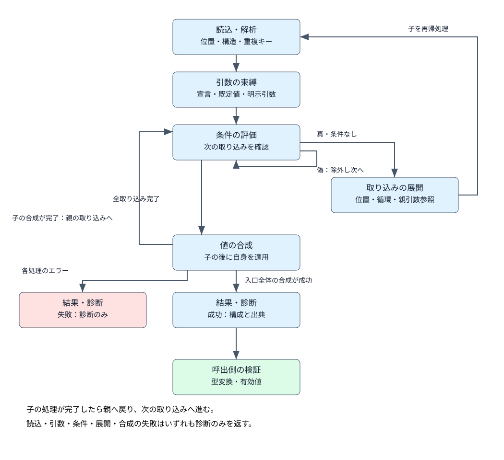
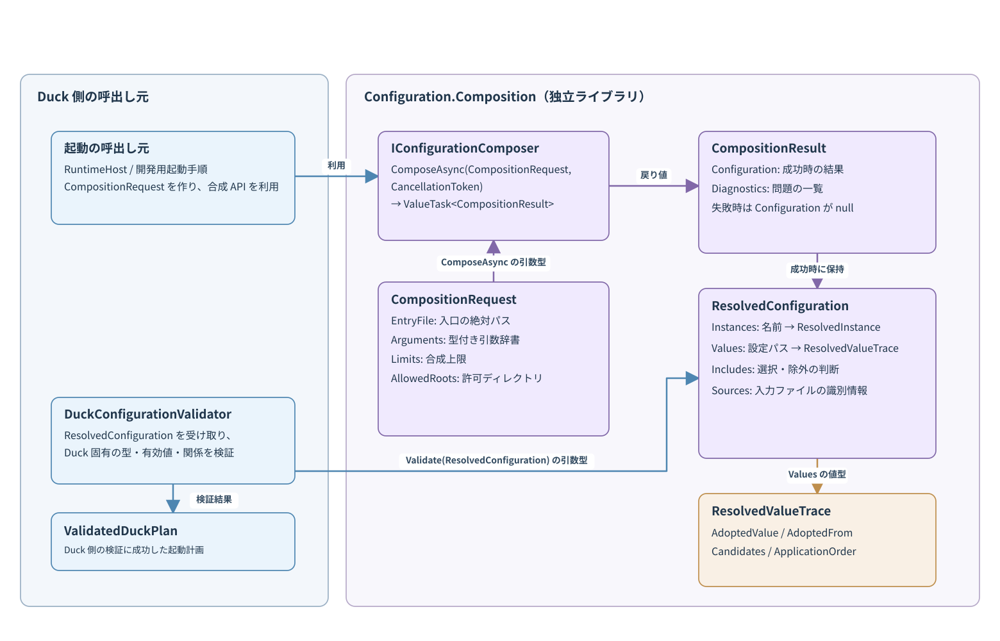

# 設定合成ライブラリの設計案

状態: 未実装の設定合成ライブラリ設計案です。

設計対象の基準は `main` の `7c8e860899f08acd4b02a0cdf1b44eba180a9f21` です。旧基準 `d215ec0c3b9daef978bf889c15addbe97623da59` は履歴の参照だけに使います。

## 目的と範囲

複数の設定ファイルを相対参照で取り込み、型付き引数と条件に基づいて一つの構成へ合成する設計です。結果には採用値、候補、出典、適用順を保持します。型変換、意味検証、サービス起動などアプリケーション固有の処理は呼出側が担います。

ライブラリは呼出側の型やホストの実行環境に依存しません。初版では既存形式との互換、任意の処理実行、設定からのサービス起動を扱いません。

## 責務境界

| 担当 | 責務 |
| --- | --- |
| 合成ライブラリ | ファイル読込、構造解析、相対参照、型付き引数、条件評価、循環・型・形の不整合検出、確定結果と出典の返却。 |
| 呼出側 | アプリケーション固有の型変換、未知設定と有効値の検証、機密項目の分類、検証後のサービス起動。 |

合成ライブラリはアプリケーション固有の設定型、ログ機構、起動 API を参照しません。独立して検証・配布できる公開境界を保ちます。

## 一般的な利用例

共通設定 `parts/base.yaml` を取り込み、入口 `entry.yaml` で通信に使う番号だけを変更する例です。これは設計上の案で、まだ実行できません。

```yaml
# parts/base.yaml
version: 1
instances:
  - name: worker
    kind: service
    settings:
      port: 8000
      enabled: true
```

```yaml
# entry.yaml
version: 1
includes:
  - file: parts/base.yaml
instances:
  - name: worker
    kind: service
    settings:
      port: 8001
```

| 設定項目 | 共通設定 | 入口 | 採用値 |
| --- | --- | --- | --- |
| `port` | 8000 | 8001 | 8001 |
| `enabled` | `true` | 指定なし | `true` |

呼出側は入口と引数を `CompositionRequest` にまとめ、合成結果を受け取る案です。

```csharp
CompositionResult result =
    await composer.ComposeAsync(request, cancellationToken);
```

例えば `CompositionRequest` に次の値を指定します。上限は設計上の提案値を使います。

| 要求の項目 | 指定例 |
| --- | --- |
| `EntryFile` | `/config/entry.yaml` |
| `Arguments` | 空の辞書 |
| `AllowedRoots` | `/config` を含む一覧 |
| `Limits` | 読込量、深さなどの上限 |

成功時は `Configuration`、失敗時は `Diagnostics` を確認します。型変換と有効値の検証を通すまで、呼出側はサービスを開始しません。

## 処理の流れ



### 読込・解析

入口の絶対位置と許可範囲を照合し、構造と重複キーを検査する。子の読込でも同じ検査を行う。

### 引数の束縛

現在の文書の宣言に対して明示引数と既定値を解決する。例えば `port` の既定値が 8000 で、整数 8001 を渡せば 8001 を使う。

### 条件の評価

現在の文書の宣言済み引数で取り込みごとの条件を評価する。条件なし、または真の場合だけ子へ進む。偽なら子を開かず、除外理由を記録する。

### 取り込みの展開

選択した子の位置と循環を確認し、直近の親の明示引数参照を解決してから子を読み込む。子の宣言との照合は子の引数の束縛で行う。子の展開を終えてから次の取り込みに進む。

### 値の合成

子を記述順に深さ優先で適用した後、自身の設定を適用する。一般的な利用例では 8000 の後に 8001 を採用する。型・形・種別の不一致は拒否する。

### 結果・診断

合成が成功すれば採用値・出典・候補・取り込み判断を返す。途中の検査や合成でエラーがあれば診断だけを返し、部分的な構成を返さない。

### 呼出側の検証

成功結果を受け取った呼出側が未知設定と有効値を検証する。例えば呼出側の規則で `port` が許容範囲外なら起動しない。合成ライブラリの成功は起動可能性を保証しない。

## 最小限の構造と合成規則

独自の条件式言語や汎用の起動フレームワークは作らない。構造は `version`、`parameters`、`includes`、`instances` に限定する。式は `when` の既存 `CEL` だけに使う。引数参照には `{ parameter: name }` の単一値形式を使い、文字列補間や C# の処理実行は対象外とする。

### 構造と設定値の例

| キー | 記述例 | 意味 |
| --- | --- | --- |
| `version` | `1` | 文書の版 |
| `parameters` | `{port: {type: int, default: 8000}}` | 引数の宣言 |
| `parameters.<name>.type` | `bool`、`int`、`double`、`string` | 単一値の型 |
| `parameters.<name>.default` | `true`、`8000`、`1.5`、`worker` | 対応する型の既定値 |
| `includes` | `[{file: parts/base.yaml}]` | 取り込みの列 |
| `includes[].file` | `parts/base.yaml` | 記述元からの相対位置 |
| `includes[].when` | `'port >= 8000'` | 親の引数を使う条件 |
| `includes[].args` | `{port: {parameter: port}}` | 子への明示引数 |
| `instances` | `[{name: worker, kind: service, settings: {port: 8000}}]` | 設定の列 |
| `instances[].name` | `worker` | 設定の名前 |
| `instances[].kind` | `service` | 呼出側が定める種別 |
| `instances[].settings` | `{port: 8000, enabled: true}` | 呼出側が定める設定 |
| 値の参照 | `{parameter: port}` | 宣言済み引数の値 |

### 合成規則

以下の記述は項目ごとの例です。設定値の名称と意味は呼出側が定めます。

| 項目 | 採用を提案する規則 |
| --- | --- |
| 型付き引数 | 初版は `bool`、64桁幅の `int`、有限の `double`、`string`。既定値は子の宣言に置き、呼出しの明示引数があればそちらを採用する。暗黙の型変換はしない。 |
| 子への受渡し | `includes[].args` の値に `{ parameter: name }` を使う場合、参照先はその取り込みを記述した直近の親が宣言した引数に限る。まず親の宣言と値を解決し、その後で子の宣言済み引数の有無と型を照合する。祖先や兄弟の引数を暗黙に探さない。既定値を持たない子の引数は呼出し時に必須。 |
| 値位置の参照 | `instances.name` と `settings` 内の値で `{ parameter: name }` を解決する。この形は参照専用として予約する。キー名、`includes` の位置、`kind` の動的生成、文字列埋め込みは認めない。 |
| 条件 | 親の宣言済み引数を `CEL` に渡す。型検査で結果が真偽値になることを要求し、真だけを取り込む。構文誤り、未知変数、型違い、評価エラー、上限超過はエラーにする。偽に読み替えない。 |
| 読込順 | 選択した取り込みを記述順に深さ優先で展開し、その後にファイル自身の `instances` を適用する。順序が値の優先順位となり、後の有効値を採用する。 |
| 合成 | 同名・同種別の設定を項目単位で再帰的に統合する。同じ型・同じ形の異なる値はエラーにせず、後の指定値を採用する。同じ値も適用順・出典の履歴に残す。 |
| 配列 | 配列は全体置換とする。追記、削除、添字単位の合成は初版に含めない。配列と単一値など形が異なる指定はエラー。 |
| 型・種別 | 型の変更、写像・配列・単一値の形の変更、同名で異なる `kind` の指定はエラー。 |
| 未知キー | 文書構造、引数宣言、`includes`、`instances` の未知キーはライブラリが拒否。`settings` 内の未知キーと必要項目は呼出側が種別ごとの型で起動前に拒否する。辞書として宣言した領域だけは自由なキーを許す。 |
| 名前とキー | 構造キー、引数、名前は大文字小文字を区別する。呼出側の設定キーは既存の正しい綴りに固定し、大文字小文字だけが異なる二重指定も変換前に拒否する。 |

| 規則 | 元の値・宣言 | 後の指定・条件 | 合成結果・エラー |
| --- | --- | --- | --- |
| 型付き引数 | `port: {type: int, default: 8000}` | `port: 8001` | 8001。文字列 `"8001"` は型エラー |
| 子への受渡し | 親の `port: 8001`、子の整数宣言 | `args: {port: {parameter: port}}` | 子の引数は 8001。子の宣言なし、親に参照先なし、型違いはエラー |
| 値位置の参照 | `port: 8001` | `settings: {port: {parameter: port}}` | `port: 8001`。キー名への参照はエラー |
| 条件 | 親の `port: 8000` | `when: 'port >= 8001'` | 子を除外。8001 なら取り込む。未知変数はエラー |
| 読込順 | 子の `port: 8000` | 自身の `port: 8001` | 8001 |
| 合成 | `{network: {port: 8000, enabled: true}}` | `{network: {port: 8001}}` | `{network: {port: 8001, enabled: true}}` |
| 同値の合成 | `port: 8000` | `port: 8000` | 8000。両方の出典を保持 |
| 配列 | `ports: [8000, 8001]` | `ports: [8002]` | `ports: [8002]` |
| 型・形 | `port: 8000` | `port: "8001"` または `port: [8001]` | エラー |
| 種別 | `name: worker, kind: service` | 同名で `kind: job` | エラー |
| 未知キー | `version: 1` | 文書直下に `unknown: true` | 構造エラー。設定内の未知項目は呼出側で拒否 |
| 名前とキー | `worker` | `Worker` | 異なる名前として扱う。設定内の `port` と `Port` の二重指定は呼出側で拒否 |

構造解析では一つの `YAML` 文書だけを受理し、同じ写像内の重複キーを同値でも拒否する。別名参照、参照先の印、合成キー、独自の型指定は初版では無効にする。文字列・真偽・数値・空値の対応規則を固定し、日付や `yes` などを暗黙の別型にしない。複雑な値は部品と明示引数で再利用する。解析、条件式の構文検査、引数参照、型検査で機密項目を分類する前に失敗した場合、診断に含めるのはエラー種別と、取得できるときの行・列番号だけとする。ファイル名、キー、入力原文の抜粋、条件式に含まれる文字列値はエラー、例外、ログ、標準出力へ含めない。安全な行・列番号が取得できなければ、エラー種別だけを示す。

## 読込と循環、評価上限

入口は利用者が指定した絶対位置へ正規化する。相対取り込みは記述元を基準に解決し、呼出元の作業ディレクトリには依存させない。初版は手元のファイルだけを扱い、URL、`glob`、環境変数展開、動的な位置式は受け付けない。入口と配布部品を含む許可ディレクトリを呼出側で指定し、その外への参照を拒否する。

循環は、現在の取り込み経路上にあるファイルの実体の同一性で検出する。引数が異なっていても A → B → A は拒否し、循環全体と各取り込み位置を示す。同じ部品の兄弟取り込みは許容する。シンボリックリンクを解決できない場合は、安全に同一性を決められない参照として拒否する。Windows の大文字小文字や別名の位置も考慮する。

条件が偽の取り込みは子を開かず、親側の位置形式と条件式だけを検査し、除外理由を出典へ残す。子の引数名・内容は選択時に検証する。未選択の構成は別の引数組合せの検証試験で覆う。

合成要求には上限を持たせる。初版の提案値は、深さ32、展開した取り込み256件、ファイル単体1,048,576バイト、合計8,388,608バイト、式4,096バイトとする。構造の深さと値の総数にも上限を設ける。`CEL` には取消にも対応させる。条件式の評価に使う処理量に上限を設け、上限を超えた場合は評価を打ち切り、設定エラーとする。具体的な評価上限の値と対応 API は依存の技術検証後に確定する。

### 再帰的な取り込みの例

| 記述元 | 取り込み先 | 適用順 |
| --- | --- | --- |
| `entry.yaml` | `parts/base.yaml` | 3 |
| `parts/base.yaml` | `defaults.yaml` | 2 |
| `parts/defaults.yaml` | なし | 1 |

各文書自身の設定が適用される順を示す。`parts/defaults.yaml` が入口を再び取り込めば循環エラーとなる。同じ子を兄弟の取り込みで二度使う場合は循環としない。

条件付きの取り込みの例では、親の整数引数を次のように渡す。この例では共通設定を次のように変更し、子にも整数の `port` を宣言しておく。

```yaml
version: 1
parameters:
  port: {type: int, default: 8001}
includes:
  - file: parts/base.yaml
    when: 'port >= 8001'
    args:
      port: {parameter: port}
```

```yaml
# parts/base.yaml
version: 1
parameters:
  port: {type: int}
instances:
  - name: worker
    kind: service
    settings:
      port: {parameter: port}
      enabled: true
```

親の引数が 8000 の場合は子を開かない。8001 の場合は子を読み、子の宣言に対して引数を照合する。後者の合成結果は `{port: 8001, enabled: true}` となる。

## C# の構造案

以下は責務を示す公開境界の案であり、未採用のライブラリ API に依存する実装例ではない。

呼出し側と合成ライブラリの型の関係を図に示す。矢印は型の利用、引数・戻り値、包含を表す。



```csharp
namespace Configuration.Composition;

/// <summary>
/// 一つの入口ファイルを合成するための入力と安全上の制約をまとめる。
/// </summary>
/// <param name="EntryFile">合成を開始する設定ファイルの絶対パス。</param>
/// <param name="Arguments">入口で利用できる、名前と型付き引数値の対応。</param>
/// <param name="Limits">読込量、展開数、深さなどの合成上限。</param>
/// <param name="AllowedRoots">入口および取り込み先として許可するディレクトリ。</param>
public sealed record CompositionRequest(
    string EntryFile,
    IReadOnlyDictionary<string, ScalarValue> Arguments,
    CompositionLimits Limits,
    IReadOnlyList<string> AllowedRoots);

/// <summary>
/// 特定のアプリケーションやホストに依存せず、要求を合成結果へ解決する公開境界。
/// </summary>
public interface IConfigurationComposer
{
    /// <summary>
    /// 指定された要求を非同期に合成し、確定した設定または診断を返す。
    /// </summary>
    /// <param name="request">入口、引数、上限、許可ディレクトリを含む合成要求。</param>
    /// <param name="cancellationToken">読込・解析・評価を中止するための通知。</param>
    /// <returns>成功時は確定設定、失敗時は診断を含む合成結果。</returns>
    ValueTask<CompositionResult> ComposeAsync(
        CompositionRequest request, CancellationToken cancellationToken);
}

/// <summary>
/// 合成の成功結果または発生した診断をまとめる。
/// </summary>
/// <param name="Configuration">成功時の確定設定。診断がある場合は null。</param>
/// <param name="Diagnostics">読込、条件、型、形などの問題。成功時は空。</param>
public sealed record CompositionResult(
    ResolvedConfiguration? Configuration,
    IReadOnlyList<CompositionDiagnostic> Diagnostics);

/// <summary>
/// 合成に成功した全インスタンス、値の出典、取り込み判断、入力ファイルを表す。
/// </summary>
/// <param name="Instances">インスタンス名をキーとする、合成後の設定。</param>
/// <param name="Values">設定パスをキーとする、採用値と候補の出典記録。</param>
/// <param name="Includes">選択または除外した設定取り込みの判断。条件が指定された場合は、条件式と評価結果も内部の構造化データとして保持。</param>
/// <param name="Sources">合成で参照した入力ファイルの識別情報。</param>
public sealed record ResolvedConfiguration(
    IReadOnlyDictionary<string, ResolvedInstance> Instances,
    IReadOnlyDictionary<string, ResolvedValueTrace> Values,
    IReadOnlyList<IncludeDecision> Includes,
    IReadOnlyList<SourceFileFingerprint> Sources);

/// <summary>
/// 一つの設定パスについて採用値と、値を選んだ根拠を保持する。
/// </summary>
/// <param name="AdoptedValue">適用順に従って最終的に採用した型付き値。</param>
/// <param name="AdoptedFrom">採用値を記述したファイル、位置、取り込み経路。</param>
/// <param name="Candidates">その設定パスに指定された値と各出典の履歴。</param>
/// <param name="ApplicationOrder">候補を適用した順番。大きい順番ほど後に適用。</param>
public sealed record ResolvedValueTrace(
    ConfigValue AdoptedValue,
    ValueOrigin AdoptedFrom,
    IReadOnlyList<ValueCandidate> Candidates,
    int ApplicationOrder);
```

`ScalarValue` と `ConfigValue` は型を保持した値、`ResolvedInstance` は名前・種別・設定値を持つ不変のデータとする。`CompositionRequest` が入口と制約を `IConfigurationComposer.ComposeAsync` に渡し、`CompositionResult` は成功時の `ResolvedConfiguration` または診断を返す。`ResolvedConfiguration.Values` は採用値、出典、適用順、候補を保持し、取り込みの選択と除外も記録する。エラー時は実行可能な構成を返さず、診断だけを返す。機密値の分類と表示制御は呼出側が担う。

### 結果と出典の例

一般的な利用例の `worker.settings.port` に対する内部の結果を示す。実際の出力形式を定める例ではない。

| 候補値 | 記述元 | 適用順 | 判断 |
| --- | --- | --- | --- |
| 8000 | `parts/base.yaml` | 先 | 候補 |
| 8001 | `entry.yaml` | 後 | 採用 |

値の出典には行・列と取り込み経路も保持する。呼出側が機密分類と表示可否を判断する。例えば後の値を文字列 `"8001"` に変えると合成は失敗し、`Configuration` は `null` となる。機密分類前の診断は型不一致という種別と、安全に取得できる行・列だけを含む。入力原文や値は表示しない。

内部は次の小さな処理に分ける。初版で外部機能の動的読込、独自の DI 機構、式解析器は作らない。`YAML` と `CEL` の外部型は内部の変換層に閉じ込める。

| 処理 | 入出力と役割 |
| --- | --- |
| 読込・解析 | 読み取ったバイト列から位置付きの文書型を作り、ファイルのハッシュ値を記録する。位置を失う前に重複キーと未知構造を検出する。 |
| 引数の束縛 | 宣言と呼出値を照合し、子ごとに不変の引数辞書を作る。 |
| 条件の評価 | 宣言済みの単一値だけを渡し、型検査済みの真偽値を得る。C# オブジェクト、任意関数、型情報からの動的な探索を公開しない。 |
| 取り込みの展開 | 経路と上限を管理し、循環検出と子の解決を行う。同一バイト列の解析は再利用しても、別引数での解決結果は混同しない。 |
| 値の合成 | 型付き候補を適用順に処理し、後の同型・同形の値、採用値の履歴と出典を不変の結果にする。不正な型・形や種別は診断にする。 |

## 採用前に実証する依存

`CEL` は [公式仕様](https://github.com/cel-expr/cel-spec/blob/master/doc/langdef.md)を基準とする。`cameraCount >= 4 && mode == "comparison"` のような自然な条件式をそのまま扱う。C# の任意処理の実行、`Roslyn`、任意アセンブリの実行は採用しない。以下は公式リポジトリの説明を読んだ候補であり、この作業で導入・実行・性能比較はしていない。

| 候補 | 読み取れた特徴と採用前の確認 |
| --- | --- |
| [`Celly`](https://github.com/bsidio/celly) | 管理された C# 実装で、変数宣言、型検査、辞書の入力、評価予算と取消、構文木の検査を提供すると説明されている。候補の第一案。対象の .NET 版、配布物の依存、公開 API、実際の予算の効き方と公式仕様との一致を実証する。 |
| [`CelDotNet`](https://github.com/hbjydev/celdotnet) | 型検査と .NET の式木への変換を提供する候補。C# の任意処理の実行とは異なるが、公開する型や関数の制限、評価予算、仕様どおりのエラー処理を実証する。式木を使う必要がないため、第一案の不足時に比較する。 |
| [`YamlDotNet`](https://github.com/aaubry/YamlDotNet) | 低水準の解析と文書型を提供する候補。行・列の保持、重複キー検出、`YAML` 1.2 相当の単一値の解釈、別名等の無効化、深さとサイズの制限を実証する。 |

実装に進む前の小さな検証で、候補の版、利用条件、推移的な依存を記録し、次を確認する。公式説明の完全性や性能の主張を、そのまま本設計の検証結果にはしない。

- 宣言した `int`、`string` に対する上記の式で、境界値3・4、二つの `mode` の真偽が一致する。
- 未知変数、文字列と数値の比較、真偽値以外の結果、桁あふれ、評価エラーを確実に拒否する。`CEL` の論理演算で扱われるエラーについても公式仕様と照合する。
- ホストのメソッド、ファイル、通信、時刻、環境変数へ到達できない。初版は比較・論理・算術と単一値に限定し、不要な拡張機能を無効化または構文木の検査で拒否する。独自の式構文は追加しない。
- 大きな式、深い式、大きな文書が予算内で終了し、取消と上限超過を区別して返す。
- `YAML` の位置情報、文字列の引用、同じファイルの二回利用、Windows の別名位置でも出典と循環検出が安定する。

満たせない候補は差し替え、必要な契約を満たす既存実装がなければ依存選定を未解決として本人へ戻す。独自の `CEL` 実装で埋め合わせない。

## 実装時の検証条件

| 対象 | 必須の確認 |
| --- | --- |
| 合成契約 | 相対取り込み、親からの明示的な引数参照、既定値と明示値、条件分岐、循環、型・形の不一致を確認する。 |
| 結果 | 後の値の採用、候補・出典・適用順の保持、配列の全体置換、部分的な成功結果を返さないことを確認する。 |
| 呼出側境界 | 合成結果を呼出側の型と規則で検証する。検証失敗時にホストや外部資源を開始しない。 |
| 機密情報 | 機密分類前のエラーは種別と安全に取得できる位置だけを返し、原文、キー、条件式の文字列値を露出しない。 |
| 独立性 | 合成ライブラリの公開・推移依存と配布物に、特定アプリケーションやホストの型を含めない。 |

## 未決事項

依存の具体的な版、対象 .NET、評価・読込上限、ファイルの実体識別は技術検証後に確定します。これらは提案段階であり、実装済みや採用済みとは扱いません。
