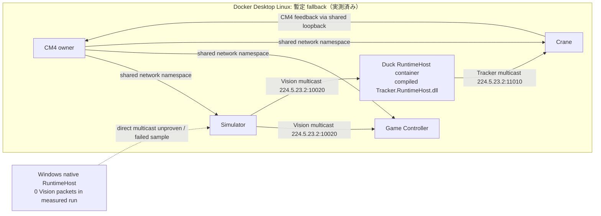

# Aspire を使って開発用シミュレーションを起動する

このページでは、Windows 上の Docker Desktop を使い、Aspire で開発用シミュレーション環境を起動する方法を説明します。

日常の起動は、Docker Desktop を起動してリポジトリの最上位ディレクトリで `dotnet run --file scripts/start-duck-simulation.cs` を実行します。Windows 上の RuntimeHost と開発用 UDP 転送を起動します。FA780 での通信と終了の先行実測は [11月18日の実機記録](../reports/issue128-development-udp-fa780-20261118.md) を参照してください。これは先行版の結果です。PR #146 の現行候補では受入を実施しておらず、本人指示によりスキップしています。

## 構成図

次の編集可能な SVG は、RuntimeHost を Docker コンテナで動かす構成を示します。Windows の既定構成は [開発用 UDP 転送設計図](duck-development-udp-design.md) を参照してください。[#134 当時の構成図](https://github.com/ibis-ssl/Duck/blob/c93c9c1ef2bae7bb2cceaf65cdf94fcd667d1229/Testing/duck-architecture.drawio)は過去の試作構成を示す履歴資料です。


[編集用ソース](duck-architecture.drawio)も参照できます。SVG の単一ページ構造と、原図に対する埋込編集データの整合性を確認しています。画面上の重なりや日本語の読みやすさは未確認で、この原稿の PNG プレビューも未生成です。

## AppHost の役割

`Testing/Duck.Testing.AppHost` は `Duck.slnx` に登録済みの Aspire AppHost です。AppHost は `base`、`comparison`、`match` の各構成を登録し、Aspire/DCP を通じて Docker Engine 上のシミュレーター、Game Controller、Crane、Duck RuntimeHost などを起動・管理します。本書の Windows 構成では、AppHost 自体は Windows 上で動く .NET プロセスです。

図中のソースプロジェクトは編集元です。例えば `Tracker/Tracker.RuntimeHost` はソースの場所で、`dotnet publish` により `Tracker.RuntimeHost.dll` と依存ファイルが発行先に生成されます。AppHost は `Release` 構成の発行先と、そのプロジェクトの `Dockerfile` から `duck-runtime` イメージを作って `duck` リソースのコンテナを起動します。コンテナ内の起動対象は `/app` にコピーされた `Tracker.RuntimeHost.dll` で、実行コマンドは `dotnet Tracker.RuntimeHost.dll` です。

`Tracker/Tracker.Core` も編集元のソースプロジェクトで、発行物の `Tracker.Core.dll` は RuntimeHost などに組み込まれるライブラリです。図のコンテナ内の処理は、これらの発行済み実行物の動作を表します。DebugHost と `Duck.Testing.RefereeDriver.Host` も、それぞれの発行先からイメージを作り、コンテナ内で対応するホストの `.dll` を `dotnet` で起動します。

後述する `base` の `rvo2` 起動例では、シミュレーター、Game Controller、Crane、Duck RuntimeHost を起動します。`comparison` は比較対象や DebugHost を追加する構成、`match` は対戦相手、AutoRef、ログ記録、試合進行制御を含む構成です。通常の `base` 起動後は Game Controller の試合設定を画面から行います。

RuntimeHost を変更したら起動ツールを実行し直します。AppHost を直接操作して RuntimeHost をコンテナで動かす場合は、後述の手動手順で `dotnet publish` も再実行します。

## Windows の前提条件

- .NET 10 SDK。CI は `10.0.x` を使います。リポジトリに `global.json` はなく、SDK のパッチ版は固定されていません。
- Docker Desktop を起動し、Linux コンテナを実行できる状態にします。AppHost は Docker CLI と選択中の Docker 接続先を使います。
- Windowsで動かす既定構成では、Docker Desktop側で稼働中のWSL仮想アダプターが1つ必要です。
- 初回起動時は Docker Engine からコンテナレジストリへ接続できる必要があります。
- リポジトリを取得したら、ソリューションを復元する前にサブモジュールを初期化します。

初回のみ、リポジトリの最上位ディレクトリでサブモジュールを取得します。これにより起動ファイルのビルドと発行に必要なファイルがそろいます。

```powershell
git submodule update --init --recursive
```

SDK や Docker の状態を確認する場合は次のコマンドを使います。

```powershell
dotnet --list-sdks
docker version
docker info --format '{{.OSType}}'
```

`dotnet --list-sdks` に .NET 10 SDK が表示されること、`docker version` に `Client` と `Server` の両方が表示されること、`docker info` の結果が `linux` であることを確認します。

## AppHost を直接起動する場合

`base` の `visibility_graph` は CM4 simulator を起動します。起動ツールの `--helper-free-compose` と `--persistent` が使う現行 Docker Compose では、CM4 を共有ネットワーク名前空間の起点にする方式を採用済みです。採用していないのは旧 DCP での実現方式であり、CM4 共有名前空間そのものではありません。この現行 Docker Compose は CM4 補助プログラムを必要としません。AppHost 直接起動で `Testing:Compose:StandardBaseEnabled=true` を指定できるのは、`Testing:Mode=base`、`Testing:Crane:Planner=visibility_graph`、`Testing:RuntimeHostOnWindows=false` の構成です。以下の `rvo2` の例は旧 DCP 経路で、CM4 simulator 自体を起動しません。

AppHost は Docker イメージのビルド元に `Tracker.RuntimeHost` の `Release` 構成の発行先を使います。先に RuntimeHost の `dotnet publish` を実行し、その後 AppHost を起動します。

日常の開発では次節の一コマンド手順を使います。以下の手動手順は AppHost を個別に操作・診断する場合に使います。

```powershell
dotnet publish Tracker/Tracker.RuntimeHost/Tracker.RuntimeHost.csproj --configuration Release --output Tracker/Tracker.RuntimeHost/bin/Release/net10.0/publish
dotnet run --project Testing/Duck.Testing.AppHost/Duck.Testing.AppHost.csproj -- --Testing:Mode=base --Testing:Crane:Planner=rvo2
```

起動時は Aspire の出力に表示された Dashboard URL を開いてください。Game Controller の画面は Dashboard に表示される `game-controller` の HTTP 接続先から開けます。各リソースの公開ポートは動的に割り当てられるため、実際に表示された URL を使ってください。終了時は同じ PowerShell ウィンドウで `Ctrl+C` を押します。別の Duck AppHost が既定の排他ロックを保持している場合は、その AppHost を先に終了してください。

RuntimeHost のコードを変更したら、上記の `dotnet publish` を再実行してから AppHost を起動し直します。AppHost が発行先から Docker イメージを作り、更新後のコードをコンテナ内で実行します。

## .NET ファイルからの起動手順

`scripts/start-duck-simulation.cs` は通常の `base` 構成を準備して起動します。引数なしで使うと、Windows 上で RuntimeHost を動かし、開発用 UDP 転送と Docker 側のサービスを起動します。

```powershell
dotnet run --file scripts/start-duck-simulation.cs
```

起動ファイルは、モードごとに必要なプロジェクトを先に発行します。引数なしと `--host-runtime` では、Windows 上の RuntimeHost に `Debug` 成果物を使い、転送用プロジェクトを `Release` 構成で発行します。転送イメージのビルド元もこの発行物です。

`--helper-free-compose` と `--persistent` は `Tracker.RuntimeHost` プロジェクトを `Release` で発行し、RuntimeHost を Docker 内で動かします。AppHost はこの発行物を使って RuntimeHost イメージを構築します。

Windows RuntimeHost 構成では、Windows と Docker の製品間通信にマルチキャストを使い、環境の境界は UDP ユニキャストでつなぎます。不足する固定イメージは起動時に取得します。試合設定には管理画面を使ってください。

既定の起動は停止時に実行資源を片付ける方式です。同じ端末で `Ctrl+C` を押した後、プロセスの終了と記録の完了を確認してください。正常停止時の終了値は `0` です。AppHost が異常終了した場合は、その終了値を返します。資源を保持するときは同じ識別子で再起動し、削除時もその識別子を指定します。識別子を省略した場合の既定値は `duck-local-development` です。

RuntimeHost も Docker 内で動かす構成を選ぶ場合は、次のコマンドを実行します。

```powershell
dotnet run --file scripts/start-duck-simulation.cs -- --helper-free-compose
```

一時起動が既定です。同じ端末で `Ctrl+C` を押し、`dotnet run` が戻るまで待ちます。端末に戻った後、`dotnet run` の終了値と AppHost の子プロセス終了値を別々に確認します。

`artifacts/duck-simulation/<stack-id>/apphost-*.stdout-stderr.log` には `AppHost exited with code ...; stdout and stderr drained.` が記録されます。これは AppHost の終了値と標準出力・標準エラーの回収完了を示します。端末の終了値、AppHost の終了値、ログの回収記録をそれぞれ照合してください。

通常の一時起動では、AppHost の正常終了時に Aspire が所有資源を停止します。AppHost 異常終了時に起動ツールが行う自動回収は、一時起動で今回取得した資源に限られます。`--persistent` は AppHost 終了後も資源を保持し、異常時も自動回収しません。所有関係を確認し、同じ `--stack-id` を指定して `--stop-persistent` で停止します。
```powershell
dotnet run --file scripts/start-duck-simulation.cs -- --persistent --stack-id duck-local-dev
dotnet run --file scripts/start-duck-simulation.cs -- --stop-persistent --stack-id duck-local-dev
```

`--host-runtime` は引数なしと同じ Windows 標準構成を選びます。経路と製品の配置は [開発用 UDP 転送設計図](duck-development-udp-design.md) を参照してください。`Testing:Compose:StandardBaseEnabled=false` を明示した従来の DCP 経路と `comparison` / `match` には CM4 関連処理が残ります。

AppHost を直接起動する従来手順では、RuntimeHost は Docker コンテナ内で動作します。AppHost がイメージのビルドに使う `Tracker.RuntimeHost` の `Release` 発行物を、起動前に手動で用意します。この手順は、起動ファイルの引数なしの既定構成とは別です。
旧 `Testing:Compose:HostNetworkingEnabled=true` は起動時に拒否されます。転送なしの過去の直接経路試験では、Windows 上の RuntimeHost が受信したビジョンデータは0件でした。[直接経路の試験記録](../reports/issue128-relay-free-direct-path-20261118.md)。現在の起動ファイルは[開発用 UDP 転送](duck-development-udp-design.md)を使います。
## モードと補助ファイル

CM4 補助プログラムの要否は、起動経路とモードで決まります。起動ツールの `--helper-free-compose` と `--persistent` が選ぶ現行 Docker Compose は、`base` の CM4 共有ネットワーク名前空間構成を採用済みで、補助プログラムを必要としません。採用していないのは旧 DCP での構成実現方式であり、共有名前空間ではありません。AppHost 直接起動時の `Testing:Compose:StandardBaseEnabled=true` も、同じ共有名前空間構成を使います。AppHost 直接起動でこの設定を使えるのは、`Testing:Mode=base`、`Testing:Crane:Planner=visibility_graph`、`Testing:RuntimeHostOnWindows=false` の場合です。旧 DCP の `base` と `comparison` は `visibility_graph` で CM4 simulator を使い、`rvo2` では CM4 simulator を起動しません。旧 DCP の `match` は既定の `rvo2` でも CM4 simulator と補助プログラムを使います。

| 補助ファイル | 用途と必要なモード | このリポジトリでの準備 |
| --- | --- | --- |
| `cm4-transport-control` | 旧 DCP の `base`／`comparison` で CM4 simulator を使う場合と、旧 DCP の `match` で必要な Linux x64 補助プログラムです。 | 旧 DCP の `base`／`comparison` で `rvo2` を使う場合は不要です。GitHub Actions は Ubuntu 上で必要な場合に生成します。共有ネットワーク名前空間構成では使いません。 |
| `autoref-game-log-agent.jar` | `match` の AutoRef コンテナに付ける Java エージェントです。AutoRef のモジュールが有効になった後、既存の `GameLogRecorder` を開始します。 | `scripts/build_autoref_game_log_agent.sh` が `javac --release 17` と `jar` で作ります。GitHub Actions は Ubuntu 上でこのスクリプトを実行してから AppHost をビルドします。AppHost のビルド・発行は既存ファイルのコピーだけです。 |

コピー元は AppHost プロジェクトの `$(IntermediateOutputPath)` です。上記の `Debug` 手順と CI では `Testing/Duck.Testing.AppHost/obj/Debug/net10.0` に準備し、ビルド時に `bin/Debug/net10.0` へコピーされます。`Release` など別の構成では中間出力先も変わります。いずれもファイルが存在する場合だけコピーする設定で、欠落していてもビルド時には生成しません。起動時に必要なモードを選ぶと、ファイルがないためリソースの起動に失敗します。

一方、Crane の起動を補助する `crane-launch-overlay` は AppHost のビルドで Linux x64 向けに自動発行されます。この処理は CM4 補助プログラムや Java エージェントの生成を含みません。

旧DCPの `base` を `visibility_graph` で起動する場合は CM4 補助プログラムが必要です。`match` では CM4 補助プログラムと Java エージェントの両方を使います。Windows 用の起動ファイルが扱う2つの `base` 構成では、これらの事前準備は不要です。CI は Ubuntu 上で `match` 用の両ファイルを準備します。
[課題 #53](https://github.com/ibis-ssl/Duck/issues/53) の過去調査では、確認した画面なしでの起動、CI 設定、録画クラス、画面設定から自動録画開始の設定・引数は見つからず、Java エージェントから既存の録画開始 API を呼んで実ログ生成を確認しています。全呼出箇所を網羅した調査ではないため、別の開始方法が存在しないと断定したものではありません。

## 検証範囲と未確認事項

本書の起動構成と準備処理は、[AppHostの登録処理](Duck.Testing.AppHost/Program.cs)、[共通資源の登録処理](Duck.Testing.AppHost/BaseSimulationResourceRegistration.cs)、[プロジェクト設定](Duck.Testing.AppHost/Duck.Testing.AppHost.csproj)、[Windows用のファイル起動ツール](../scripts/start-duck-simulation.cs)、[CI定義](../.github/workflows/dotnet-test.yml)と照合しました。今回の文書作業では、掲載した復元、発行、AppHost起動をWindows/Docker Desktop上で実行していません。手順は実装から確認したもので、この作業場所での起動成功を示すものではありません。

通常の `dotnet test` は `Tracker/Tracker.Tests/AspireFullStackAcceptanceTests.cs` を既定でコンパイル対象から外します。そのため、通常のテスト成功は Docker コンテナを使う全体の受入試験の成功を示しません。`.github/workflows/dotnet-test.yml` の `workflow_dispatch` は `comparison` または `match` の受入経路を実行できますが、条件により処理が省略される場合があります。省略を成功とは扱わず、同じコミットでの CI 結果を確認してください。

AppHost が異常終了したときは、端末に表示された起動ツールの終了値と `artifacts/duck-simulation/<stack-id>/apphost-*.stdout-stderr.log` を照合してください。ログファイルには AppHost の終了値に加え、標準出力・標準エラーの回収完了も残ります。起動前に記録先を作れない場合は AppHost を開始せず、稼働中のログ書き込みに失敗した場合は AppHost と子プロセスを停止します。Docker 実機での異常経路確認は未実施です。

### #145 先行版の実機記録

以下は #145 に含まれた先行版の実測記録であり、この候補の受入結果ではありません。[課題56の11月14日の常駐再参加実測](../reports/issue56-local-launch-lifecycle-20261114.md)では、同一の識別子で再参加した7件のうち4件を再利用し、Duck・Game Controller・DebugHostの3件を再作成しました。これはプログラム変更後に更新されることを確かめた結果ではありません。[11月19日の常駐停止検証](../reports/issue-128-pr130-persistent-shutdown-verification-20261119.md)と[一時起動の停止検証](../reports/issue-128-pr130-session-shutdown-verification-20261119.md)には、それぞれの停止処理、終了値、出力回収と所有資源の後片付けを記録しています。既定の識別子を明示した常駐の起動・再起動・停止は[実機で確認しました](../reports/issue-128-pr130-default-stack-id-verification-20261119.md)。

### 現行経路と過去の証跡

現在の起動経路では Windows 上の RuntimeHost と Docker 内の各製品がマルチキャストを使い、Windows と Docker の境界だけを開発用 UDP 転送で接続します。転送を使わなかった旧試験の画像通知0件や旧ポート切替の記録は、現在の経路の検証結果ではありません。Windows と Docker 間の実通信、CM4 再作成後の試合管理機能による再受信は未確認です。

PR #135 の CM4 共通ネットワーク領域案は採用していません。失敗の実測記録と Docker 構成に関する仮説は分けて保持し、Docker 資源作成失敗の実測はありません。レビュー時に案として挙がった模擬器の応答先 `127.0.0.1`、機体制御側の指令 `12345/UDP`・設定 `12350/UDP`・応答用一斉送信、DCP 成立条件の再評価、I81-07H 重複見出しの整理は当時の記録であり、現在の構成や新しい実測の根拠にはしません（[PR #135 通常レビューの4件](https://github.com/ibis-ssl/Duck/pull/135#issuecomment-6997075946)）。

Windows で `match` の準備操作を減らすには、Linux 補助プログラムを Docker Desktop の Linux コンテナで生成し、Java 17 でエージェントを作って AppHost のビルド前に配置・検証する PowerShell 準備スクリプトを追加する案があります。現在その自動化はありません。

関連する実装・検証記録は [Aspire シミュレーションテスト環境](../Tracker/Design/Testing/aspire-simulation-test-environment.md) と [課題 49 のフォローアップ記録](../Tracker/Design/Testing/issue49-kickoff-api-phase-followup.md)を参照してください。

## 課題 #128 の2026-11-18時点の整理

Windows 上の RuntimeHost と Docker 側の各製品を結ぶ、中継なしの直接 UDP 経路は成立していません。Windows 側 RuntimeHost は 10020/UDP を待ち受け、224.5.23.2 を受信先として登録していましたが、観測時間中のビジョン受信は0件でした。Simulator と Game Controller は同じ Linux ネットワーク名前空間内でビジョンを送受信しましたが、Windows への到達とトラッカーの送信は確認できませんでした。詳細は [課題 #128 の直接 UDP 記録](../reports/issue128-relay-free-direct-path-20261118.md) を参照してください。

### 2026-11-18 の追加実測記録

Simulator は設定成功時に `SimulatorResponse` を返さないため、成功の確認応答は観測できません。Windows 上の RuntimeHost 候補ではビジョンとトラッカーをそれぞれ0件受信しました。別の試験ではビジョンの受信とトラッカーデータの生成まで確認しましたが、Crane の UDP 11010 受信待ち数は0件で、トラッカー未受信の警告が続きました。これらの結果は、Windows と Docker の間の中継なし通信が成功したことを示しません。標準 DCP から CM4 補助プログラムを完全に除く対応も未完了です。

## 課題 #128: 2026-11-18 の補助プログラムなしの一時起動記録

起動ツールの `--helper-free-compose` と `--persistent` では、CM4 用 C 補助プログラムを使わない Docker の構成を起動します。CM4 の所有側、Simulator、Game Controller、Crane は同じネットワーク名前空間にあり、Docker 内の Duck RuntimeHost は同じ Docker ブリッジに接続します。永続化した構成の停止コマンドは `--stop-persistent --stack-id ID` です。

RuntimeHost のビジョン転送設定と実装は削除しました。旧 `Testing:Compose:HostNetworkingEnabled=true` はアプリケーション内の中継を必要としていたため、現在は拒否します。Windows から直接マルチキャストした実測ではビジョンの受信は0件で、Docker 内の受信経路が成立したとは扱いません。

Duck RuntimeHost イメージのビルド対象には `Tracker/Tracker.RuntimeHost/bin/Release/net10.0/publish` を使います。この発行先と Docker のビルド対象には `.cs` / `.csproj` はありません。`Tracker.RuntimeHost.dll` と依存ライブラリは実行用の成果物としてイメージに含めます。現時点では Windows 上で動かす構成に次ぐ暫定代替として扱います。実測時に Crane の `/world_model` は `tracker_detected: true` と `available_tracker: true` を報告しました。詳細な受信状況、所有側の再作成、その証拠の限界は [課題 #128 の標準構成記録](../reports/issue128-standard-dcp-helper-free-20261118.md) を参照してください。

### 2026-11-18 時点の暫定事項

この「補助プログラムを使わないDocker構成」は、現在利用できる中での暫定代替です。`Tracker.RuntimeHost.dll`はDuck RuntimeHostイメージに含まれます。2026-11-18の実測ではCrane自身の`/world_model`がトラッカーを検出し、既存イメージを変更せず、Duckのプロジェクト一式をコンテナに共有せずに処理しました。Windows上のRuntimeHostが直接マルチキャストでビジョンを受信した件数は0です。下図では代替構成の実際の配置と、Windowsからの通信が未成立だった経路を分けて示します。この結果はWindowsから中継なしで直接通信できたことを示さず、Duckのコンパイル済み実行ファイルをコンテナに置かない最終構成でもありません。


