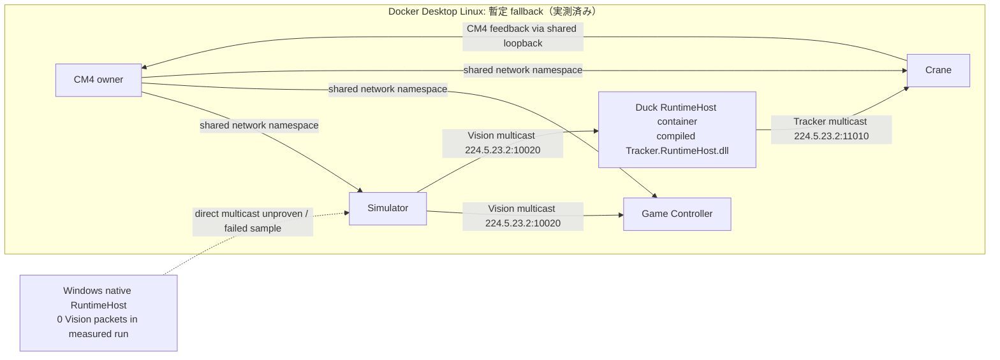

# Aspire を使って開発用シミュレーションを起動する

このページでは、Windows 上の Docker Desktop を使い、Aspire で開発用シミュレーション環境を起動する方法を説明します。

## 構成図

次の単一ページの編集可能な SVG は、主要処理と通信の流れ、Windows 上の AppHost/Aspire、Docker Desktop の Linux コンテナ、Duck が作るイメージと外部イメージの境界、プロジェクト参照を示します。


[編集用ソース](duck-architecture.drawio)も参照できます。SVG の単一ページ構造と、原図に対する埋込編集データの整合性を確認しています。画面上の重なりや日本語の読みやすさは未確認で、この原稿の PNG プレビューも未生成です。

## AppHost の役割

`Testing/Duck.Testing.AppHost` は `Duck.slnx` に登録済みの Aspire AppHost です。AppHost は `base`、`comparison`、`match` の各構成を登録し、Aspire/DCP を通じて Docker Engine 上のシミュレーター、Game Controller、Crane、Duck RuntimeHost などを起動・管理します。本書の Windows 構成では、AppHost 自体は Windows 上で動く .NET プロセスです。

図中のソースプロジェクトは編集元です。例えば `Tracker/Tracker.RuntimeHost` はソースの場所で、`dotnet publish` により `Tracker.RuntimeHost.dll` と依存ファイルが発行先に生成されます。AppHost は `Release` 構成の発行先と、そのプロジェクトの `Dockerfile` から `duck-runtime` イメージを作って `duck` リソースのコンテナを起動します。コンテナ内の起動対象は `/app` にコピーされた `Tracker.RuntimeHost.dll` で、実行コマンドは `dotnet Tracker.RuntimeHost.dll` です。

`Tracker/Tracker.Core` も編集元のソースプロジェクトで、発行物の `Tracker.Core.dll` は RuntimeHost などに組み込まれるライブラリです。図のコンテナ内の処理は、これらの発行済み実行物の動作を表します。DebugHost と `Duck.Testing.RefereeDriver.Host` も、それぞれの発行先からイメージを作り、コンテナ内で対応するホストの `.dll` を `dotnet` で起動します。

後述する `base` の `rvo2` 起動例では、シミュレーター、Game Controller、Crane、Duck RuntimeHost を起動します。`comparison` は比較対象や DebugHost を追加する構成、`match` は対戦相手、AutoRef、ログ記録、試合進行制御を含む構成です。通常の `base` 起動後は Game Controller の試合設定を画面から行います。

RuntimeHost の変更を反映するには、`dotnet publish` を再実行してから AppHost を起動し直します。この構成には `dotnet watch` による RuntimeHost のホットリロードはありません。

## Windows の前提条件

- .NET 10 SDK。CI は `10.0.x` を使います。リポジトリに `global.json` はなく、SDK のパッチ版は固定されていません。
- Docker Desktop を起動し、Linux コンテナを実行できる状態にします。AppHost は Docker CLI と選択中の Docker 接続先を使います。
- 初回起動時は Docker Engine からコンテナレジストリへ接続できる必要があります。
- リポジトリを取得したら、ソリューションを復元する前にサブモジュールを初期化します。

以下はリポジトリのルートで実行する Windows PowerShell 用の確認・復元コマンドです。後述する `rvo2` の起動例は既存の WSL ディストリビューションを必要としません。

```powershell
git submodule update --init --recursive
dotnet --list-sdks
docker version
docker info --format '{{.OSType}}'
dotnet restore Duck.slnx
```

`dotnet --list-sdks` に .NET 10 SDK が表示されること、`docker version` に `Client` と `Server` の両方が表示されること、`docker info` の結果が `linux` であることを確認します。

## Windows で AppHost を起動する

`base` の既定の `Testing:Crane:Planner` は `visibility_graph` で、この構成は CM4 simulator も起動します。WSL を使わず最初に AppHost を試す場合は `rvo2` を指定します。`rvo2` の `base` 構成では CM4 simulator と `cm4-transport-control` は使いません。

AppHost は Docker イメージのビルド元に `Tracker.RuntimeHost` の `Release` 構成の発行先を使います。先に RuntimeHost の `dotnet publish` を実行し、その後 AppHost を起動します。

```powershell
dotnet publish Tracker/Tracker.RuntimeHost/Tracker.RuntimeHost.csproj --configuration Release --output Tracker/Tracker.RuntimeHost/bin/Release/net10.0/publish
dotnet run --project Testing/Duck.Testing.AppHost/Duck.Testing.AppHost.csproj -- --Testing:Mode=base --Testing:Crane:Planner=rvo2
```

起動時は Aspire の出力に表示された Dashboard URL を開いてください。Game Controller の画面は Dashboard に表示される `game-controller` の HTTP 接続先から開けます。各リソースの公開ポートは動的に割り当てられるため、実際に表示された URL を使ってください。終了時は同じ PowerShell ウィンドウで `Ctrl+C` を押します。別の Duck AppHost が既定の排他ロックを保持している場合は、その AppHost を先に終了してください。

RuntimeHost のコードを変更したら、上記の `dotnet publish` を再実行してから AppHost を起動し直します。AppHost が発行先から Docker イメージを作り、更新後のコードをコンテナ内で実行します。

## .NET file-based 起動 launcher

`scripts/start-duck-simulation.cs` は通常の `base` 構成を準備して起動します。RuntimeHost、DebugHost、`Duck.Testing.RefereeDriver.Host` の発行、CM4 補助プログラムの確認、AppHost のビルドと起動をまとめます。これは PowerShell script の置換で、CM4 helper を撤去する変更ではありません。

```powershell
dotnet run --file scripts/start-duck-simulation.cs
```

Session 起動が既定です。Persistent stack を使う場合は同じ ID で起動し、停止時も同じ ID を指定します。

```powershell
dotnet run --file scripts/start-duck-simulation.cs -- --persistent --stack-id duck-local-dev
dotnet run --file scripts/start-duck-simulation.cs -- --stop-persistent --stack-id duck-local-dev
```

この launcher の通常 session と `--persistent` は helper-free Compose の base 構成を選び、`cm4-transport-control` を mount・起動しません。明示的な `--host-runtime` は Windows native RuntimeHost の実験経路です。低レベルの AppHost を直接起動する従来 DCP 構成と `comparison` / `match` は別経路であり、CM4 helper の全廃は未完了です。WSL を使わず従来 DCP の `visibility_graph` を試す場合は前節の `rvo2` 手順を使ってください。match 用 Java agent は生成しません。

既定の session 起動は helper-free Compose profile です。CM4 owner、Simulator、Game Controller、Crane は CM4 の network namespace を共有し、Duck RuntimeHost は同じ Compose bridge に直接接続します。`--host-runtime` は周辺に固定 Docker images を使いながら RuntimeHost を Windows 上の Debug DLL から起動する別の実験経路です。このモードでは任意の DebugHost Vision observer と RefereeDriver を無効にし、これらの Duck-owned container image を登録・publishしません。AppHost もこの2つが明示的に有効な設定を拒否します。RuntimeHost の Release publish と Duck runtime image の再作成も省きますが、AppHost build（RuntimeHost を含む通常の Debug build）は行います。

`Testing:Compose:HostNetworkingEnabled=true` は、旧 application-level Vision relay を必要としたため拒否されます。Vision / Tracker の relay-free multicast の Windows↔Docker 到達を含む実 packet 通信は未成立です。RuntimeHost を Windows native で起動した実測では Vision を0件受信できました。詳細は `reports/issue128-relay-free-direct-path-20261118.md` を参照してください。

## モードと補助ファイル

`native/cm4-transport` と `cm4-transport-control` は現在も標準 DCP `visibility_graph` / `match` profile の既存実装に残っています。本人の後続指示は CM4 C helper の全撤去を求めていますが、同 profile の owner replacement と feedback を helper-free にした実装・検証は未完了です。したがってこの文書の同 directory に関する詳細は現状記録であり、最終設計ではありません。

| 補助ファイル | 用途と必要なモード | このリポジトリでの準備 |
| --- | --- | --- |
| `cm4-transport-control` | 旧 DCP `base` / `comparison` の `visibility_graph` と `match` で使う Linux x64 補助プログラム。helper-free Compose の `base` と `rvo2` では使いません。 | file-based launcher の通常 session / `--persistent` は mount・起動しません。旧 DCP / comparison / match の準備処理は既存の補助実装を維持します。GitHub Actions は Ubuntu 上で必要な場合に生成します。 |
| `autoref-game-log-agent.jar` | `match` の AutoRef コンテナに付ける Java エージェントです。AutoRef のモジュールが有効になった後、既存の `GameLogRecorder` を開始します。 | `scripts/build_autoref_game_log_agent.sh` が `javac --release 17` と `jar` で作ります。GitHub Actions は Ubuntu 上でこのスクリプトを実行してから AppHost をビルドします。AppHost のビルド・発行は既存ファイルのコピーだけです。 |

コピー元は AppHost プロジェクトの `$(IntermediateOutputPath)` です。上記の `Debug` 手順と CI では `Testing/Duck.Testing.AppHost/obj/Debug/net10.0` に準備し、ビルド時に `bin/Debug/net10.0` へコピーされます。`Release` など別の構成では中間出力先も変わります。いずれもファイルが存在する場合だけコピーする設定で、欠落していてもビルド時には生成しません。起動時に必要なモードを選ぶと、ファイルがないためリソースの起動に失敗します。

一方、Crane の起動を補助する `crane-launch-overlay` は AppHost のビルドで Linux x64 向けに自動発行されます。この処理は CM4 補助プログラムや Java エージェントの生成を含みません。

`base` を `visibility_graph` で起動する場合は補助プログラムが必要ですが、`match` 用の Java エージェントは不要です。`match` は両方を必要とします。Windows file-based launcher は `base` 用で、Java エージェントを作りません。生成物のない Windows 作業ツリーから `match` 用の両ファイルを自動準備する手順はありません。CI は Ubuntu で両方を準備します。

[課題 #53](https://github.com/ibis-ssl/Duck/issues/53) の過去調査では、確認した画面なしでの起動、CI 設定、録画クラス、画面設定から自動録画開始の設定・引数は見つからず、Java エージェントから既存の録画開始 API を呼んで実ログ生成を確認しています。全呼出箇所を網羅した調査ではないため、別の開始方法が存在しないと断定したものではありません。

## 検証範囲と未確認事項

本書の起動構成と準備処理は、[AppHost の登録コード](Duck.Testing.AppHost/Program.cs)、[共通リソースの登録コード](Duck.Testing.AppHost/BaseSimulationResourceRegistration.cs)、[プロジェクト設定](Duck.Testing.AppHost/Duck.Testing.AppHost.csproj)、[Windows file-based launcher](../scripts/start-duck-simulation.cs)、[CI 定義](../.github/workflows/dotnet-test.yml) と照合しました。今回の文書作業では、掲載した復元、発行、AppHost 起動を Windows/Docker Desktop 上で通して実行していません。ソースから確認した手順であり、この作業ツリーでの起動成功を報告するものではありません。

通常の `dotnet test` は `Tracker/Tracker.Tests/AspireFullStackAcceptanceTests.cs` を既定でコンパイル対象から外します。そのため、通常のテスト成功は Docker コンテナを使う全体の受入試験の成功を示しません。`.github/workflows/dotnet-test.yml` の `workflow_dispatch` は `comparison` または `match` の受入経路を実行できますが、条件により処理が省略される場合があります。省略を成功とは扱わず、同じコミットでの CI 結果を確認してください。

Windows で `match` の準備操作を減らすには、Linux 補助プログラムを Docker Desktop の Linux コンテナで生成し、Java 17 でエージェントを作って AppHost のビルド前に配置・検証する PowerShell 準備スクリプトを追加する案があります。現在その自動化はありません。

関連する実装・検証記録は [Aspire シミュレーションテスト環境](../Tracker/Design/Testing/aspire-simulation-test-environment.md) と [課題 49 のフォローアップ記録](../Tracker/Design/Testing/issue49-kickoff-api-phase-followup.md)を参照してください。

## Issue #128 の最新切り分け (2026-11-18)

Windows native RuntimeHost と Docker consumers の間に relay-free の直接 UDP 経路は成立していません。Windows 側 RuntimeHost は 10020/UDP に bind し、224.5.23.2 membership を持っていましたが、観測時間中 Vision を0件受信しました。Simulator と Game Controller は同一 Linux namespace 内で Vision を送受信した一方、Windows 到達と Tracker egress は確認できませんでした。詳細は [Issue #128 relay-free direct UDP 記録](../reports/issue128-relay-free-direct-path-20261118.md) を参照してください。

### 2026-11-18 追加実測

Simulator 設定成功時は `SimulatorResponse` を返さないため、成功 ACK は観測できません。Windows host-runtime 候補では RuntimeHost は Vision 0件、Tracker 0件でした。別の実験では Vision ingress と Tracker frame 生成までは確認したものの、Crane の UDP 11010 socket receive queue は0で、Tracker 未受信の警告が継続しました。これらは中継なしの Windows↔Docker 成功を示しません。標準 DCP の CM4 helper 全撤去も未完了です。

## Issue #128: 標準 session 経路の helper-free 切替 (2026-11-18)

`dotnet run --file scripts/start-duck-simulation.cs` の通常 session 起動と `--persistent` 起動は、CM4 C helper を使わない standard base Compose profile を選びます。CM4 owner、Simulator、Game Controller、Crane は同じ network namespace / bridge にあり、Duck RuntimeHost は同じ Compose bridge に接続します。persistent project は AppHost 停止後も保持し、`--stop-persistent --stack-id ID` でその stack/run ID の Duck RuntimeHost と Compose project を停止します。`--host-runtime` は別の Windows native 試験経路です。

RuntimeHost の vision forwarding configuration / implementation は削除しました。旧 `Testing:Compose:HostNetworkingEnabled=true` は application-level relay を必要としていたため拒否します。Windows native direct multicast の実測では Vision 0件で、Docker 内の受信経路が成立したとは扱いません。

Duck RuntimeHost image の build context はソースディレクトリではなく `Tracker/Tracker.RuntimeHost/bin/Release/net10.0/publish` です。publish directory と Docker context に `.cs` / `.csproj` はありません。`Tracker.RuntimeHost.dll` と依存 DLL は実行に必要な成果物として image に入ります。現時点では Windows native の次順位に置く暫定 fallback として扱います。実測 run では Crane の `/world_model` が `tracker_detected: true`、`available_tracker: true` を報告しました。詳細な受信・owner recreation 証拠と限界は [Issue #128 standard helper-free 記録](../reports/issue128-standard-dcp-helper-free-20261118.md) を参照してください。

### 暫定扱い（2026-11-18）

この helper-free Compose profile は現在利用できる中での暫定 fallback です。`Tracker.RuntimeHost.dll` は Duck RuntimeHost image に含まれます。2026-11-18 の実測では Crane 自身の `/world_model` が Tracker を検出し、fixed image と source tree mount を使わず Tracker を処理しました。Windows native RuntimeHost の direct multicast は実測で受信0件です。fallback の実在配置と Windows の未成立経路を下図に分けて示します。これは relay-free Windows direct topology の成立を意味せず、Duck の compiled executable を container に置かない最終形でもありません。


