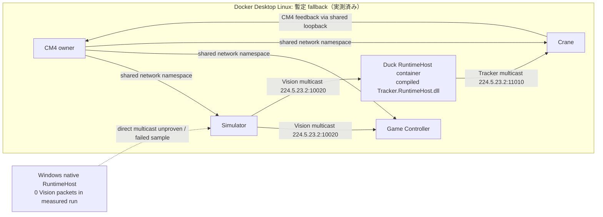

# Aspire を使って開発用シミュレーションを起動する

このページでは、Windows 上の Docker Desktop を使い、Aspire で開発用シミュレーション環境を起動する方法を説明します。

日常の起動は、Docker Desktop を起動してリポジトリのルートで `dotnet run --file scripts/start-duck-simulation.cs` を実行します。Windows native RuntimeHost と開発用 UDP 転送を起動します。FA780 での通信と終了の結果は [実機記録](../reports/issue128-development-udp-fa780-20261118.md) を参照してください。

## 構成図

次の編集可能な SVG は、RuntimeHost を Docker コンテナで動かす構成を示します。Windows native の既定構成は [開発用 UDP 転送設計の draw.io 図](duck-development-udp-design.md) を参照してください。[#134 当時の構成図](https://github.com/ibis-ssl/Duck/blob/c93c9c1ef2bae7bb2cceaf65cdf94fcd667d1229/Testing/duck-architecture.drawio)は過去の試作構成を示す履歴資料です。


[編集用ソース](duck-architecture.drawio)も参照できます。SVG の単一ページ構造と、原図に対する埋込編集データの整合性を確認しています。画面上の重なりや日本語の読みやすさは未確認で、この原稿の PNG プレビューも未生成です。

## AppHost の役割

`Testing/Duck.Testing.AppHost` は `Duck.slnx` に登録済みの Aspire AppHost です。AppHost は `base`、`comparison`、`match` の各構成を登録し、Aspire/DCP を通じて Docker Engine 上のシミュレーター、Game Controller、Crane、Duck RuntimeHost などを起動・管理します。本書の Windows 構成では、AppHost 自体は Windows 上で動く .NET プロセスです。

図中のソースプロジェクトは編集元です。例えば `Tracker/Tracker.RuntimeHost` はソースの場所で、`dotnet publish` により `Tracker.RuntimeHost.dll` と依存ファイルが発行先に生成されます。AppHost は `Release` 構成の発行先と、そのプロジェクトの `Dockerfile` から `duck-runtime` イメージを作って `duck` リソースのコンテナを起動します。コンテナ内の起動対象は `/app` にコピーされた `Tracker.RuntimeHost.dll` で、実行コマンドは `dotnet Tracker.RuntimeHost.dll` です。

`Tracker/Tracker.Core` も編集元のソースプロジェクトで、発行物の `Tracker.Core.dll` は RuntimeHost などに組み込まれるライブラリです。図のコンテナ内の処理は、これらの発行済み実行物の動作を表します。DebugHost と `Duck.Testing.RefereeDriver.Host` も、それぞれの発行先からイメージを作り、コンテナ内で対応するホストの `.dll` を `dotnet` で起動します。

後述する `base` の `rvo2` 起動例では、シミュレーター、Game Controller、Crane、Duck RuntimeHost を起動します。`comparison` は比較対象や DebugHost を追加する構成、`match` は対戦相手、AutoRef、ログ記録、試合進行制御を含む構成です。通常の `base` 起動後は Game Controller の試合設定を画面から行います。

RuntimeHost を変更したら launcher を起動し直します。AppHost を直接操作して RuntimeHost をコンテナで動かす場合は、後述の手動手順で `dotnet publish` も再実行します。

## Windows の前提条件

- .NET 10 SDK。CI は `10.0.x` を使います。リポジトリに `global.json` はなく、SDK のパッチ版は固定されていません。
- Docker Desktop を起動し、Linux コンテナを実行できる状態にします。AppHost は Docker CLI と選択中の Docker 接続先を使います。
- Windows native の既定構成では、Docker Desktop 側の稼働中の WSL 仮想アダプターが1つ必要です。
- 初回起動時は Docker Engine からコンテナレジストリへ接続できる必要があります。
- リポジトリを取得したら、ソリューションを復元する前にサブモジュールを初期化します。

初回はリポジトリのルートでサブモジュールを取得します。launcher のビルドと発行が依存関係を復元します。

```powershell
git submodule update --init --recursive
```

SDK や Docker の状態を確認する場合は次のコマンドを使います。

```powershell
dotnet --list-sdks
docker version
docker info --format '{{.OSType}}'
```

`dotnet --list-sdks` に .NET 10 SDK が表示されること、`docker version` に `Client` と `Server` の両方が表示されること、`docker info` の結果が `linux` であることを確認します。

## AppHost を直接起動する場合

`base` の `visibility_graph` は CM4 simulator も起動します。AppHost を直接起動して helper-free Compose を選ぶときは `Testing:Compose:StandardBaseEnabled=true` を指定できます。以下の `rvo2` の例は CM4 simulator を使わない DCP 経路です。

AppHost は Docker イメージのビルド元に `Tracker.RuntimeHost` の `Release` 構成の発行先を使います。先に RuntimeHost の `dotnet publish` を実行し、その後 AppHost を起動します。

日常の開発起動では次節の一コマンド launcher を推奨します。以下の手動手順は AppHost を個別に操作・診断する場合に使います。

```powershell
dotnet publish Tracker/Tracker.RuntimeHost/Tracker.RuntimeHost.csproj --configuration Release --output Tracker/Tracker.RuntimeHost/bin/Release/net10.0/publish
dotnet run --project Testing/Duck.Testing.AppHost/Duck.Testing.AppHost.csproj -- --Testing:Mode=base --Testing:Crane:Planner=rvo2
```

起動時は Aspire の出力に表示された Dashboard URL を開いてください。Game Controller の画面は Dashboard に表示される `game-controller` の HTTP 接続先から開けます。各リソースの公開ポートは動的に割り当てられるため、実際に表示された URL を使ってください。終了時は同じ PowerShell ウィンドウで `Ctrl+C` を押します。別の Duck AppHost が既定の排他ロックを保持している場合は、その AppHost を先に終了してください。

RuntimeHost のコードを変更したら、上記の `dotnet publish` を再実行してから AppHost を起動し直します。AppHost が発行先から Docker イメージを作り、更新後のコードをコンテナ内で実行します。

## .NET ファイルからの起動手順

`scripts/start-duck-simulation.cs` は通常の `base` 構成を準備して起動します。引数なしで使うと、Windows 上で RuntimeHost を動かし、開発用 UDP 転送と Docker 側のサービスを起動します。

```powershell
dotnet run --file scripts/start-duck-simulation.cs
```

起動処理と AppHost が転送用イメージの準備、ビルド、UDP ポートの設定を行い、未取得の固定イメージを取得します。Windows 上の RuntimeHost と Docker 内の各製品は一斉送信を使い、両環境の境界だけを開発用 UDP 転送でつなぎます。試合設定には管理画面を使います。同じ端末で `Ctrl+C` を押した後、起動処理の終了を待ちます。正常停止時は終了値 `0`、AppHost の異常終了時は AppHost の終了値を返します。

RuntimeHost も Docker 内で動かす構成を選ぶ場合は、次のコマンドを実行します。

```powershell
dotnet run --file scripts/start-duck-simulation.cs -- --helper-free-compose
```

一時起動が既定です。`--persistent` は RuntimeHost を Docker で動かす構成を選び、AppHost 終了後も Docker 資源を保持します。起動と停止には同じ識別子を使います。

```powershell
dotnet run --file scripts/start-duck-simulation.cs -- --persistent --stack-id duck-local-dev
dotnet run --file scripts/start-duck-simulation.cs -- --stop-persistent --stack-id duck-local-dev
```

`--host-runtime` は引数なしと同じ Windows 標準構成を選びます。経路と製品の配置は [開発用 UDP 転送設計図](duck-development-udp-design.md) を参照してください。`Testing:Compose:StandardBaseEnabled=false` を明示した従来の DCP 経路と `comparison` / `match` には CM4 関連処理が残ります。

旧 `Testing:Compose:HostNetworkingEnabled=true` は起動時に拒否されます。転送なしで Windows と Docker をまたいだ過去の試験では画像通知の受信が0件でした。現在の起動処理は [開発用 UDP 転送](duck-development-udp-design.md) を使います。

## モードと補助ファイル

`native/cm4-transport` と `cm4-transport-control` は legacy DCP `base` と `comparison` / `match` の既存実装に残っています。launcher の2つの `base` 構成では Compose の共有名前空間を使い、CM4 C helper は不要です。

| 補助ファイル | 用途と必要なモード | このリポジトリでの準備 |
| --- | --- | --- |
| `cm4-transport-control` | legacy DCP の `base` と `comparison` / `match` で使う Linux x64 補助プログラム。 | Compose 構成と `rvo2` では不要です。GitHub Actions は Ubuntu 上で必要な場合に生成します。 |
| `autoref-game-log-agent.jar` | `match` の AutoRef コンテナに付ける Java エージェントです。AutoRef のモジュールが有効になった後、既存の `GameLogRecorder` を開始します。 | `scripts/build_autoref_game_log_agent.sh` が `javac --release 17` と `jar` で作ります。GitHub Actions は Ubuntu 上でこのスクリプトを実行してから AppHost をビルドします。AppHost のビルド・発行は既存ファイルのコピーだけです。 |

コピー元は AppHost プロジェクトの `$(IntermediateOutputPath)` です。上記の `Debug` 手順と CI では `Testing/Duck.Testing.AppHost/obj/Debug/net10.0` に準備し、ビルド時に `bin/Debug/net10.0` へコピーされます。`Release` など別の構成では中間出力先も変わります。いずれもファイルが存在する場合だけコピーする設定で、欠落していてもビルド時には生成しません。起動時に必要なモードを選ぶと、ファイルがないためリソースの起動に失敗します。

一方、Crane の起動を補助する `crane-launch-overlay` は AppHost のビルドで Linux x64 向けに自動発行されます。この処理は CM4 補助プログラムや Java エージェントの生成を含みません。

legacy DCP の `base` を `visibility_graph` で起動する場合は CM4 補助プログラムが必要です。`match` は CM4 補助プログラムと Java エージェントの両方を使います。Windows file-based launcher が扱う2つの `base` 構成では、これらの事前準備は不要です。CI は Ubuntu で `match` 用の両ファイルを準備します。

[課題 #53](https://github.com/ibis-ssl/Duck/issues/53) の過去調査では、確認した画面なしでの起動、CI 設定、録画クラス、画面設定から自動録画開始の設定・引数は見つからず、Java エージェントから既存の録画開始 API を呼んで実ログ生成を確認しています。全呼出箇所を網羅した調査ではないため、別の開始方法が存在しないと断定したものではありません。

## 検証範囲と未確認事項

本書の起動構成と準備処理は、[AppHost の登録コード](Duck.Testing.AppHost/Program.cs)、[共通リソースの登録コード](Duck.Testing.AppHost/BaseSimulationResourceRegistration.cs)、[プロジェクト設定](Duck.Testing.AppHost/Duck.Testing.AppHost.csproj)、[Windows file-based launcher](../scripts/start-duck-simulation.cs)、[CI 定義](../.github/workflows/dotnet-test.yml) と照合しました。今回の文書作業では、掲載した復元、発行、AppHost 起動を Windows/Docker Desktop 上で通して実行していません。ソースから確認した手順であり、この作業ツリーでの起動成功を報告するものではありません。

通常の `dotnet test` は `Tracker/Tracker.Tests/AspireFullStackAcceptanceTests.cs` を既定でコンパイル対象から外します。そのため、通常のテスト成功は Docker コンテナを使う全体の受入試験の成功を示しません。`.github/workflows/dotnet-test.yml` の `workflow_dispatch` は `comparison` または `match` の受入経路を実行できますが、条件により処理が省略される場合があります。省略を成功とは扱わず、同じコミットでの CI 結果を確認してください。

AppHost が異常終了した場合は、表示された終了値と `artifacts/duck-simulation/<stack-id>/apphost-*.stdout-stderr.log` を確認します。起動前に記録先を作成できない場合は AppHost を開始せず、稼働中に記録が失敗した場合は AppHost とその子プロセスを停止します。通常停止時の資源回収は AppHost が行い、異常終了または記録失敗時は起動処理が所有表示を照合して片付けます。Docker 実機での異常終了後の残存資源確認は、今回の手元確認では実施していません。

### 現行経路と過去の証跡

現在の起動経路では Windows 上の RuntimeHost と Docker 内の各製品がマルチキャストを使い、Windows と Docker の境界だけを開発用 UDP 転送で接続します。転送を使わなかった旧試験の画像通知0件や旧ポート切替の記録は、現在の経路の検証結果ではありません。Windows と Docker 間の実通信、CM4 再作成後の試合管理機能による再受信は未確認です。

PR #135 の CM4 共通ネットワーク領域案は採用していません。失敗の実測記録と Docker 構成に関する仮説は分けて保持し、Docker 資源作成失敗の実測はありません。レビュー時に案として挙がった模擬器の応答先 `127.0.0.1`、機体制御側の指令 `12345/UDP`・設定 `12350/UDP`・応答用一斉送信、DCP 成立条件の再評価、I81-07H 重複見出しの整理は当時の記録であり、現在の構成や新しい実測の根拠にはしません（[PR #135 通常レビューの4件](https://github.com/ibis-ssl/Duck/pull/135#issuecomment-6997075946)）。

Windows で `match` の準備操作を減らすには、Linux 補助プログラムを Docker Desktop の Linux コンテナで生成し、Java 17 でエージェントを作って AppHost のビルド前に配置・検証する PowerShell 準備スクリプトを追加する案があります。現在その自動化はありません。

関連する実装・検証記録は [Aspire シミュレーションテスト環境](../Tracker/Design/Testing/aspire-simulation-test-environment.md) と [課題 49 のフォローアップ記録](../Tracker/Design/Testing/issue49-kickoff-api-phase-followup.md)を参照してください。

## 課題 #128 の2026-11-18時点の整理

Windows native RuntimeHost と Docker consumers の間に relay-free の直接 UDP 経路は成立していません。Windows 側 RuntimeHost は 10020/UDP に bind し、224.5.23.2 membership を持っていましたが、観測時間中 Vision を0件受信しました。Simulator と Game Controller は同一 Linux namespace 内で Vision を送受信した一方、Windows 到達と Tracker egress は確認できませんでした。詳細は [Issue #128 relay-free direct UDP 記録](../reports/issue128-relay-free-direct-path-20261118.md) を参照してください。

### 2026-11-18 の追加実測記録

Simulator 設定成功時は `SimulatorResponse` を返さないため、成功 ACK は観測できません。Windows host-runtime 候補では RuntimeHost は Vision 0件、Tracker 0件でした。別の実験では Vision ingress と Tracker frame 生成までは確認したものの、Crane の UDP 11010 socket receive queue は0で、Tracker 未受信の警告が継続しました。これらは中継なしの Windows↔Docker 成功を示しません。標準 DCP の CM4 helper 全撤去も未完了です。

## 課題 #128: 2026-11-18 の補助プログラムなしの一時起動記録

launcher の `--helper-free-compose` と `--persistent` では CM4 C helper を使わない Compose 構成を使います。CM4 owner、Simulator、Game Controller、Crane は同じ network namespace にあり、Docker 内の Duck RuntimeHost は同じ Compose bridge に接続します。persistent project は `--stop-persistent --stack-id ID` で停止します。

RuntimeHost の vision forwarding configuration / implementation は削除しました。旧 `Testing:Compose:HostNetworkingEnabled=true` は application-level relay を必要としていたため拒否します。Windows native direct multicast の実測では Vision 0件で、Docker 内の受信経路が成立したとは扱いません。

Duck RuntimeHost image の build context はソースディレクトリではなく `Tracker/Tracker.RuntimeHost/bin/Release/net10.0/publish` です。publish directory と Docker context に `.cs` / `.csproj` はありません。`Tracker.RuntimeHost.dll` と依存 DLL は実行に必要な成果物として image に入ります。現時点では Windows native の次順位に置く暫定 fallback として扱います。実測 run では Crane の `/world_model` が `tracker_detected: true`、`available_tracker: true` を報告しました。詳細な受信・owner recreation 証拠と限界は [Issue #128 standard helper-free 記録](../reports/issue128-standard-dcp-helper-free-20261118.md) を参照してください。

### 2026-11-18 時点の暫定事項

この helper-free Compose profile は現在利用できる中での暫定 fallback です。`Tracker.RuntimeHost.dll` は Duck RuntimeHost image に含まれます。2026-11-18 の実測では Crane 自身の `/world_model` が Tracker を検出し、fixed image と source tree mount を使わず Tracker を処理しました。Windows native RuntimeHost の direct multicast は実測で受信0件です。fallback の実在配置と Windows の未成立経路を下図に分けて示します。これは relay-free Windows direct topology の成立を意味せず、Duck の compiled executable を container に置かない最終形でもありません。


