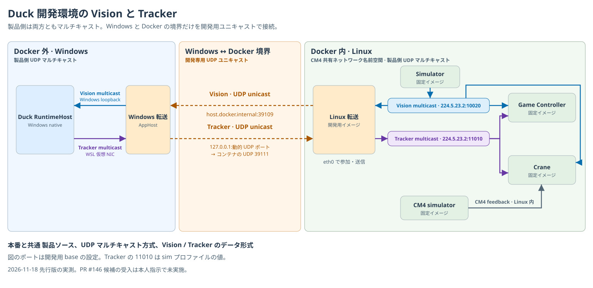

# Duck 開発環境の Windows／Docker UDP 転送設計

Duck #128 のWindows開発環境では、Duck RuntimeHostをWindowsで起動し、Simulator、Game Controller、Crane、CM4 simulatorは既存の固定イメージで動かす。Duckと各製品のプログラムは本番と開発で共通にする。開発用`base`の内外で、ビジョンとトラッカーのマルチキャスト受信先、ポート、データ形式を維持する。開発用の転送機能はAppHostと専用イメージに置く。



図の編集元ファイルは[draw.io](duck-development-udp.drawio)です。図は開発用`base`設定におけるWindowsの既定構成を示します。TIGERsは別設定で扱います。

## 本番と共通の部分と開発環境の違い

本番と共通にするのは製品プログラム、UDPマルチキャストを使う通信方式、ビジョンとトラッカーのデータ形式です。開発環境ではDockerの内外とも製品がマルチキャストで送受信し、WindowsとDockerの境界だけをUDPユニキャストで接続します。WindowsのループバックとWSL仮想ネットワークアダプター、Dockerの共有ネットワーク名前空間、境界の転送は開発環境用の配置です。

図のアドレスとポートは開発用`base`の値です。Duckのトラッカーは起動ツールが選ぶ`sim`設定で`11010/UDP`を使います。リポジトリの設定では`default`が`10010/UDP`、`fast`が`10011/UDP`です。本番で選ばれている設定や実際のネットワーク配置は今回の確認範囲に含まれません。[RuntimeHostの設定定義](../Tracker/Tracker.RuntimeHost/appsettings.json)。

| 方向 | Docker 外の Windows | Windows と Docker の境界 | Docker 内の Linux |
| --- | --- | --- | --- |
| ビジョン · Linux → Windows | Windows転送 → Duck。ループバック上で`224.5.23.2:10020/UDP`にマルチキャスト | Linux転送 → Windows転送。`host.docker.internal:39109/UDP`へユニキャスト | Simulator → Linux転送、Game Controller、Crane。共有ネットワーク名前空間で`224.5.23.2:10020/UDP`にマルチキャスト |
| トラッカー · Windows → Linux | Duck → Windows転送。WSL仮想NIC上で`224.5.23.2:11010/UDP`にマルチキャスト | Windows転送 → Linux転送。Windowsの`127.0.0.1`に公開された動的UDPポートへユニキャストし、Dockerがコンテナの`39111/UDP`に配送 | Linux転送 → Game Controller、Crane。共有ネットワーク名前空間の`eth0`から`224.5.23.2:11010/UDP`にマルチキャスト |

## Windows と Docker Desktop の通信上の制限

### 公式資料で確認したこと

Docker Desktopのホストネットワーク機能は、版4.34以降で設定から有効にできます。Linuxコンテナとホスト間の双方向TCP・UDP通信に対応しますが、処理は第4層で行われます。コンテナはホストのネットワークインターフェースを直接使えず、そのIPアドレスで待ち受けることもできません。公式資料は、マルチキャスト宛てUDPがWindowsとDockerの境界を越えて届くかを明記していません。[Docker公式資料「ホストネットワークドライバー」](https://docs.docker.com/engine/network/drivers/host/)。

### FA780 の実機記録と受入状況

転送を使わなかった試験では、同じLinuxネットワーク名前空間のGame ControllerがSimulatorからビジョンを受信しました。Windows上のRuntimeHostはビジョン用ポートで待ち受け、224.5.23.2を受信先として登録しましたが、受信は0件でした。[直接経路の試験記録](../reports/issue128-relay-free-direct-path-20261118.md)。

Docker Desktop のホストネットワーク機能を有効にした FA780（Docker Engine 29.9.1）では、`--network host` を指定した UDP ユニキャスト試験で、受信側の起動を確認してから計測しました。Windows → Docker の `127.0.0.1:49280` と Docker → Windows の `127.0.0.1:49281` ではそれぞれ1件を受信しました。同じ端末のマルチキャスト試験では両方向とも受信0件でした。ただし、送信時に受信側が起動していたことは時刻付きで確認できていません。

2026-11-18の先行版を使った実機試験では、Windows側でビジョンデータを復号し、Docker内でGame ControllerとCraneがトラッカーデータを受信しました。CM4を再作成して公開ポートが変わった後も、両データの受信が復旧しました。[11月18日の先行版実機記録](../reports/issue128-development-udp-fa780-20261118.md)。11月19日の候補ではCM4再作成前に確認を中断したため、製品側の受信と再作成後の復旧は未確認です（[中断記録](../reports/issue136-fa780-live-acceptance-20261119.md)）。

### 未確認のこと

マルチキャストの直接試験でパケットがどこで欠落したかは特定できていません。別のDocker Desktopの版、ネットワークやインターフェースの設定で届くかも未確認です。上記の受信0件は試験条件下の観測であり、境界を越えるマルチキャストが不可能だとする根拠にはなりません。

### 今回の設計で境界だけをユニキャストにする理由

FA780で受信を確認したユニキャストを境界で使い、両側では製品のマルチキャストを維持する。転送サービスはUDPデータの内容を変えずに運び、受信側で該当区間の受信先と製品ポートへ再送する。これによりDuckや各製品のプログラムを開発用に分岐させず、複数の製品が同じ受信先から受信できる。WindowsとDockerの境界に置く転送とインターフェースの割り当ては開発環境固有であり、本番環境の配置や設定には含めない。

## 開発者の操作

| 場面 | 操作 |
| --- | --- |
| 初回 | .NET 10 SDK と Linux コンテナを実行できる Docker Desktop を準備し、取得したリポジトリで `git submodule update --init --recursive` を実行する。初回の復元・イメージ取得にはネットワーク接続が必要。 |
| 起動 | Docker Desktopを起動後、リポジトリの最上位ディレクトリで `dotnet run --file scripts/start-duck-simulation.cs` を実行する。起動ツールが発行とビルドを行う。試合設定が必要な場合は管理画面からGame Controllerを開く。 |
| 終了 | 起動に使った端末で `Ctrl+C` を押す。AppHostがWindows上のプロセスと対象のDocker Composeプロジェクトを停止する。 |

引数なしで起動ツールを実行すると、Windows 上の RuntimeHost と開発用 UDP 転送が起動する。`--host-runtime` も同じ構成を選ぶ。開発者がポート番号を入力したり、別端末で転送プログラムを起動したりする必要はない。Windows の既定構成には、Docker Desktop 側で稼働中の WSL 仮想ネットワークアダプターが1つ必要である。

起動ツールで起動すると、初回のDocker Compose実行時に、手元にない固定イメージだけを取得し、準備済みのイメージは再利用する。AppHostを直接起動する従来手順と稼働中コンテナの再作成には、従来のイメージ取得方針を適用する。

```powershell
dotnet run --file scripts/start-duck-simulation.cs
```

Linux 内で受信を確認済みの構成は `--helper-free-compose` で選ぶ。`--persistent` も既存の Linux 内構成を選び、同じ構成 ID で再起動と停止を管理する。AppHost を直接起動する場合の構成選択は従来どおりとする。

## 転送の契約

**ビジョン:** SimulatorはLinux内の`224.5.23.2:10020/UDP`に送信し、Game ControllerとCraneは直接受信する。Linux転送はUDPデータを複製して`host.docker.internal`の開発用ポートへ送り、Windows転送からループバック上の同じ受信先と製品ポートへ送り返す。Duckは既存の`VisionReceiver:InterfaceAddress`を使い、ループバック上で`224.5.23.2`を受信先に登録する。

**トラッカー:** Duckは`224.5.23.2:11010/UDP`に送信する。AppHostでは既存の`Tracker:Profiles:sim:Publish:InterfaceName`にWindowsのWSL仮想ネットワークアダプターを指定する。Windows転送は同じアダプターで`224.5.23.2`を受信先に登録し、Linux転送がループバック上に公開するポートへUDPユニキャストを送る。Linux転送はCM4の共有ネットワーク名前空間内にある`eth0`からトラッカーデータをマルチキャストする。

各転送は一方向につき受信口と出力先を一つ持ち、UDPデータの内容と境界を保つ。Linux転送はビジョンだけをマルチキャストから取り込み、Windows転送はトラッカーだけを取り込む。CM4の応答は既存の共有ネットワーク名前空間内で扱う。

Windowsのビジョン転送は`127.0.0.1:39109/UDP`だけで受信する。Linuxのトラッカー転送受信口`39111/UDP`はWindowsのループバック上で動的に公開する。AppHostはWSL仮想ネットワークアダプターを一意に選べない場合やポートを確保できない場合、理由を表示して終了する。

## 実装範囲と受け入れ条件

製品側は通常の受信・送信を使う。旧試作にあったSimulatorのポート切替とテスト用ロボットの検出数計測は製品側から取り除く。Simulatorは既定のマルチキャスト先へ送信する。

開発用の配置先にUDP転送プログラムと`Dockerfile`を置く。WindowsではAppHost内のサービスが、LinuxではDocker Compose内の専用コンテナが同じ転送処理を担う。現行 Docker Compose は CM4 を共有ネットワーク名前空間の起点として採用済みで、Simulator、Game Controller、Crane がその名前空間を共有する。採用しなかったのは旧 DCP でこの構成を実現する方式であり、CM4 共有名前空間そのものではない。起動ツールはWindows用の成果物を発行し、Docker Composeはその成果物から転送イメージを作成する。AppHostは公開されたLinux側UDPポートをWindows側の転送先に設定する。Linux転送コンテナは共有ネットワーク名前空間の従属側として再作成され、変更後の公開ポートはAppHostに反映される。

## FA780 の実機記録と受入状況

### Windows 標準起動での試合確認

`dotnet run --file scripts/start-duck-simulation.cs -- --play-match` は Windows の一時セッションを使う。通信の基準は FA780 のコミット `68ff65fbfedd5e933b553d6ce4f5d3ea535f33fa`。この実測では UTC 21:25:18.523 に Duck が Vision に参加し、21:25:18.643 に Linux が Tracker を転送し、21:25:22 に Crane の world model が Tracker 検出と利用可能を報告した。21:25:22.612 時点で Duck は Vision 255 件を復号し、Tracker 123 件を送信した。両方の失敗数は 0。試合完走の実測は今後行う。

起動時に現在の Git コミットと実行 ID を記録する。Proto は既存の起動前検査を通し、Docker Desktop の `desktop-linux`、Linux amd64 の固定５参照をローカルで確認する。対象は Simulator `a52b6bd`、CM4 `d7a2e07c47cf09c6d359e391f1cf2828f4fe7f5a`、Game Controller `3.20.3`、Crane `scenario-4063cd31cd5b11b1cc919003907f5f4c527b252d`、転送の Dockerfile が指定する .NET runtime digest。イメージの ID、digest とプラットフォームを実行記録に残す。

既存の短時間試合設定と初期配置を使い、黄色を Crane とする。Duck の Detection 復号数と Tracker 送信数の増加、Crane の新しい world model、同じ Compose プロジェクトでの審判 UDP と Game Controller API を照合する。ホストの診断は HTTP 200 と `IsReady=false / Unattributed` が併存する。試合開始は審判の `NORMAL_START`、GC の `RUNNING`、同じ前半ステージでの試合時計の減少で判定する。初回の開始操作から 10 秒で成立しなければ開始未達と記録する。成立後は前後半を進めて `POST_GAME` を待つ。上限到達、通信経路の未成立、中断はそれぞれ記録する。結果は実行 ID 配下に残し、停止処理はこの Compose プロジェクトの所有資源に適用する。

### Linux フル試合 CI の進行証跡

Linux の試合コントローラーは、既存の初回キックオフ手順で取得した `NORMAL_START` のステージ、指令番号、UDP パケット時刻を `initialKickoff` に保存する。その後の前半で、審判 UDP と GC API の指令がともに `NormalStart` またはともに `ForceStart` で、API のフェーズが `Running` の二点を採る。二点の指令と指令番号は同じで、UDP 時刻は初回キックオフより後かつ増加し、正の残り時間は厳密に減少する。再開の `ForceStart` は初回キックオフより後の指令番号を必要とする。

CI は `match-result.json` のキックオフ、時計の二点、`POST_GAME` と、録画・資源ログを確認したゲート結果を照合する。試合時間の上限到達は不合格。既存の `MATCH_TRANSITION` ログに実行 ID と採用した二点を出し、証跡が欠けた場合は重複を除いた棄却理由を出す。

旧採取規則の [run 45506489489](https://github.com/ibis-ssl/Duck/actions/runs/45506489489) では、初回キックオフ、前半の `ForceStart / Running`、黄 1–0 青での `POST_GAME`、証跡保存まで確認した。必須ゲートは `MATCH_IN_PLAY_PROGRESS_MISSING` で失敗した。当時の時計の生値と、`NormalStart / Running` の有効な二点が採れなかった理由は未確認。合成試験では従来の規則が正常キックオフ後の `ForceStart / Running` における時計の減少を採取しないことを再現した。

### 2026-11-18の先行版実測（PR #146 現行候補の受入とは別）

2026-11-18の先行版では、Windows上のRuntimeHostがビジョンデータ643件を復号し、トラッカーデータ315件を送信しました。これは先行版の実測で、PR #146 の現行候補の受入結果ではありません。Game Controllerのログには形状の更新とトラッカー送信元の切替が残っています。Craneはトラッカーを検出し、CM4の応答受信を記録しています。同日のCM4所有側だけを再作成した後、公開UDPポートが変わった状態で通信が復旧しました。これは11月18日の旧版で得た結果です。

### PR #146 現行候補の受入状況

PR #146 の現行候補では本人指示により受入を実施していません。11月18日の実測は先行版で得た結果であり、この候補の受入結果として扱いません。

### 2026-11-19に中断した別候補の実機確認

11月19日の実機確認は候補 `d04be004683775209a319bacccb968677cfe7578` を起動後、CM4の再作成前に`Ctrl+C` で中断しました。製品側でビジョンデータ、トラッカーデータ、CM4の応答を受信した確認、パケット件数、再作成後の通信復旧は採取していません。AppHostの記録値は0、端末の終了値は1で、出力回収は別に記録されています。この候補の実機受入は未完了です。[11月18日の旧版実機記録](../reports/issue128-development-udp-fa780-20261118.md)、[11月19日の実機中断記録](../reports/issue136-fa780-live-acceptance-20261119.md)。

比較資料: [標準構成の既存実機検証](../reports/issue128-standard-dcp-helper-free-20261118.md)、[Windows と Docker 間の既存測定](../reports/issue128-relay-free-direct-path-20261118.md)。
