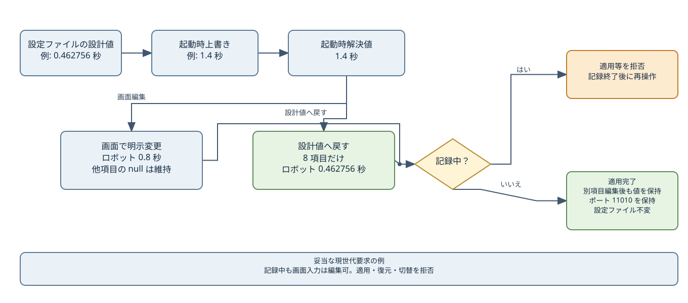

# Tracker DebugHost 実行中の追跡設定調整 詳細設計

本書は、DebugHost の自前トラッカーに対する設定値の編集・適用・設計値へ戻す操作を定める。設定ファイルの設計値を読み取り、既存の設定変更要求へ接続する。画面操作で設定ファイルを書き換えない。

## 課題13: 実行中の追跡設定の調整

課題13の画面調整では、既存の設定変更要求を共通の入口として使う。対象8項目の編集・適用、設計値へ戻す操作、追跡状態との関係を定める。

### 目的

追跡結果を見ながらロボットとボールの設定を調整する。初版の対象は DebugHost 内で有効な自前トラッカーのみとする。

### 操作の入口

Tracked 画面の設定を選択する欄に、適用中の値と編集値を分けて表示する。編集、適用、取消、設計値へ戻す操作を用意する。画面の操作で設定ファイルは書き換えない。既存の `TrackerProfileRequestService` と `TrackerCoordinator.RequestProfileSwitch` を再利用する。実変更では追跡状態の初期化を伴うことを適用前に表示する。

対象外は RuntimeHost と外部トラッカーの操作、新しい外部向け設定変更 API、通信設定の編集、永続保存、課題27の練習範囲の編集、追跡状態を維持した設定変更、記録途中の設定変更の再現とする。

設定変更履歴の閲覧と直前値への復元も別機能とする。この設計でいう「取消」は未適用の画面編集または待ち要求の取り消しであり、「設計値へ戻す」とは異なる操作である。

### 設計

#### 編集対象と入力検証

初版の編集対象は次の8項目とする。表の値は `Tracker.DebugHost/appsettings.json` の`default` と `sim` の設定にある現行の設計値を示す。新しい既定値を増やすものではない。両方の8項目の設計値は同じで、選択中の設定ファイル値を設計値へ戻す先として保持する。

| 項目 | ロボット | ボール | 検証の前提 |
| --- | --- | --- | --- |
| `ProcessNoise` | 0.1 | 0.1 | 有限の正数 |
| `MeasurementNoise` | 20.0 | 100.0 | 有限の正数 |
| `VisibilityHalfLifeSeconds` | 0.462756 | 1.0 | 有限の正数、秒 |
| `OutputVisibilityThreshold` | 0.05 | 0.0 | 0以上1以下 |

前3項目には画面独自の上限を設けない。非数、無限大、入力形式の誤り、型や項目の意味を満たさない値は拒否する。出力のしきい値は比率のため、0以上1以下とする。追跡エンジンが前3項目に適用する下限は `0.001` であるため、たとえば入力 `0.0001` の実効値は `0.001` になる。画面の適用後表示、記録する実効値、同値判定は `Tracker.Core` が使う値に合わせ、`0.0001` と `0.001` を別の適用済み値として扱わない。入力値が有限でも、その二乗など後続計算が非有限になる場合がある。新しい数値上限は設けず、入力の検証だけでなく既存の追跡計算で必要となる有限性を確認し、非有限の計算結果になる要求は一括適用しない。

対象8項目が設定ファイルで未指定または `null` の場合に限り、既存の `Tracker.Core` 追跡処理が使う既定値を使う。ロボットとボールの `ProcessNoise` はそれぞれ `50`、`MeasurementNoise` は `1`、`VisibilityHalfLifeSeconds` は `1` 秒、`OutputVisibilityThreshold` は `0` である。これは設定ファイルに明記された値を置き換えず、新しい既定値でもない。画面表示と「設計値へ戻す」は、選択中設定の明示値を優先し、未指定項目だけこの既存値を使う。設定ファイルの設計値と既存値は区別する。

#### 適用・追跡状態

設定ファイルの設計値、起動時解決値、現在適用済みの画面一時値、画面の未適用編集値、今回の操作で明示的に変更した項目を区別する。設定ごとの設計値は設定ファイルに保持し、実行時に読み取る。製品側に設計値を直接記載せず、設定ファイルも画面操作では書き換えない。画面の一時値は8項目だけを対象とし、要求では今回変更する項目を識別する。画面側の `null` は「今回の操作でその項目を指定・変更していない」を表し、現在適用済みの画面一時値を消す意味にはしない。`null` を数値の `0` や設計値として送らず、出力しきい値の有効な `0` とも区別する。

既存の起動時設定解決は維持する。まず選択中の設定値に `Tracker:RuntimeOverrides` の起動時上書きを適用して起動時解決値を作る。その上に現在適用済みの画面一時値を保持し、要求では今回明示的に変更した項目だけをその最新状態へ重ねる。今回変更しない項目の `null` は、その項目の現在適用済み画面一時値を保ち、画面一時値がなければ起動時解決値を使う。状態取得の応答では起動時解決値と現在適用済み画面一時値を区別し、適用済み世代も返す。画面更新要求はその世代と今回明示的に変更した項目を示す。画面要求には起動時に解決した他の設定と上書きを含め、画面値を渡すために起動時の通信設定や対象外の追跡設定を落とさない。同じ画面が別項目だけを変更する場合も、最新状態を取得した別画面が別項目だけを変更する場合も、変更対象外の適用済み一時値は引き継ぐ。設計値へ戻す操作は通常の未編集値とは別の明示操作とし、選択中設定のファイル値があればそれを、未指定なら既存の `Tracker.Core` 値を使い、8項目すべての設計値を要求に明示する。起動時上書きがある項目もその8項目に限って設計値へ戻す。この操作後も、後続要求で変更しない項目の設計値は現在適用済み値として維持する。配信先などの通信設定と対象外の設定は起動時解決値を保つ。設定ファイルは読み取りのみとし、8項目がすでに設計値と同じなら世代と追跡状態を変更しない。

確認例では、ロボットの選択中設定値 `0.462756`、起動時の同項目の上書き `1.4`、画面で適用した一時値 `0.8`、`Publish.Port` の設定値 `10010` と起動時の上書き `11010` を使う。起動時は `1.4`、画面でロボット項目を明示変更・適用した後は `0.8` が実効値となる。その後、同じ画面で別項目だけを変更しても、または最新状態を取得した別画面で別項目だけを変更しても、ロボットは `0.8` のままとする。設計値へ戻す明示操作後はロボットが `0.462756` となり、その後も同じ二通りの別項目だけの変更で `0.462756` を保つ。設計値へ戻しても通信・対象外設定を変えず、配信ポート`11010`、他の設定、設定ファイルは不変とする。同じ設計値へ2回目に戻しても世代と追跡状態を維持する。

記録中の変更禁止を確認し、設定要求は適用済み設定の世代を最初に照合する。世代が古ければ、要求内容が現在適用値と同じか、取消に見えるかを判定する前に競合として拒否し、待ち・処理中要求を変更せず、最新の適用済み値と世代を返す。世代が一致する要求だけを同じ排他制御下で一括検証・適用する。要求番号と適用済み設定の世代を区別し、世代は実際に異なる設定を適用した場合のみ進める。

| 操作・条件 | 結果 |
| --- | --- |
| 起動時に設定値 `0.462756` 秒へ上書き `1.4` 秒を適用 | 起動時解決値は `1.4` 秒 |
| 画面からロボット値 `0.8` 秒を適用 | 対象項目だけ画面一時値にする。未指定の `null` は既存一時値を保つ |
| 同じ画面または最新状態の別画面で別項目を変更 | ロボット値 `0.8` 秒を維持 |
| 設計値へ戻す | 8項目を設計値へ戻す。ロボット値は `0.462756` 秒。ポート `11010`、対象外設定、設定ファイルは不変 |
| 現世代の画面 A が処理中要求の後に X へ戻す | 復帰要求を保持し、先行処理の後に X を適用 |
| 別画面 B が A の待ち・処理中に同じ世代で要求 (現値 X も含む) | 同値判定より画面間の競合拒否を優先し、A の要求を保持。B へ最新値と世代を返す |
| 古い世代の別画面 B が、A の処理中に現値 X を要求 | 同値判定より世代競合拒否を先に行う。A の要求を保持し、B に最新値と世代を返す |
| 保持中の最終要求と同じ内容を再要求 | その最終要求と重複する要求を作らず、保持中の要求を維持 |
| 待ち要求・処理中要求がなく、最新適用値と同値の要求 | この場合だけ同値適用として扱い、世代・追跡状態を維持 |
| 明示的な取消 | 未適用の待ち要求だけを取り消す。適用済み世代と追跡状態を維持 |
| 同じ設定内で実効値を変更 | 同じ設定を維持した値変更として扱う。適用完了時に世代を一つ進め、追跡状態を一度初期化する。設定の切り替えとは扱わない |
| 異なる設定へ切り替え | 実効値が同じでも設定の切り替えとして扱う。未適用値を破棄し、適用完了時に世代を一つ進め、追跡状態を一度初期化する。起動時上書きは既存の設定解決経路で適用する |
| 記録開始受付から最終書き込み終了まで | 画面入力は編集できる。設定の適用、設計値へ戻す操作、設定切り替えは拒否 |

世代照合は同値判定や取消の解釈に先行する。したがって、画面 B が A の処理中に古い世代で現在適用値 X を要求しても競合として拒否し、A の要求は変えずに B へ最新状態を返す。これに対し、現在世代を持つ画面 A 自身が処理中要求と異なる現適用値 X へ戻す操作は、同値を理由に捨てず、復帰要求として保持し、先行処理の完了後に適用する。明示的な取消操作は対象の未適用待ち要求だけに作用し、処理中要求や既に適用された値を取り消さない。実変更では既存の制御要求として未確定の入力と追跡状態、最新の追跡フレームを消去する。追跡フレームの番号と送信元識別情報は維持する。同じ設定を選んだままの調整では通信設定を保持し、UDP 送受信先を再構成しない。適用完了後の実効値と世代を画面へ返す。

#### 記録との関係

記録開始の受付から、記録中、記録停止後の関連する全書き込みの終了まで、調整の適用、設計値へ戻す操作、設定の切り替えを拒否する。画面だけでなく既存の設定切り替え要求を含む共通の要求受付側で拒否し、既存の `POST /api/tracker/profile-switch/{profileName}` は記録を理由とする拒否時に HTTP 409 を返す。拒否した要求は保留せず、HTTP 202 を返さない。新しい未認証の遠隔変更 API は追加しない。

記録開始と設定変更は同じ制御境界で順序付ける。適用待ちまたは処理中の要求があれば記録開始を拒否し、開始を受け付けた時点から最終書き込みまで変更を禁止する。記録停止の指示だけでは変更を許可しない。

記録開始の受付時に、その時点の適用済み設定構成と実効設定を固定し、将来の録画用 MCAP ではその1回分の記録内に設定情報として保存する。再生に必要な設定構成と実効設定はその MCAP 単体から復元でき、別ファイルだけに依存しない。最初の入力受信時に再解決せず、記録途中でも書き換えない。再生ではその録画用 MCAP から実効設定を復元する。この設計は既存の録画方式全体が既に MCAP へ移行したことを意味せず、既存の `Tracker.Core` capture metadata 契約を含む現在の記録形式や補助成果物をここで移行・変更しない。旧形式の記録を移行する作業も含めない。起動単位のホスト診断 MCAP は別の記録であり、録画用 MCAP と統合せず、録画の出力先や再生記録情報へ結び付けない。起動単位の診断記録の設計は課題151で扱う。

### 受入条件

- [ ] A1: 自前トラッカー有効時のみ、適用中の値を読み取り、編集・取消できる。自前トラッカー無効時および再生専用時は適用できない。
- [ ] A2: 全項目が妥当な場合のみ一括適用し、次の追跡出力に反映する。記録中も画面入力の編集は可能とし、適用・設計値への復元・設定切り替えを拒否する。拒否後、世代の一致を最初に確認し、古い世代の要求は現在値と同じでも競合拒否して設定・追跡状態と A の待ち・処理中要求を変えず、B へ最新の値と世代を返す。A 自身が現在世代で要求する復帰操作は処理中要求の後に保持する。同じ内容の再要求は保持中の最終要求と重複させない。待ち要求の明示的取消は未適用待ち要求だけを対象にする。
- [ ] A3: 同じ設定への再適用と適用待ちの明示的な取消は世代と追跡状態を維持する。同じ設定内で実効値を変更する場合は設定を維持した値変更として扱い、設定の切り替えとは区別する。適用完了時に世代を一つ進め、追跡状態を一度初期化する。異なる設定への切り替えは、実効値が同じでも切り替えとして扱い、未適用値を破棄して、適用完了時に世代を一つ進め、追跡状態を一度初期化する。設計値へ戻す操作は8項目だけを選択中の設定ファイル値または未指定時の既存 `Tracker.Core` 値へ戻し、通信設定と対象外の追跡値を保持する。値が変わらなければ追跡を初期化しない。起動時解決値と現在適用済み画面一時値を区別し、今回変更対象外の一時値を同じ画面または最新値を取得した別画面からの更新で保つ。設計値 `0.462756` に戻した後の別項目変更もこの値を維持する。同じ設定を選んだままの調整では UDP を再構成せず、追跡フレームの番号を維持する。入力 `0.0001` のように `Tracker.Core` で `0.001` に正規化される値は、画面表示・実効値の記録・同値判定を `0.001` に揃える。画面独自の上限は追加しない。
- [ ] A4: 記録開始の受付から停止後の最終書き込みまで設定変更を拒否する。既存 API は記録を理由とする拒否時に HTTP 409 を返し、保留しない。設定変更の待ち・処理中は記録開始を拒否する。
- [ ] A5: 将来の録画形式では記録開始の受付時に固定した適用済みの実効設定と設定構成を、その1回分の録画用 MCAP 単体から読み取れる。再生が設定情報の別ファイルだけに依存せず、起動単位の診断 MCAP と録画用 MCAP を統合しない。現在の `Tracker.Core` capture metadata 契約、旧形式の記録、設定ファイルや既存データは移行・変更しない。

### 検証項目

| テストの目的 | 対応条件 | 方法 | 期待結果 |
| --- | --- | --- | --- |
| 画面の状態 | A1 | 編集、取消、自前トラッカー無効、再生専用 | 適用前は設定不変。無効時は変更拒否 |
| 一括適用と競合 | A2 | 複数項目、形式不正・非有限・意味範囲外の値、`Tracker.Core` の正規化前後で同じ値になる入力、有限入力でも後続の二乗計算が非有限になる値、A の処理中に B が古い世代で現在適用値 X を要求する例、A 自身が現在値 X へ戻す例、同じ内容の再要求を保持中に重ねる例、異なる設定が同じ実効値を持つ切り替え例、待ち要求を明示的に取り消す例 | 全体成功または全体拒否。値が X と同じでも世代不一致が先に拒否されて A の要求を保持し、B へ最新値・世代を返す。A の復帰要求は処理中要求の後に適用する。同じ内容の再要求で重複を作らず、同じ実効値の異なる設定への切り替えでは未適用値を破棄する。明示取消は未適用の待ち要求だけを取り消す |
| 追跡状態と復元 | A3 | 同値の適用、実変更、設計値へ戻す操作、起動時解決値 `1.4` からロボットへ画面一時値 `0.8` を適用した後に、同じ画面で別項目だけを変更する例、および最新状態を取得した別画面で別項目だけを変更する例。設計値 `0.462756` へ戻した後も両画面例を行う。`Publish.Port` の設定値 `10010`・起動時上書き `11010`、設定ファイルで未指定の8項目を既存 `Tracker.Core` 値で表示・復元する例、2回目に戻す操作も含む | `null` は今回の未編集を示し、既存の適用済み画面一時値を消さない。画面一時値 `0.8` と設計値へ明示的に戻した後の `0.462756` は、同じ画面または最新値を取得した別画面からの他項目変更後も維持する。設計値へ戻す操作は8項目だけを設計値にし、配信ポート`11010`、対象外設定、設定ファイルは保持する。未指定値は既存 `Tracker.Core` 値を使い、2回目は世代と追跡状態を変えない |
| 記録開始・停止 | A4 | 記録開始と設定変更を並行要求し、記録中は既存 API からも変更要求。記録中の画面入力と適用・復元・切替を個別に確認 | 入力編集は可能。適用・復元・切替は拒否され、記録中の実効設定が不変 |
| 記録・再生 | A5 | 設計対象の録画用 MCAP 単体の読み戻しと再生、起動単位診断 MCAP と出力先・内容を比較 | 将来の録画用 MCAP 単体から設定構成と実効値を復元できる。起動単位診断 MCAP は独立する。現在の `Tracker.Core` capture metadata 契約、既存データ、設定ファイルは不変 |
