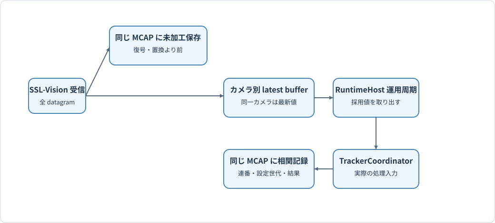

# 試合入力の単体 MCAP 録画

## 目的

試合時の追跡判断を後から確認・再計算できるよう、RuntimeHost が受信した全 SSL-Vision 入力と、追跡器が実際に処理した入力およびその時点の設定を、録画ごとの MCAP 1 本へ記録する。起動時診断ログや別ファイルには依存しない。

## 実装方針

RuntimeHost に録画単位の所有者を置き、DebugHost の録画 UI や起動単位の診断ログから分離する。受信データは復号とカメラ別最新値バッファへの保存より前に未加工データとして記録する。運用ループがバッファから取り出した入力は `TrackerCoordinator` に相関情報を渡し、同クラスが追跡処理へ実際に適用した境界で処理順と実効設定世代を確定する。

`RuntimeHost:MatchRecording:DirectoryPath` が空なら記録しない。値を指定した場合はホストの開始・停止に合わせて 1 録画を開始・確定する。

1. 録画開始を受信・周期処理と同じ直列化境界で扱い、境界前にバッファ済みの入力を処理してから開始時の形状・設定を記録する。
2. 開始後は各受信を一意な連番で未加工データとして保存してから既存の復号・バッファ処理へ進める。復号失敗も未加工データと失敗理由を残す。
3. 同じカメラの複数入力が周期間に届いた場合は全件を未加工データとして残す。バッファで後続入力に置き換えられた入力は未処理理由を記録し、実際に `TrackerCoordinator` が処理した入力だけを連番と設定世代に相関づける。
4. 録画停止は新規受付を閉じ、既に受付済みの未加工入力、処理情報、設定・形状変更および処理結果をすべて書き終えてから MCAP を確定する。失敗したファイルは完成録画として公開しない。

現在の RuntimeHost には領域選別がないため、初期版は「全域・領域選別無効」を明示的な必須設定として記録する。座標系は SSL の競技場中心原点、x/y は mm とする。設定が欠落した記録を領域選別無効と推測してはならない。領域選別機能本体と再計算時の設定上書きはこの設計の対象外とする。

## 記録境界

録画開始・停止、未加工データの受付、カメラ別バッファからの取り出し、`TrackerCoordinator` への処理依頼を、RuntimeHost 内の同一の直列化境界で順序づける。開始時は境界前に受信済みのバッファを処理してから録画 ID を有効にする。停止時は新規受付を閉じ、同じ録画 ID で受け付けた入力の処理または未処理理由の記録が終わるまで待ってからファイルを閉じる。次の録画へ前の録画の入力を引き継がない。

各未加工入力には録画 ID、入力連番、受信時刻、送信元、元の受信内容を保存する。処理情報は同じ入力連番、処理順、復号結果、処理有無と理由、実効設定世代を持つ。設定世代と制御イベントは追跡処理への適用境界で順序づけ、受信時刻だけから適用設定を推定しない。

## 受け入れ条件

- 同じカメラから一周期内に複数入力を受信したとき、未加工データには全入力があり、置き換えられた入力と実際に処理された入力を区別できる。
- 実処理入力の相関先から、当時の設定世代と明示された全域・領域選別無効の状態を読み取れる。
- MCAP を 1 本だけ空の別ディレクトリへ移しても、必要な未加工入力、設定、処理情報を読み、記録時設定による再計算を開始できる。
- 開始・停止境界で録画外の入力が混入せず、必須データが欠けた録画や確定に失敗した録画は通常再生で拒否される。

## テスト内容

| テストの目的 | 方法 | 期待結果 |
| --- | --- | --- |
| 同一カメラの複数入力と採用入力 | RuntimeHost の受信から運用ループまでを模擬し、同じカメラの異なる連番を一周期内に複数投入する | 未加工データ全件が保存され、置き換えられた入力は未処理、最後に残った入力は実処理情報と相関する |
| 形状入力の置き換え | 形状 A を処理後、同じ周期に形状 B と空の受信データを受け、次周期に形状 C を処理する | B は未加工データに残るが未処理、空の受信データは A の状態を維持し、C だけが後続の形状更新となる |
| 録画境界 | 入力を開始前・受付中・停止待機中に投入し、停止後に次の録画を開始する | 開始前の入力は録画に入らず、受付済み入力は旧 ID で完了し、停止後の入力は次 ID にのみ属する |
| 単体 MCAP 再計算 | 録画後に MCAP 1 本だけを空の別ディレクトリへ移し、読取機能と通常再計算経路で開く | 付属データなしで全未加工入力と実効設定を読み、記録時設定から再計算を開始できる |
| 必須情報・完成失敗 | 必須設定または処理相関を欠く入力、および書込確定失敗を与える | 不正または未完成の録画を完成扱いせず、通常再生が拒否する |

## 範囲外

起動単位の診断ログ、DebugHost の UI、領域選別機能、外部比較、旧録画形式、異常終了後の途中ファイル回収、実機でのネットワーク検証はこの設計の対象外とする。
