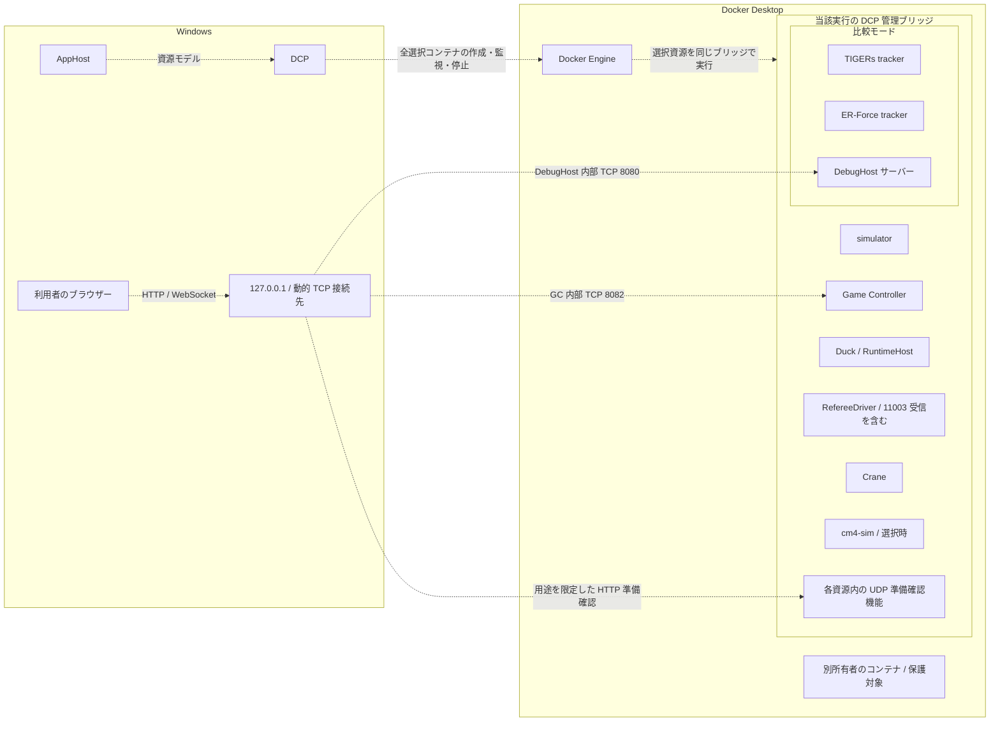
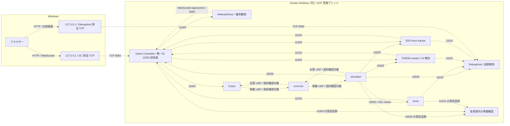
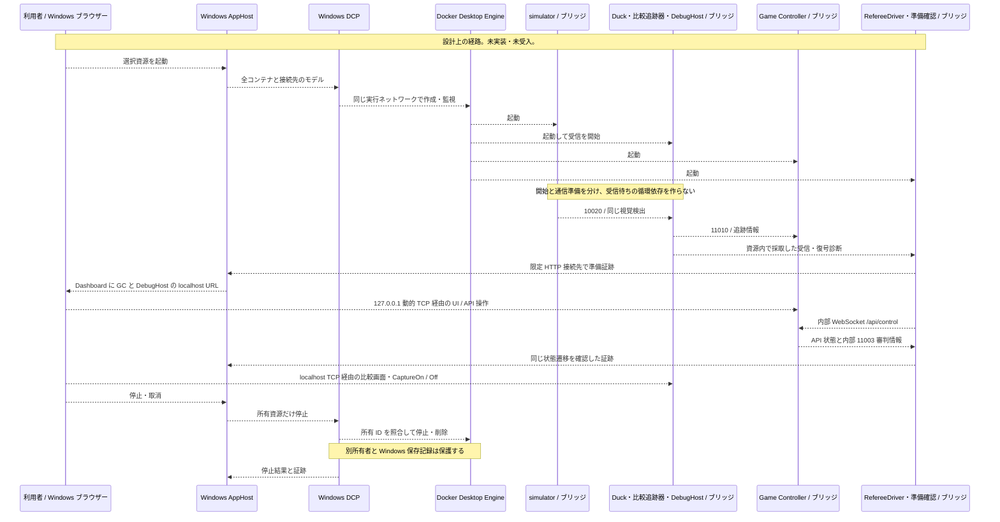

# Aspire シミュレーション試験環境

> **現行設計案・未実装・未受入。** Windows の AppHost と利用者ごとの Docker Desktop を使う。UDP とマルチキャストの参加者は、すべて同じ DCP 管理のブリッジネットワーク内へ配置する。Windows 上には AppHost、DCP、利用者のブラウザーを置く。利用者管理の Ubuntu 上の別の Docker Engine は製品実行経路に含めない。Docker Desktop 内部の Linux 仮想環境 や WSL 2 は製品の基盤であり、その変更や削除は求めない。
>
> [2026-10-21 の再編前の設計記録](aspire-simulation-test-environment-history.md)は当時の内容を保持する。本書の方式への移行、Windows 上の DCP、ブリッジ内の通信、準備完了判定は未検証である。

## 目的と設計判断

Windows AppHost から Aspire 13.5.4 の標準 `AddContainer` を使い、利用者自身の Docker Desktop に試験資源を登録する。DCP が資源の作成、状態監視、記録、停止、削除を管理する。別の Docker コマンド管理プログラムとコンテナの所有権を二重に持たない。

DCP は Developer Control Plane の略称で、Aspire が内部で使う起動管理プログラムである。AppHost は資源資源定義を DCP に渡し、Docker Engine がコンテナを実行する。DCP はネットワークの転送機能ではない。[DCP 公式リポジトリ](https://github.com/microsoft/dcp)と[Aspire 13.5.4 のコンテナ作成処理](https://github.com/microsoft/aspire/blob/v13.5.4/src/Aspire.Hosting/Dcp/ContainerCreator.cs#L109-L204)を根拠とする。当該版が作る既定の Aspire ネットワークをこの実行の専用ブリッジとする。任意の別ネットワークを追加指定できるとは仮定しない。

課題 #80 の I80-NR-001 に対応し、Duck、DebugHost のサーバー、RefereeDriver の審判情報受信機能、準備確認の受信機能もコンテナ側へ置く。Windows のプロセスにブリッジ内のマルチキャストを直接受信させる経路は要求しない。これは配置の設計変更であり、UDP の公開、中継、ホストネットワークは使わない。Docker Desktop の公式資料は、ブリッジが 仮想環境 内にあり Windows ホストから直接到達できないことを示す（[既知制限](https://docs.docker.com/desktop/features/networking/networking-how-tos/#known-limitations)、[通信の構造](https://docs.docker.com/desktop/features/networking/)）。同じブリッジ内に配置しても、複数受信や外部イメージとの通信の実測は必要である。

現行 `Testing/Duck.Testing.AppHost` の実装はこの設計と異なる。Duck と DebugHost はホスト上の `ProjectResource`、外部資源は Docker コマンド起動管理を介した `ExecutableResource` で、後者は `--network host` を使う。旧 `AddContainer` は DCP の利用者定義ネットワークと `--network host` が競合し、Docker に `cannot attach both user-defined and non-user-defined network-modes` と拒否された。移行時は標準コンテナ資源だけに所有権を集め、同じ引数を戻さない。現行実装や過去の受入証拠を、新配置の実装済み・受入済みの根拠にしない。

## 対象資源

すべての UDP 送受信機能を同じブリッジ内に置く。各イメージの版とハッシュ値を固定し、起動時には完全なコンテナ ID、DCP 資源 ID、実行 ID、ネットワーク ID を記録する。Duck と DebugHost の Linux 向け配布イメージ、準備確認機能を含む各起動構成は後続実装の対象である。

| 資源 | 配置と役割 |
| --- | --- |
| `simulator` | コンテナ。SSL-Vision `224.5.23.2:10020` の送信者。別の SSL-Vision プロセスは起動しない。 |
| `duck` | `Tracker.RuntimeHost` のコンテナ。視覚検出を受信し、`sim` 設定で公式形式 `TrackerWrapperPacket` を `224.5.23.2:11010` へ送信する。 |
| `game-controller` | コンテナ。審判情報 `224.5.23.1:11003` の唯一の送信者。視覚検出と追跡情報も入力する。画面と制御 API は内部 TCP 8082。 |
| `crane`、`cm4-sim` | コンテナ。必要なロボット制御と応答を同じブリッジ内で送受信する。`cm4-sim` は構成に応じて選ぶ。 |
| `referee-driver` | 選択時に起動するコンテナ。双方向API 制御と `UdpRefereeCommandSource` の11003受信を同じ資源内で行う。Windows に UDP 受信部を残さない。 |
| `tracker-tigers` | 比較時の Sumatra 追跡機能コンテナ。10020と11003を受信し、11010へ公式形式の追跡情報を送る。TIGERs AI と内蔵 Game Controller は起動しない。 |
| `tracker-erforce` | 比較時の ER-Force AutoRef 追跡機能コンテナ。同じ入力から11010へ公式形式の追跡情報を送る。 |
| `debug-host` | 比較時の `Tracker.DebugHost` コンテナ。自身の追跡・UDP送信を無効にし、10020と Duck / TIGERs / ER-Force の11010を受信する。表示・記録・再生をサーバー内で行い、Windows ブラウザーへ画面を返す。 |
| 各資源の準備確認機能 | 対象コンテナ内で UDP を受信し、対象サービス自身の復号件数と新しさを確認する。ホスト上の旧起動管理プログラムの受信数は代用しない。 |

比較モードは任意選択であり、選択した全資源を同じ AppHost 実行で管理する。三つの追跡器の識別と比較契約は[比較デバッグ設計](tracker-comparison-debug-design.md)に従う。Crane は追跡器ではない。TIGERs AI 対 Crane の対戦経路は別課題 #43 / #50 とし、この比較モードでは起動しない。

## 配置案

図の破線は未実装の管理・起動経路を表す。各資源内の UDP 準備確認機能もブリッジ内で動く。別所有者のコンテナはネットワークに加えない。

## 通信契約

UDP はブリッジ内で完結させる。コンテナ IP を固定せず、資源名から接続先を解決する。マルチキャストは マルチキャストの宛先 と ポート を維持し、各受信側はコンテナ内の IPv4 インターフェースで参加する。Windows の NIC を `InterfaceAddress` に渡さない。送信側のインターフェース、同時受信、再参加の挙動は実機受入で確認する。

| 用途 | 送受信と接続先 |
| --- | --- |
| 視覚検出 | simulator → Duck / DebugHost / TIGERs / ER-Force / Game Controller。 `224.5.23.2:10020/UDP`。選択資源が同じ新しい入力を受ける。 |
| 審判情報 | Game Controller のみ → 比較追跡器、Crane、RefereeDriver、および必要な準備確認機能。 `224.5.23.1:11003/UDP`。各受信機能の実装は確認対象とする。 |
| 追跡情報 | Duck / TIGERs / ER-Force → DebugHost と Game Controller 等の必要受信側。 `224.5.23.2:11010/UDP`。三者は公式形式と独立した送信元識別を保持する。 |
| シミュレーション／チーム制御 | `10300/UDP`、`10301/UDP`、`10302/UDP`。構成で使う送信者・受信者を外部契約確認で確定する。 |
| Crane 経路 | `12345/UDP`、`12346/UDP`。報告された `12350/UDP` の使用有無も確認する。 |
| ロボット応答 | simulator の `50100 + robot-id/UDP` と、`224.5.20.(100 + robot-id):50100 + robot-id/UDP` の使用経路を確認する。 |
| 内部 Game Controller 制御 | RefereeDriver 等のコンテナ内利用者 → `ws://game-controller:8082/api/control`。 |
| Windows の Game Controller 画面・制御 | `http://127.0.0.1:<GC割当ポート>/` と同じポートの `ws://127.0.0.1:<GC割当ポート>/api/control`。 |
| Windows の比較画面 | `http://127.0.0.1:<DebugHost割当ポート>/`。DebugHost 内部は HTTP 8080 を設計値とする。既存の HTTPS 転送・待受設定の対応は実装前に確認する。 |
| HTTP 準備確認 | 各資源の限定された検証口を127.0.0.1の動的 TCP ポートへ対応付ける。UDP をホストで受信しない。後述の確認契約が成立するまで公開しない。 |

破線は設計上の通信で、実測済みを示さない。準備確認は対応する資源内で行い、独立観測器の受信だけでサービス自身の受信を代用しない。10300、10301、10302等の未確定の制御契約を、図の既知経路へ推測で割り当てない。

### 外部接続先と再作成

Crane、cm4-sim、simulator を同じブリッジへ移しても、別コンテナの `127.0.0.1` は共有しない。既存資料は、Crane の数値 IP、cm4-sim の `inet_addr` と 127.0.0.1 固定応答、simulator の数値 `QHostAddress` を報告している。固定した外部イメージで次の確認を終えることを、設計段階の検証契約とする。確認が終わるまで当該経路と全体受入を阻害として扱う。

| 対象 | 必要な確認と変更判断 |
| --- | --- |
| Crane → cm4-sim／simulator | 送信先を資源名で設定できるか確認する。数値 IP だけを受ける場合は、接続時の名前解決と再接続を外部実装へ加える変更を特定する。 |
| cm4-sim → simulator と応答 | 他コンテナへの送信・応答先に127.0.0.1を使わず、simulator／Craneの資源名へ対応させる。送信先、応答先、待受 ポート、マルチキャスト用インターフェース の設定箇所を固定版で確認する。 |
| simulator → cm4-sim | 数値宛先しか渡せない場合は資源名を再解決する変更を特定する。起動時に一度だけ解決した IP の永続利用は採らない。 |
| 個別再作成 | DCP の資源名から現在の接続先を取得し直す。UDP は送信先と応答先を更新し、マルチキャスト は新しいコンテナのインターフェースで参加し直す。古い接続先は無効化し、通信準備を未完了へ戻す。 |

外部契約を変更できない場合は、固定 IP、暗黙の中継、同一コンテナ化へ自動変更せず、#80 の設計判断へ戻す。後続実装の開始前に、対応する版・変更先・受入条件を記録する。この文書変更では外部イメージを変更しない。

### Windows の TCP 待受

AppHost は Game Controller の8082、DebugHost の8080、必要な HTTP 準備確認口に名前付きの接続先を定義し、動的なホストポートを Dashboard に示す。Windows ブラウザーは Dashboard の `game-controller` と `debug-host` の URL を開く。コンテナ内では対象のネットワークインターフェースで HTTP を待ち受け、ホスト側は127.0.0.1だけとする。コンテナ内の待受と Windows の待受範囲を混同しない。

準備確認口は simulator=39101、Game Controller=39102、cm4-sim=39103、Crane=39104、TIGERs=39105、ER-Force=39106、Duck=39108、RefereeDriver=39110 の内部 TCP ポートを設計値とする。DebugHost は8080の `/health/vision` と `/health/comparison` を使う。各外部サービスに既存の検証口があるとは仮定せず、必要な受信・復号診断を当該コンテナ内へ実装する。検証口はデータ中継をせず、実行 ID、資源 ID、対象の完全なコンテナ ID と結び付けた件数・受信時刻・状態を返す。

Aspire 13.5.4／Windows DCP の 127.0.0.1 待受は**設計段階の確認事項**である。実装前に当該版の 接続先 定義から Docker の ホスト側の待受アドレス までを追跡し、127.0.0.1の指定方法、動的 ポート、HTTP／双方向API、Dashboard表示、再起動時の再割当てを確定する。標準 `AddContainer` で限定できることを確認できなければ、接続先を有効にせず設計を阻害とする。全インターフェース公開、Docker Desktop設定変更、別の起動管理へ切り替えない。

Docker が 127.0.0.1 指定の公開を説明していても、Aspire 13.5.4の設定で保証できた証拠にはしない（[Docker 公開ポート](https://docs.docker.com/engine/network/port-publishing/)、[Aspire ネットワーク概要](https://aspire.dev/fundamentals/networking-overview/)）。Game Controller の UI と `/api/control` が同じ ポート を使うことは[v3.20.3 README](https://github.com/RoboCup-SSL/ssl-game-controller/blob/v3.20.3/README.md)を根拠とする。画面の URL 末尾と実到達性は固定イメージで確認する。

## DebugHost のデバッグと記録

Windows の開発環境から、DCP が起動した `debug-host` に接続する。デバッグ用イメージには同じ版のソースコードから作成した実行ファイル、対応する移植可能なデバッグ情報ファイル、`/vsdbg/vsdbg` を事前に含める。実行中のコンテナへの依存追加やデバッグ用 TCP ポート公開を前提にしない。

1. Dashboard／DCP の資源情報から、当該実行の `debug-host` の完全なコンテナ ID と イメージのハッシュ値 を取得する。期待する実行 ID・資源 ID・イメージと照合し、名前だけで対象を選ばない。
2. Windows の .NET デバッグ環境で、Docker Desktop の明示的な `desktop-linux` 接続先を指定した `docker.exe --context desktop-linux exec -i <完全ID> /vsdbg/vsdbg --interpreter=vscode` を接続用の標準入出力として使う。コンテナ内の `dotnet Tracker.DebugHost.dll` のプロセスIDを選ぶ。デバッグ環境の `pipeTransport`、`processId`、`sourceFileMap` に、この接続と `/src` → Windows の同じ版のソースコードの絶対パスを設定する。
3. 停止位置とソースコード／デバッグ情報ファイルの一致を確認する。停止中は受信の新しさが失われ得るため、通信受入の計測時間から除き、再開後に準備確認をやり直す。切断はデバッグ接続だけを終え、コンテナの作成・停止・削除は DCP に任せる。
4. 再作成後は新しい完全 ID とプロセスIDを取得し直す。旧 ID へ再接続しない。Windows の開発環境、事前配布したデバッガー、同じ版のソースコード対応の成立は後続の確認対象である。

記録は `%LOCALAPPDATA%\Duck\Aspire\<run-id>\captures` を実行ごとの Windows 保存先とし、DCP が `debug-host` の `/data/captures` へ読み書き可能で割り当てる。AppHost は所有する実行の保存先だけを作成し、記録先を Dashboard の資源説明とログへ示す。`VisionReceiver__PacketCapture__DirectoryPath=/data/captures` を渡す。現在の設定キーは存在するが、この割当てと読み書きの権限は未実装・未検証である。

利用者はブラウザーで CaptureOn を開始し、終了時に CaptureOff とファイルの書き出し完了を確認する。raw vision、診断、三つの追跡情報、送信元情報、時刻対応、記録の一覧を同じ記録保存先に残す。Windows の保存先から保存先全体を複製して取り出し、関連ファイルを分離しない。DCP の通常停止・後始末は Windows の記録を削除しない。記録の削除は利用者の別操作とする。

同じ起動中は `/diagnostics` で再生する。後日の再生専用起動では、保存した保存先を `/data/replay` へ読み取り専用で割り当て、`VisionReceiver__PacketCapture__DirectoryPath=/data/replay`、記録無効の設定で開く。記録と再生が相互に書き換えないこと、終了後の再読と 送信元識別子 の保持を後続実装・受入で確認する。

## 準備完了、依存、停止

コンテナの開始は通信準備完了ではない。simulatorを先に起動可能にし、その受信者を同時に動かす。Duck／DebugHostの受信を simulator の起動条件にしない。比較追跡器は simulator と Game Controller の準備を待つ。DebugHost の起動を三つの追跡結果受信の後にせず、起動後の比較準備確認で三者の別 識別子 と同じ有限窓内の新しい パケット を要求する。

RefereeDriver は内部 API に接続し、API の状態と11003の審判情報を照合する。各資源の準備確認はブリッジ内で採取した診断を HTTP で DCP／AppHostへ伝える。ホストの旧起動管理で動く `VisionServiceReadiness`、`TrackerPacketReadinessMonitor`、`GameControllerReadinessMonitor` の マルチキャスト受信を残さない。診断の期限切れ、復号失敗、対象IDの変更では準備未完了へ戻す。`WaitFor` は開始順を定め、障害後の自動再起動を保証しない。

図の利用者からコンテナへの TCP 線は、前述の Windows 127.0.0.1 動的接続先を経由する。製品の UDP が Windows へ出る経路を表さない。正常停止は15秒以内とし、取消、部分失敗、個別再作成、一括停止で当該実行の資源だけを後始末する。固定する SDK は13.5.4であり、過去に観測した DCP 0.25.13を現在の Windows 実行版とみなさない。

## 優先受入条件

すべて将来の受入目標であり、実施済みの結果ではない。項目ごとに合格、失敗、未実施、阻害、未検証を記録する。Windows 上の AppHost と利用者の Docker Desktop で、対象の版と全選択資源を記録して実施する。

| ID | 必須条件 |
| --- | --- |
| `ASPIRE-NET-001` | 全選択資源、Duck、DebugHost、RefereeDriver、準備確認機能が同じ DCP ブリッジ内で動く。AppHost／DCPだけが所有・管理し、開始、取消、途中失敗、二重起動、個別再起動、一括停止でも別所有者を変えず、正常停止15秒以内を完全IDの前後比較で示す。 |
| `ASPIRE-NET-002` | 安定起動後5秒以内に Duck 自身の `VisionPacketsReceivedTotal` が新しい検出データ10件以上の復号を示す。Windows上の観測器や仮想環境内の独立観測器だけでは代用しない。 |
| `ASPIRE-NET-003` | Duck と DebugHost が同じ確認窓で同じ10020入力を受信する。受信件数、入力時刻、検出内容を記録する。 |
| `ASPIRE-NET-004` | TIGERs と ER-Force が同じ10020と Game Controller の11003を受信し、独立した追跡結果を生成する。Game Controller以外が11003を生成しない。 |
| `ASPIRE-NET-005` | DebugHost が TIGERs / ER-Force の11010を別 識別子 として受信し、同じ有限窓の新しさを確認する。 |
| `ASPIRE-NET-006` | Duck の11010も同じ DebugHost が同時受信し、三つの 比較対象の役割 が互いに別の 識別子 へ一意に対応する。Game Controller等の必要受信側にも届く。 |
| `ASPIRE-NET-007` | Windows ブラウザーの Game Controller UI操作で `HALT` から `running` へ遷移し、API応答と内部11003受信で同じ遷移を確認する。Crane／cm4-sim／simulatorの必要UDP往復と、視覚検出データ上の100 mm以上の移動を示す。 |
| `ASPIRE-NET-008` | コンテナ内 `InterfaceAddress` 未指定と明示IPv4の両方で受信する。一受信者の開始・停止が他の件数を止めない。VPN、Tailscale、複数NIC等のホスト条件とコンテナ内の選択結果を分けて記録する。 |
| `ASPIRE-NET-009` | 単一AppHostの排他と制御ポート競合を確認する。共有マルチキャスト ポートの使用中判定だけで失敗にしない。個別再作成で新ID・接続先の再解決・応答先更新・マルチキャストの宛先再参加・準備復帰を示す。古いIPを使い続ける場合は失敗とする。 |
| `ASPIRE-HOST-001` | DashboardのGame Controller／DebugHost URLから画面と双方向接続が成立する。Game Controllerの操作、DebugHostの三者比較、127.0.0.1からの到達、127.0.0.1以外での待受なしを確認する。準備確認口を含む全ホストTCP接続先の待受範囲・割当・再割当てを記録する。 |
| `ASPIRE-DEBUG-001` | Windowsから当該所有IDのDebugHostへ標準入出力で接続し、同じ版のソースコード・デバッグ情報ファイルで停止／再開する。デバッグTCP公開なし、再作成後の対象更新、切断後のDCP管理を示す。 |
| `ASPIRE-CAPTURE-001` | CaptureOff後にWindows保存先へ全関連ファイルが残る。停止・再作成後も取り出して再生でき、三者の識別子と時刻対応を保持する。読み取り専用再生が元記録を変えない。 |

HTTP `GET` の400応答、ソケットの待受だけ、Linux別Docker Engineでの成功、WSL内での継続検証は Windows Docker Desktop の合格証拠ではない。Linux／macOSの対応も同じ配置契約で個別に確認し、Windowsの成功や未実施を代用しない。選択した版の外部接続契約、127.0.0.1限定待受、必要経路のいずれかが未確定なら受入を保留する。

## 安全境界と関連課題

UDP公開、マルチキャスト中継、ホストネットワーク、固定コンテナIPを前提にしない。TCPの公開は127.0.0.1の画面・制御・用途を確定した準備確認だけとする。利用者管理Ubuntuの別Docker Engine、別所有者のコンテナ、既存の記録を変更しない。Docker Desktop、WSL、Docker接続先、`PATH`、認証、ネットワーク、ホスト設定の恒久変更は本設計の作業に含めない。

#80はこの配置・外部接続契約・127.0.0.1待受の設計とレビューを扱う。設計受理後の#81で標準コンテナ資源への移行を実装し、#82でWindows実機の受入を行う。この文書変更で#79〜#82を閉じない。旧Docker起動管理のレビュー、過去の環境一覧やパケット観測は当時の証拠に限り、新配置の成立を保証しない。旧履歴は変更せず、本書と比較設計を再レビューする。
