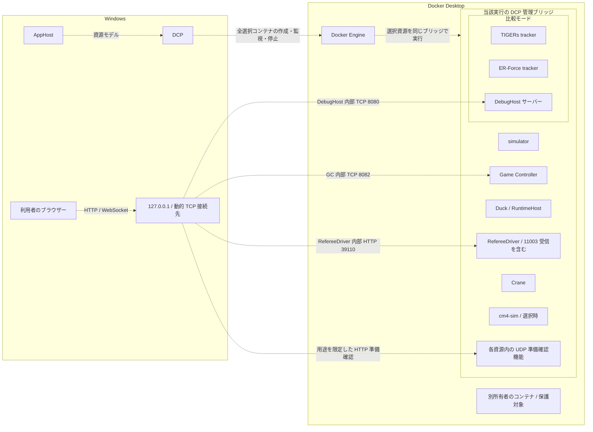
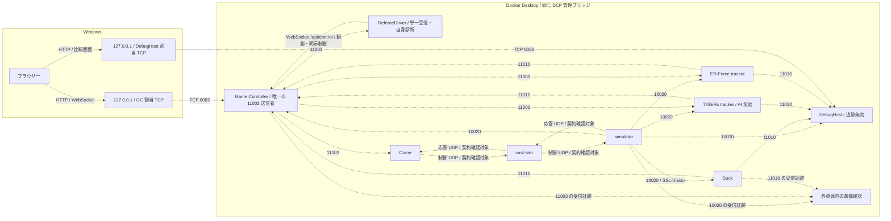
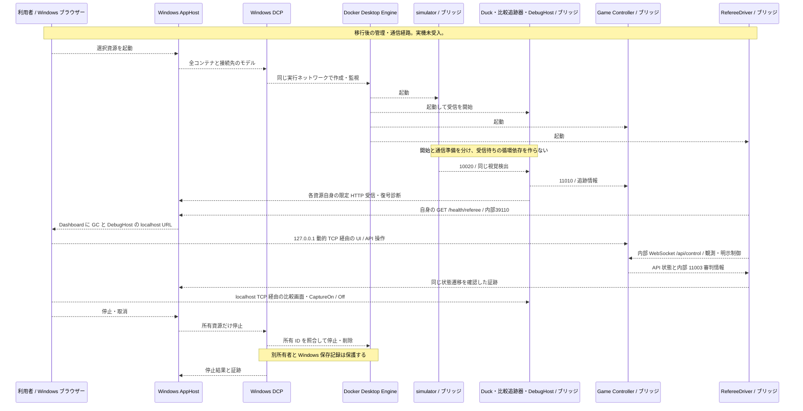

# Aspire シミュレーション試験環境

> **現行設計案・移行未完了・未受入。** Windows の AppHost と利用者ごとの Docker Desktop を使う。UDP とマルチキャストの参加者は、すべて同じ DCP 管理のブリッジネットワーク内へ配置する。Windows 上には AppHost、DCP、利用者のブラウザーを置く。利用者管理の Ubuntu 上の別の Docker Engine は製品実行経路に含めない。Docker Desktop 内部の Linux 仮想環境 や WSL 2 は製品の基盤であり、その変更や削除は求めない。
>
> [2026-10-21 の再編前の設計記録](aspire-simulation-test-environment-history.md)は当時の内容を保持する。本書の方式への移行、Windows 上の DCP、ブリッジ内の通信、準備完了判定は未検証である。

## 目的と設計判断

Windows AppHost から Aspire 13.5.4 の標準 `AddContainer` を使い、利用者自身の Docker Desktop に試験資源を登録する。DCP が資源の作成、状態監視、記録、停止、削除を管理する。別の Docker コマンド管理プログラムとコンテナの所有権を二重に持たない。

DCP は Developer Control Plane の略称で、Aspire が内部で使う起動管理プログラムである。AppHost は資源資源定義を DCP に渡し、Docker Engine がコンテナを実行する。DCP はネットワークの転送機能ではない。[DCP 公式リポジトリ](https://github.com/microsoft/dcp)と[Aspire 13.5.4 のコンテナ作成処理](https://github.com/microsoft/aspire/blob/v13.5.4/src/Aspire.Hosting/Dcp/ContainerCreator.cs#L109-L204)を根拠とする。当該版が作る既定の Aspire ネットワークをこの実行の専用ブリッジとする。任意の別ネットワークを追加指定できるとは仮定しない。

課題 #80 の I80-NR-001 に対応し、Duck、DebugHost のサーバー、RefereeDriver の審判情報受信機能、準備確認の受信機能もコンテナ側へ置く。Windows のプロセスにブリッジ内のマルチキャストを直接受信させる経路は要求しない。これは配置の設計変更であり、UDP の公開、中継、ホストネットワークは使わない。Docker Desktop の公式資料は、ブリッジが 仮想環境 内にあり Windows ホストから直接到達できないことを示す（[既知制限](https://docs.docker.com/desktop/features/networking/networking-how-tos/#known-limitations)、[通信の構造](https://docs.docker.com/desktop/features/networking/)）。同じブリッジ内に配置しても、複数受信や外部イメージとの通信の実測は必要である。

現行 `Testing/Duck.Testing.AppHost` の実装はこの設計と異なる。Duck と DebugHost はホスト上の `ProjectResource`、外部資源は Docker コマンド起動管理を介した `ExecutableResource` で、後者は `--network host` を使う。旧 `AddContainer` は DCP の利用者定義ネットワークと `--network host` が競合し、Docker に `cannot attach both user-defined and non-user-defined network-modes` と拒否された。移行時は標準コンテナ資源だけに所有権を集め、同じ引数を戻さない。現行実装や過去の受入証拠を、新配置の実装済み・受入済みの根拠にしない。

## 対象資源

すべての UDP 送受信機能を同じブリッジ内に置く。各イメージの版とハッシュ値を固定し、起動時には完全なコンテナ ID、DCP 資源 ID、実行 ID、ネットワーク ID を記録する。Duck と DebugHost の Linux 向け配布イメージ、準備確認機能を含む各起動構成は後続実装の対象である。

| 資源 | 配置と役割 |
| --- | --- |
| `simulator` | コンテナ。SSL-Vision `224.5.23.2:10020` の送信者。別の SSL-Vision プロセスは起動しない。 |
| `duck` | `Tracker.RuntimeHost` のコンテナ。視覚検出を受信し、`sim` 設定で公式形式 `TrackerWrapperPacket` を `224.5.23.2:11010` へ送信する。 |
| `game-controller` | コンテナ。審判情報 `224.5.23.1:11003` の唯一の送信者。視覚検出と追跡情報も入力する。画面と制御 API は内部 TCP 8082。 |
| `crane`、`cm4-sim` | コンテナ。必要なロボット制御と応答を同じブリッジ内で送受信する。`cm4-sim` は構成に応じて選ぶ。 |
| `referee-driver` | 選択時に起動するコンテナ。新しい実行プロジェクトの単一受信処理で11003を観測し、自身の診断と内部API状態を照合する。自動制御は明示選択時だけ行う。Windows に UDP 受信部を残さない。 |
| `tracker-tigers` | 比較時の Sumatra 追跡機能コンテナ。10020と11003を受信し、11010へ公式形式の追跡情報を送る。TIGERs AI と内蔵 Game Controller は起動しない。 |
| `tracker-erforce` | 比較時の ER-Force AutoRef 追跡機能コンテナ。同じ入力から11010へ公式形式の追跡情報を送る。 |
| `debug-host` | 比較時の `Tracker.DebugHost` コンテナ。自身の追跡・UDP送信を無効にし、10020と Duck / TIGERs / ER-Force の11010を受信する。表示・記録・再生をサーバー内で行い、Windows ブラウザーへ画面を返す。 |
| 各資源の準備確認機能 | 対象コンテナ内で UDP を受信し、対象サービス自身の復号件数と新しさを確認する。ホスト上の旧起動管理プログラムの受信数は代用しない。 |

比較モードは任意選択であり、選択した全資源を同じ AppHost 実行で管理する。三つの追跡器の識別と比較契約は[比較デバッグ設計](tracker-comparison-debug-design.md)に従う。Crane は追跡器ではない。TIGERs AI 対 Crane の対戦経路は別課題 #43 / #50 とし、この比較モードでは起動しない。

視覚入力から `Tracker.RuntimeHost` の準備完了までを単独で確認する場合は、`Testing:VisionSimulationOnly=true` を明示する。この選択では `simulator` と `duck` の2資源だけを Aspire 標準 `ContainerResource` として登録し、既定の基本構成・比較構成は変更しない。既存の `RuntimeHostOnly` は Duck だけの1資源選択として維持する。simulator は `linux-image-lock.json` の `framework-simulator` 一覧ダイジェストを使い、Dockerイメージの `Entrypoint=["tini","--"]` と `Cmd=["./bin/simulator-cli"]` に対応するよう、`tini` と `-- ./bin/simulator-cli -g 2020B --realism None --ibis-port 12346 --ibis-team-color yellow` を指定する。追加の `tini` を起動引数に重ねない。UDP は公開せず、ホストネットワークも使わない。simulator が起動した後に Duck を開始し、Duck 自身の `/health/vision` が復号済み視覚入力を確認する。これは最小の視覚入力経路の検証であり、比較資源やその他の外部サービスを含む全体構成の受入を意味しない。固定イメージの実行、同一 DCP ブリッジ内のマルチキャスト到達、厳格な準備確認の成功は実測で確認する。

### Linux 向けアプリケーションの配布出力（I81-04A）

次の既存プロジェクトを、復元済み依存を使い、.NET 10 の共有実行環境で動かす配布物として発行する。各出力は .NET アセンブリから起動し、OS 固有の実行ファイルと実行基盤資材を含めない。実行時は後続の I81-04B で確定する .NET 10 実行環境を使う。コンテナイメージの基底、外部イメージ、デバッグ専用資材の版とダイジェストは I81-04B で別に確定する。

| プロジェクト | 固定する配布出力 |
| --- | --- |
| `Tracker/Tracker.RuntimeHost` | `Tracker.RuntimeHost.dll`、対応する `.deps.json` と `.runtimeconfig.json`、`appsettings.json`。 |
| `Tracker/Tracker.DebugHost` | `Tracker.DebugHost.dll`、対応する `.deps.json` と `.runtimeconfig.json`、`appsettings.json`、`wwwroot/app.css`、`wwwroot/favicon.png`。画面に使う静的ファイルを配布先へ含める。 |
| `Testing/Duck.Testing.RefereeDriver.Host` | `Duck.Testing.RefereeDriver.Host.dll`、対応する `.deps.json` と `.runtimeconfig.json`。設定は環境変数で渡すため、追加の設定ファイルを要求しない。 |

自動検査では既存プロジェクトを実際に発行し、生成先の各ファイルと `.runtimeconfig.json` の .NET 10 の共有実行基盤を使う設定を検査する。新しい配布一覧だけの自己検査で代用しない。ここではイメージの取得・作成・起動、外部成果物の取得、実行中の依存導入、デバッグ資材の追加を行わない。

### Linux 向け通常コンテナの配布定義（I81-04B2）

`Testing/Duck.Testing.AppHost/linux-image-lock.json` は、AppHost が既に参照する外部イメージ6件と通常用の .NET 基底2件について、完全な参照値、`digest`、`mediaType`、公開情報で確認した `platforms` を固定する。`otherDescriptors` の未識別項目は対象環境として数えない。`GHCR` の3件では公開手順から確認した `sourceCommit` も記録するが、元リポジトリの変更番号と配布イメージとの暗号学的な対応までは証明しない。固定参照は最上位一覧のダイジェストを使い、公開情報の対象環境一覧から新しい利用者要件を追加しない。

| 管理プログラム | 固定基底 | 定義ファイルと入力元 | 実行入口 |
| --- | --- | --- | --- |
| `Tracker.RuntimeHost` | 固定した `mcr.microsoft.com/dotnet/runtime` 参照 | `Tracker/Tracker.RuntimeHost/Dockerfile`。実際の発行先を入力元にする。 | `dotnet Tracker.RuntimeHost.dll` |
| `Tracker.DebugHost` | 固定した `mcr.microsoft.com/dotnet/aspnet` 参照 | `Tracker/Tracker.DebugHost/Dockerfile`。実際の発行先を入力元にする。 | `dotnet Tracker.DebugHost.dll` |
| `Duck.Testing.RefereeDriver.Host` | 固定した `mcr.microsoft.com/dotnet/aspnet` 参照 | `Testing/Duck.Testing.RefereeDriver.Host/Dockerfile`。実際の発行先を入力元にする。 | `dotnet Duck.Testing.RefereeDriver.Host.dll` |

3つの `Dockerfile` は `COPY . /app` でそれぞれの発行先を取り込み、実行入口のアセンブリと共有実行基盤を発行出力に合わせる。RuntimeHostは `Microsoft.NETCore.App`、画面プログラムと審判情報受信プログラムは `Microsoft.AspNetCore.App` を使う。DebugHost用の追加デバッグ資材と事前配布するデバッガーはI81-04B3、AppHostから固定参照を選択する接続はI81-05に属する。ここでの検査は固定表と同じCI実行で生成した発行出力を照合するが、コンテナイメージの取得・作成・起動や実行環境での提供成立は証明しない。

## 配置案

図の破線は未実装の管理・起動経路を表す。各資源内の UDP 準備確認機能もブリッジ内で動く。別所有者のコンテナはネットワークに加えない。

## 通信契約

UDP はブリッジ内で完結させる。コンテナ IP を固定せず、資源名から接続先を解決する。マルチキャストは マルチキャストの宛先 と ポート を維持し、各受信側はコンテナ内の IPv4 インターフェースで参加する。Windows の NIC を `InterfaceAddress` に渡さない。送信側のインターフェース、同時受信、再参加の挙動は実機受入で確認する。

| 用途 | 送受信と接続先 |
| --- | --- |
| 視覚検出 | simulator → Duck / DebugHost / TIGERs / ER-Force / Game Controller。 `224.5.23.2:10020/UDP`。選択資源が同じ新しい入力を受ける。 |
| 審判情報 | Game Controller のみ → 比較追跡器、Crane、RefereeDriver、および必要な準備確認機能。 `224.5.23.1:11003/UDP`。各受信機能の実装は確認対象とする。 |
| 追跡情報 | Duck / TIGERs / ER-Force → DebugHost と Game Controller 等の必要受信側。 `224.5.23.2:11010/UDP`。三者は公式形式と独立した送信元識別を保持する。 |
| シミュレーション／チーム制御 | `10300/UDP`、`10301/UDP`、`10302/UDP`。構成で使う送信者・受信者を外部契約確認で確定する。 |
| Crane 経路 | `12345/UDP`、`12346/UDP`。報告された `12350/UDP` の使用有無も確認する。 |
| ロボット応答 | simulator の `50100 + robot-id/UDP` と、`224.5.20.(100 + robot-id):50100 + robot-id/UDP` の使用経路を確認する。 |
| 内部 Game Controller 制御 | RefereeDriver 等のコンテナ内利用者 → `ws://game-controller:8082/api/control`。 |
| Windows の Game Controller 画面・制御 | `http://127.0.0.1:<GC割当ポート>/` と同じポートの `ws://127.0.0.1:<GC割当ポート>/api/control`。 |
| Windows の比較画面 | `http://127.0.0.1:<DebugHost割当ポート>/`。DebugHost 内部は HTTP 8080 を設計値とする。既存の HTTPS 転送・待受設定の対応は実装前に確認する。 |
| HTTP 準備確認 | 各資源の限定された検証口を127.0.0.1の動的 TCP ポートへ対応付ける。UDP をホストで受信しない。後述の確認契約が成立するまで公開しない。 |

### 明示的な Game Controller 視覚検証モード（I81-05B3）

`Testing:GameControllerVisionOnly=true` は、通常の全構成や二資源の `VisionSimulationOnly` を切り替えず、simulator、Duck、Game Controller、RefereeDriver の四資源だけを同じ Aspire/DCP 管理ブリッジへ登録する明示選択である。既存の固定イメージ参照と起動引数を使い、Game Controller を `224.5.23.1:11003/UDP` の唯一の送信元とする。UDP はホストへ公開せず、Game Controller の HTTP 8082 は Windows の `127.0.0.1` に動的な `TCP` ポートで対応付ける。RefereeDriver は観測用の既存設定で起動し、自動運転は有効にしない。AppHost の構成試験は資源種別、固定参照、引数、依存順と公開端点を検証する。Windows 画面操作、RefereeDriver の実観測、DCP 実行と所有停止は別の実行時確認であり、この構成試験では証明しない。

### Game Controller と RefereeDriver の所有再構成（I81-07B）

`Testing:OwnedReconfiguration:Enabled=true` は `Testing:GameControllerVisionOnly=true` の場合だけ有効とする。既定値は `false` とし、他のAppHostモードの資源・引数・起動依存・命令を変更しない。有効化には `Testing:IdentityControl:DesktopBridgeEnabled=true`、既存の `Testing:IdentityControl:DockerContext` と `Testing:IdentityControl:ExpectedEngineId`、ならびにこの構成で起動する `RefereeDriver` が必要である。前提不足または別モードとの併用は、別構成へ切り替えずAppHost起動前に明示的に失敗させる。初回起動では既存の `ws://game-controller:8082/api/control` を使い、新しい接続先の取得待ちを資源起動依存へ追加しない。

有効時だけGame Controllerに所有実行IDと `game-controller` 役割を示すDockerラベルを付ける。この所有ラベル追加は既存のデスクトップ識別ブリッジ補助処理から分離し、Game Controllerに `RuntimeHost` の `UDS` 識別情報受渡しを設定しない。RefereeDriverには同じ実行IDと `referee-driver` 役割を付ける。通常起動時のRefereeDriver接続先は資源名による既定値を維持する。再構成状態が有効な場合に限り、環境設定値を得る処理からその世代の検証済み接続先を渡す。

Game Controllerの資源に追加する `reconfigure-game-controller-endpoint` 所有再構成命令は、公開されたAspire資源命令APIを使い、既知のGame Controller／RefereeDriver `IResource`だけを操作する。単一の直列化制御下で、最初のDCP停止・再起動命令より前に、同じ `Testing:IdentityControl:DockerContext` で指定された接続先の `Docker Engine ID` と、両資源のDCP登録状態・完全コンテナID・実行ID／役割ラベルを照合する。RefereeDriverがすでに停止済みの場合は、完全IDと所有ラベルを確認し、不要な `Stop` を省略して再試行できる。初期確認時にRefereeDriverが停止済みで、DCP登録から完全IDを得られない場合は、名前で補わず、いずれの命令も実行しない。再試行はDCP登録からその資源の完全IDと所有ラベルを確認できてから行う。別所有者の資源、Docker ID不一致、短縮ID、所有ラベル不一致では `Stop`／`Restart` を一つも実行しない。その後RefereeDriverを先にDCP停止命令で停止し、Game ControllerをDCP再起動命令で再作成する。`ResourceNotificationService`から新しい `Running` 状態と同じ登録資源の新しい完全コンテナIDを得る。Dockerコマンドは同じ `Testing:IdentityControl:DockerContext` で指定された接続先の `info` と、通知から得た完全IDだけを対象にする読み取り専用 `inspect` に限る。Docker ID、DCP登録資源の現在ID、実行ID／役割ラベル、実行状態を照合し、`HostConfig.NetworkMode` と `NetworkSettings.Networks` が同じDCP管理ネットワークを示し、対象ネットワークのIPv4アドレスが一つだけであることを確認する。ネットワーク欠落・複数・不一致、自ホストアドレス、空・不正IP、所有者またはDocker ID不一致は拒否する。コンテナ名や画面表示名から任意の対象を選ばない。

状態は初期（`Initial`）、再構成中（`Reconfiguring`）、有効（`Active`）、停止（`Suspended`）を区別する。初期状態だけは既存の資源名による接続先を利用できる。再構成命令開始時に古い接続先を無効化して `Reconfiguring` へ移り、失敗、取消、時間超過、予期しないGame Controller世代変更では `Suspended` にする。`Reconfiguring` または `Suspended` 時は資源名による接続先や以前の検証済み接続先へ切り替えない。

`inspect` 後に資源通知の現在状態を再取得し、資源参照・資源ID・完全コンテナID・`Running` 状態が `inspect` 前の同じ世代であることを再確認する。確認成功後だけ `ws://<検証済みIPv4>:8082/api/control` を `Active` 状態の接続先として公開し、DCPの開始命令でRefereeDriverを再作成する。開始時に環境設定値を得る処理が `Active` 状態の接続先を使用する。資源開始は通信準備完了を意味せず、この命令成功もGame Controller API応答または実通信の受入証拠にしない。

別所有者・古い通知、世代交代、部分命令失敗、時間超過、取消では新しい接続先を公開せず、停止済みRefereeDriverを古い接続先で再開しない。Game Controllerの予期しない停止または新世代通知でも接続先を直ちに無効化し、DCP通知処理自体を直列化制御の解放待ちにせず、所有確認済みRefereeDriverへDCP停止を要求する。取消・時間超過・失敗で開始命令が保留中または完了結果不明の場合は、後着する `Running` 通知を監視し、停止状態へ戻ったことを確認するまで次の再構成命令を受け付けない。遅れて開始が完了した場合も、同じ実行ID／役割／完全IDの所有確認後にDCP停止し、古い接続先で復帰させない。新世代と接続先を順序付き再構成命令で確認するまで再開しない。Dockerによる直接停止・削除や、他の資源／所有者への操作は行わない。

破線は設計上の通信で、実測済みを示さない。準備確認は対応する資源内で行い、独立観測器の受信だけでサービス自身の受信を代用しない。10300、10301、10302等の未確定の制御契約を、図の既知経路へ推測で割り当てない。

### 外部接続先と再作成

Crane、cm4-sim、simulator を同じブリッジへ移しても、別コンテナの `127.0.0.1` は共有しない。既存資料は、Crane の数値 IP、cm4-sim の `inet_addr` と 127.0.0.1 固定応答、simulator の数値 `QHostAddress` を報告している。固定した外部イメージで次の確認を終えることを、設計段階の検証契約とする。確認が終わるまで当該経路と全体受入を阻害として扱う。

| 対象 | 必要な確認と変更判断 |
| --- | --- |
| Crane → cm4-sim／simulator | 送信先を資源名で設定できるか確認する。数値 IP だけを受ける場合は、接続時の名前解決と再接続を外部実装へ加える変更を特定する。 |
| cm4-sim → simulator と応答 | 他コンテナへの送信・応答先に127.0.0.1を使わず、simulator／Craneの資源名へ対応させる。送信先、応答先、待受 ポート、マルチキャスト用インターフェース の設定箇所を固定版で確認する。 |
| simulator → cm4-sim | 数値宛先しか渡せない場合は資源名を再解決する変更を特定する。起動時に一度だけ解決した IP の永続利用は採らない。 |
| 個別再作成 | DCP の資源名から現在の接続先を取得し直す。UDP は送信先と応答先を更新し、マルチキャスト は新しいコンテナのインターフェースで参加し直す。古い接続先は無効化し、通信準備を未完了へ戻す。 |

外部契約を変更できない場合は、固定 IP、暗黙の中継、同一コンテナ化へ自動変更せず、#80 の設計判断へ戻す。後続実装の開始前に、対応する版・変更先・受入条件を記録する。この文書変更では外部イメージを変更しない。

### 名前空間共有候補の構成生成

I81-07Cでは、明示設定 `Testing:NamespaceProbe:GenerateModel=true` だけで選ぶ診断入口を追加する。通常構成へ名前空間共有を採用する変更ではない。設定値が未指定または明示的に無効なら既存構成を保ち、不正な値で通常起動へ切り替えない。既存の単独実行、映像専用、四資源、再構成、再生専用、比較構成との併用は起動前に拒否する。設定が無効な場合は既存の資源登録と選択順序を保つ。既定の共通排他ファイルと実行名の検証も保つ。

診断入口と試験は同じ内部の構成生成処理を使う。生成するのは所有元と依存側の標準 `ContainerResource` 各1件だけである。両者に固定した既存`ASP.NET`イメージと `ImagePullPolicy.Never` を指定し、既存の審判受信プログラムの配布先を `/app` へ読み取り専用で割り当てる。配布先が不足する場合に作成・取得・代替起動を行わない。審判受信を無効にする引数と、所有元39110・依存側39111のHTTP待受設定を構成へ記録する。

所有元だけに127.0.0.1の動的`TCP`公開を指定し、依存側には公開先を登録しない。安全な実行名から所有元の物理名を生成し、両資源に実行と役割の所有ラベルを付ける。依存側には `--network container:<owner>` の実行時引数と所有元の開始依存を登録する。将来の実測でも同じ生成処理を使い、試験だけの別構成で代用しない。

この入口は `builder.Resources` と実際の注釈・引数を読み、秘匿情報やホストの絶対保存先を含めないJSONを標準出力へ返す。`Build`、`Start`、`Run`へ進まず、DCP・コンテナ・HTTP待受を起動しない。ホストへの生成物の保存先や、未実装の実行切替設定は追加しない。

生成試験は標準資源型、固定イメージ、取得禁止、読み取り専用割当て、所有名・ラベル、所有元だけの公開、依存側の引数・開始依存と出力を確認する。DCPの既定ネットワーク設定はこの構成段階では注入されないため、`Networks` と `RunArgs` の実際の合成、通信、所有元再作成後の依存再結合を合格とはしない。停止・再作成の順序を表す公開APIの根拠と計画は保持し、実行した証拠とは分ける。

### I81-07D: 明示許可後の名前空間共有組成確認

I81-07Dは `Tracker.Tests` 専用の実機組成検査とし、I81-07Cの `NamespaceProbeModelFactory` を再利用する。AppHostの製品選択肢は追加せず、検査対象の2資源と同じ生成処理を使う。試験実行側で構成を作る場合は `DistributedApplicationOptions.AssemblyName` に `typeof(Projects.Duck_Testing_AppHost).Assembly.GetName().Name` を、`ProjectDirectory` に `Projects.Duck_Testing_AppHost.ProjectPath` を指定し、`Args` も渡す。未指定時の `Assembly.GetEntryAssembly()` は `Tracker.Tests` の試験実行ホストを選ぶため、Aspire 13.5.4 AppHostの参照元型情報に埋め込まれたDCP CLI等の構成組み込み構成情報を解決できない。

通常のテストでは環境変数 `DUCK_I81_NAMESPACE_DCP_PROBE_ENABLED` が未指定なら未実行として記録し、成功に数えない。値が存在する場合は `true` だけを有効値とし、それ以外の値はDCP開始前に失敗させる。有効時は `DUCK_I81_NAMESPACE_DCP_EXPECTED_ENGINE_ID` と一意な `DUCK_I81_NAMESPACE_DCP_RUN_ID` を必須とする。既存のDocker 接続先は変更せず、読み取り専用の実行環境ID、実行IDラベル、固定イメージの固定版識別子/保存済み配布物、既存発行物の必要ファイルを照合する。不一致、値の欠落、既存実行ID衝突、イメージまたは発行物の欠落時は、資源を開始・取得せず失敗させる。新しいイメージ取得・ビルド・依存導入は行わない。

有効な場合だけ同じ生成処理から所有元と依存側の標準 `ContainerResource` を一つずつ登録し、AppHostを明示的に開始する。固定版識別子の既存`ASP.NET`イメージは `ImagePullPolicy.Never`、既存発行物は読み取り専用で割り当てる。所有元は `127.0.0.1` の動的`TCP`公開だけを持ち、依存側にはホスト公開を持たせず、`--network container:<owner>` と既存の開始依存を使う。初回2資源と、所有元・依存側それぞれ1回の再作成を観察し、完全ID、実行ID/役割ラベル、現在の実行環境、所有元IDに対する依存側 `HostConfig.NetworkMode`、公開`TCP`を読み取り専用確認する。最大4つのコンテナ世代を記録する。構成生成だけの検査、構成JSON、プロセス起動、作成成功を、DCPの実合成・再作成追従またはアプリケーション通信の証明に置き換えない。

`StartAsync` から再作成・読み取り検査・後片付けまで、各回の上限を60秒とする。一回の実行中は自動再試行しない。ユーザーの許可により、課題81の限定範囲内で別の実行を繰り返せる。二回目以降は前回の終了、結果、所有完全IDと残存状態を確認してから開始する。前回の終了が不明なら、保存したプロセスID・開始時刻・引数と所有資源の読み取り専用照合を先に行い、重複起動しない。各回の対象コミット・目的・開始／終了・結果・所有完全ID・残存状態を記録する。期限・失敗時は追加の再作成を止め、残り時間内にDCP所有の通常停止・後片付けを試みる。後片付けが上限を超えた場合は、残存する所有IDと状態を記録し、失敗／未完了として報告する。強制終了や手動のコンテナ削除はしない。後片付けの確認は当該実行ID／役割ラベルと完全IDに限定し、他所有者の資源には操作しない。ネットワーク転送やアプリケーション通信成功はこの検査の判定対象に含めない。
### Windows の TCP 待受

AppHost は Game Controller の8082、DebugHost の8080、必要な HTTP 準備確認口に名前付きの接続先を定義し、動的なホストポートを Dashboard に示す。Windows ブラウザーは Dashboard の `game-controller` と `debug-host` の URL を開く。コンテナ内では対象のネットワークインターフェースで HTTP を待ち受け、ホスト側は127.0.0.1だけとする。コンテナ内の待受と Windows の待受範囲を混同しない。

準備確認口は simulator=39101、Game Controller=39102、cm4-sim=39103、Crane=39104、TIGERs=39105、ER-Force=39106、Duck=39108、RefereeDriver=39110 の内部 TCP ポートを設計値とする。DebugHost は8080の `/health/vision` と `/health/comparison` を使う。各外部サービスに既存の検証口があるとは仮定せず、必要な受信・復号診断を当該コンテナ内へ実装する。検証口はデータ中継をせず、実行 ID、資源 ID、対象の完全なコンテナ ID と結び付けた件数・受信時刻・状態を返す。

Aspire 13.5.4／Windows DCP の 127.0.0.1 待受は**設計段階の確認事項**である。実装前に当該版の 接続先 定義から Docker の ホスト側の待受アドレス までを追跡し、127.0.0.1の指定方法、動的 ポート、HTTP／双方向API、Dashboard表示、再起動時の再割当てを確定する。標準 `AddContainer` で限定できることを確認できなければ、接続先を有効にせず設計を阻害とする。全インターフェース公開、Docker Desktop設定変更、別の起動管理へ切り替えない。

Docker が 127.0.0.1 指定の公開を説明していても、Aspire 13.5.4の設定で保証できた証拠にはしない（[Docker 公開ポート](https://docs.docker.com/engine/network/port-publishing/)、[Aspire ネットワーク概要](https://aspire.dev/fundamentals/networking-overview/)）。Game Controller の UI と `/api/control` が同じ ポート を使うことは[v3.20.3 README](https://github.com/RoboCup-SSL/ssl-game-controller/blob/v3.20.3/README.md)を根拠とする。画面の URL 末尾と実到達性は固定イメージで確認する。

## RefereeDriver の実行と内部診断

### 実行プロジェクトと明示設定

`Testing/Duck.Testing.RefereeDriver.Host` を明示選択する実行プロジェクトとする。薄い `Program` は標準構成の生成と起動へ委譲し、標準の依存登録で単一の `RefereeReceiveService`、API観測、状態照合、内部HTTPを組み合わせる。HTTPの実行時依存 `Microsoft.AspNetCore.App` はこのプロジェクトへ分離し、既存の受信・制御ライブラリと利用側の実行条件を変えない。

次の構成は起動時に読み取る。設定の自動再読込みを保証しない。環境変数で渡す場合は、構成キーの区切り `:` を `__` に置き換える。

| 構成キー | 型と既定動作 | 有効時の契約 |
| --- | --- | --- |
| `RefereeDriver:Enabled` | 真偽値。明示した `true` だけ有効。未指定、`false`、解釈できない値は無効。 | 無効時はUDP受信、Game Controller接続、制御を開始せず、診断経路を登録しない。 |
| `Testing:ContainerMode` | 真偽値。明示した `true` だけコンテナ用待受を選ぶ。 | `Enabled=true` の場合、本設定が `true` なら `http://0.0.0.0:39110`、それ以外は `http://127.0.0.1:39110`。HTTPSへの転送は追加しない。 |
| `RefereeDriver:GameControllerUri` | 有効時に必須の絶対形式の接続先アドレス。暗黙の既定接続先はない。 | `ws` または `wss` の `/api/control` を指定する。通常の内部値は `ws://game-controller:8082/api/control`。観測と明示制御に同じ検査済み接続先を渡す。 |
| `RefereeDriver:InterfaceAddress` | 任意のIPv4アドレス。未指定なら既定の受信インターフェース。 | `224.5.23.1:11003` の受信で共有ポートを許可し、IPv4の全アドレスで待ち受け、指定したインターフェースで参加する。 |
| `RefereeDriver:AutoDriveToActive` | 真偽値。未指定、`false`、解釈できない値は観測専用。 | `Enabled` と本設定がともに明示した `true` の場合だけ、既存の制御処理を一度実行する。 |
| `Testing:Diagnostics:RunId` / `Testing:Diagnostics:ResourceId` / `Testing:IdentityControl:ExpectedRole` | `RunId` は空白だけでない文字列。通常の固定 `ResourceId` 経路では `ResourceId` も必須。起動時に資源キーが未確定の明示制御経路では `ExpectedRole` を必須とし、`ResourceId` は未設定にする。 | `RunId` と役割を起動時に固定し、AppHost が照合した `ResourceId` だけを同一 `UDS` 上の `handoff` における初回 `commit` で確定する。送信元アドレスやホスト名から補完しない。 |
| `Testing:Diagnostics:ContainerId` / `Testing:Diagnostics:Generation` | 完全なコンテナIDを半角16進表記64桁で指定し、起動世代は正の `Int64` で指定する。 | 未指定・不正値は帰属不明とする。正常復号件数は記録するが、準備完了にはしない。 |

無効時の診断経路は404となり、既存の待受設定を保持する。無効設定は、HTTPサーバー自体を起動しないことを意味しない。コンテナ内の39110待受と、後続のDCPによるWindows 127.0.0.1の動的ポート公開は別に確認する。

接続先に利用者情報や断片識別子を含めない。コンテナ用構成では127.0.0.1や::1等の自身を指す接続先、既知の自身の名前、資源IDと同じホスト名、診断用39110を指す宛先を起動前に拒否する。コンテナ用でない明示構成の127.0.0.1接続と、既存の制御機能の公開既定値は維持する。

### デスクトップブリッジでの `RefereeDriver` 帰属確定

四資源構成などで `Testing:IdentityControl:DesktopBridgeEnabled=true` を明示した場合、AppHost は RefereeDriver にも Duck と同じ実行IDと資源役割ラベルを付け、別々の資源通知監視を登録する。各監視は現在の資源キー・完全なコンテナID・所有ラベル・Docker Engine IDを照合し、対象コンテナだけに `dotnet Duck.Testing.RefereeDriver.Host.dll --identity-control` を実行する。RuntimeHost 側と同じ `prepare` / `challenge` / `commit` の契約を使い、RefereeDriver 側ではコンテナ内の固定位置 `/tmp/duck-referee-identity.sock` で待ち受ける `Unix` ソケットを使う。ソケットはコンテナ外へ公開せず、既存のUDP通信・Game Controller API接続先・Docker Desktop構成を変更しない。

受信開始時点ではコンテナIDと資源キーが未確定でもよいが、帰属は未成立とする。受信中に正しい識別情報が `commit` された時だけ、既存の単一受信処理の世代を切り替え、旧試行と保持中の指令を無効化する。切替後の新しい正常復号件数が増加するまで準備完了にしない。同じ識別情報の再送は冪等とし、`RunId`・資源キー不一致、世代後退、`BootId` の不一致は拒否する。RefereeDriver未選択時またはブリッジ無効時は新しい監視・制御口を起動しない。この受渡しは所有コンテナを照合した実装経路であり、実機での準備完了・Game Controller API対応成立は別途検証する。

### 診断ログの共有書込み

`Testing:IdentityControl:SafeTracePath` を指定すると、識別情報の受渡し段階と結果を改行区切りのJSONで記録する。各行の項目は `timestampUtc`、`stage`、`outcome` に限定する。実行ID、コンテナID、認証情報、制御要求の本文は記録しない。

DuckとRefereeDriverの監視が同じファイルへ追記する場合、AppHostのプロセス内で共通の排他制御を使う。一つの監視だけを対象にした排他制御では、別の監視による同時書込みを防げない。各行の追記を直列化し、複数の監視によるファイル共有違反を防ぐ。別プロセスからの書込み、保存先の権限不足、空き容量不足への対処は含まない。

### 自身の受信診断と状態照合

`GET /health/referee` は自身の受信証跡とAPI状態の現在の照合を返す。一致して準備完了の場合だけ200とし、帰属不明、入力なし、復号失敗、未知の経過時間、期限切れ、状態不一致では503とする。

保持中の一致が有効なら直ちに返す。有効な一致がなければ、常駐する一つの観測処理の照合完了を最大2秒待つ。複数のHTTP要求は同じ完了通知を共有し、要求ごとのAPI取得は起動しない。通知後は同一の受理件数、帰属、受信世代、送信元、API要求と接続先世代、双方の鮮度を返却直前に再検査する。不一致なら残り時間内で次の通知を待ち、期限に達した場合は `ObservationWaitTimedOut` で503を返す。要求の取消はその待機だけを終了し、共通の観測と他の要求を取り消さない。待機やHTTP取得によって入力の受信時刻とAPI取得開始時刻を更新しない。

| 応答項目 | 内容 |
| --- | --- |
| `isReady` / `reason` | 現在の照合結果と理由。失敗後に保持値が解除されると `NoObservation` となり得る。最後の失敗履歴を保持する契約ではない。 |
| `diagnostic.identity` | `runId`、`resourceId`、`containerId`、`generation`。帰属不明時は `null`。構造検査された入力であり、実DCP所有の証明ではない。 |
| `diagnostic` の受信証跡 | `inputId`、`receiverEpoch`、`sourceKey`、`sourceName`、`sourceUuid`、`remoteEndpoint`、`successfullyDecodedCount`、`decodeFailureCount`、`lastReceivedAt`、`decodeAgeUpperBound`、`decodeStatus`、`isReady`、`reason`。単一の対応する受信状態を返す。 |
| `api` | 正規化した `state.command` と `state.phase`、`endpoint`、`endpointGeneration`、`requestSequence`、`readStartedTimestamp`、`readCompletedTimestamp`、`ageUpperBound`。有効な観測がなければ `null`。 |

協定世界時は最終受信日時の表示に使い、新しさは同じプロセスの単調時計で判定する。日時は時差を含む形式（例：`2026-10-22T21:00:00+00:00`）で返す。同じ受信世代・送信元で正常復号件数の増加を確認し、UDP受信から5秒以内、API取得開始から3秒以内の証跡を照合する。API取得処理にも3秒の期限を設ける。読取り開始前の古い入力や、別の受信件数で更新された入力を混ぜず、HTTPの再取得で経過時間を延命しない。

APIの `HALT`、`STOP`、`RUNNING` とUDPの指令を明示対応させる。APIにUDPの `command_counter` があるとは仮定しない。同じプロセス内の観測期間の有限な新しさを照合するもので、異なる通信規約の原子的な同期や実流量での可用性を保証しない。資源の起動世代、受信世代、接続先の設定世代を区別する。

観測処理は0.1秒間隔で順次照合し、UDPを別に受信しない。観測専用時は制御への書込みを行わない。明示した自動制御では、同じ受信処理を使う既存の制御処理が `HALT` から `NEXT_COMMAND`、必要に応じて `FORCE_START` または `NORMAL_START` へ進める。この選択と診断の200判定は独立した契約である。既存のJSON形式と明示的なチーム名設定を保持し、自動改名用の設定は追加しない。

制御の送信は初期出力全体の受信後に行い、正常・失敗・取消のいずれでも接続を破棄する。自動制御の正常完了後も観測を継続し、停止時は受信、API取得、保留制御と明示所有資源を回収する。制御の待機は既存の呼出取消に従い、新しい自前期限を追加しない。

### 実装と受入の証拠範囲

標準登録は既存のUDP生成処理へ渡し、API接続は要求ごとに新しい `ClientWebSocket` へ接続先の絶対アドレスを渡す。固定した数値IPを別に保持しない。CIの隔離した組成試験では通信口と時計を置換し、実際の復号、標準の依存登録、常駐処理、127.0.0.1の動的ポートのHTTP、停止、明示制御を確認する。既存のUDP生成処理は別の動的ポート試験で実ソケットへの設定を確認する。

単体試験と実機受入の証拠は分けて記録する。[Windowsでの受入報告](../../../reports/issue81-shared-trace-and-windows-acceptance-20261026.md)には、審判情報の受信、実Game ControllerのAPI取得、識別情報の受渡し、準備完了の観測を記録した。ただし、準備完了の継続安定性と受入処理全体の成功は確認できていない。実行入口の単独起動、接続先の名前の再解決、Windowsでの全公開経路、試合全体の受入も別の確認対象である。実行プロジェクトの実装を、コンテナ配布やAppHost／DCPへの資源配線の完了に置き換えない。名前空間を共有する候補の採用や適用も、この契約の具体化には含めない。

### 実機受入の固定条件と終了確認

実機受入は `scripts/verify_desktop_referee_acceptance.py` を使い、実行前に対象版の識別値、実行識別子、判定条件、Dockerの接続先と実行環境の識別子を証拠へ保存する。起動から45秒以内に最初の有効な一致を得た後、30秒の評価期間を設ける。採取間隔は最大5秒、採取数は10回以上とし、評価期間中の503や通信失敗は許容しない。一度失敗した評価期間を後の成功で開始し直さない。

各応答では `Matched`、入力の準備完了、実行とコンテナの一致、復号失敗0件を確認する。評価期間を通じて受信世代、送信元、資源と世代、APIの接続先と世代が変わらないことも確認する。復号件数、APIの要求番号と単調時計による取得開始時刻は前回より進んでいなければならない。受信日時は形式確認と記録に使い、日時の補正を入力の停滞と判定しない。UDPの鮮度は5秒以内、APIの鮮度は3秒以内とし、応答の取得時間も加えて判定する。1回だけの準備完了は受入成功にしない。

明示的にブリッジを有効にした四資源構成では、標準の `simulator` と `game-controller`にも同じ実行識別子と各役割のラベルを付ける。このラベルは終了確認用であり、二つの標準資源へ識別情報の受渡し処理を追加しない。実行中にラベルを照合した四資源の完全なコンテナIDを保存し、通常停止の要求から15秒以内にAppHostの正常終了と記録した全IDの消失を確認する。終了値と削除待機の結果は別に記録する。

終了後の一覧は期限内で繰り返し取得し、削除直後、遅延後の消失、期限時の残存、一覧取得失敗を区別する。一覧の取得に失敗した場合は再試行せず、消失は未確認とする。他の実行の資源は別に記録し、削除対象に含めない。実行全体は120秒以内とし、この受入処理から強制終了やコンテナ削除を実行しない。期限超過時は残った処理とIDを報告し、追加操作の承認を確認する。

## AppHost から RuntimeHost への診断識別子受渡し（06A1）

AppHost は `ResourceNotificationService.WatchAsync` で資源通知を受け、登録した `IResource` の参照、イベントの不透明な `ResourceId`、役割を表す `Resource.Name`、完全な `container.id` を照合する。`TryGetCurrentState(ResourceId, out ...)` で取得した現在状態にも同じ資源キーと完全IDがあることを確認し、既知の古い通知から実行先を選ばない。この照合は公開された現在状態との一致を確認するもので、通知の全順序やDCPのDocker接続先との同一性を証明するものではない。

診断ブリッジは `Testing:IdentityControl:DesktopBridgeEnabled=true` の明示選択時だけ有効にする。その場合は `Testing:IdentityControl:DockerContext` と `Testing:IdentityControl:ExpectedEngineId` を明示し、同じDocker接続先で `docker --context <context> info --format {{.ID}}` が期待IDと一致することを確認する。さらに `docker --context <context> inspect --format {{json .}} <完全ID>` で完全ID、実行中状態、当該AppHostの起動を示す `run-id` ラベルと役割ラベルを照合し、すべて一致した完全IDだけに `docker --context <context> exec -i <完全ID> dotnet Tracker.RuntimeHost.dll --identity-control` を行う。確認に失敗した場合は `exec` しない。これは明示したDocker Desktopの接続先内で通知対象と当該実行の所有コンテナを照合する境界であり、DCPが選択したDocker Engineの接続先との直接比較を行ったという主張ではない。HTTPの宛先、名前解決、ポート番号は対象選択に使わず、AppHostは利用者のDocker設定や接続設定を変更しない。既定構成はブリッジを有効化せず、`RuntimeHostOnly` 選択もブリッジの有効化とは別である。

DCP/AppHostは資源の作成・起動・停止・削除を引き続き単独で管理する。`exec` は既に起動した対象コンテナ内でRuntimeHostの同梱アセンブリを起動し、診断識別子だけを渡す。別の起動管理者は作らず、Dockerイメージや外部資源、コンテナの起動・停止・削除は操作しない。

常駐RuntimeHostはコンテナ内の固定位置 `/tmp/duck-runtime-identity.sock` で待ち受ける `Unix` ソケットを使い、診断制御を受け付ける。`--identity-control` の短命プロセスは同じコンテナ内のこのソケットへ接続し、改行区切りJSONの `prepare` / `challenge` / `commit` を同じ接続で中継する。`prepare` と `commit` には `RunId`、`ResourceId`、役割名、完全な `ContainerId`、`Generation` を含め、両者の識別情報を一致させる。常駐プロセスは起動ごとに新しい `BootId` を持ち、`challenge` で返す。AppHost側は前回受理した `BootId` と比較し、同じ `ContainerId` でもRuntimeHostプロセスが再起動していれば `Generation` を増やしてから、同じ接続へ `expectedBootId` と同じ識別情報一式を `commit` する。常駐側は `BootId` と識別情報一式の一致を再確認してから受理する。起動時に `ResourceId` が未確定の経路では `ExpectedRole` だけを事前固定し、`ResourceId` 未設定の間は診断を未帰属として503にする。役割名が一致する `prepare` は候補確認に限り、`ResourceId` を関連付けない。同じ接続の `commit` が成功した時だけ `ResourceId` を確定する。`ResourceId` を起動時に明示する既存経路は従来どおり厳格一致させる。

AppHostが新たに起動した場合は新しい `RunId` で世代状態を開始し、別の所有者が管理する資源へ `exec` しない。RuntimeHost起動時点ではコンテナIDと資源キーがまだ確定していない場合があるため、その経路では役割名だけを期待値として保持し、受渡し完了まで診断識別情報を未帰属とする。新しい識別情報を受理した時点で診断状態と受信時刻を原子的に初期化し、次の正常な受信が観測されるまでは厳格な準備判定を503に保つ。完全IDの欠落・不正、資源ID・役割名・実行IDの不一致、世代後退、同じ世代で異なるコンテナID、`challenge` 後の `BootId` 変化は拒否する。同じ識別情報の再送は冪等とし、既存の新鮮な証跡を不必要に消さない。

このソケットはコンテナ内の制御面であり、ホストへ公開しない。認証情報や識別子をURL、Dashboard、通常ログへ出さない。単体試験ではDocker `exec`、DCPの実行環境、イメージ取得・起動を使わず、制御プロセスと同じコンテナソケットの契約まで確認する。実Docker Desktopでの `exec`、資源通知、コンテナ起動、UDP通信、ホストポート公開の確認結果は実機の報告に分けて記録する。単体試験の成功をこれらの実証へ置き換えない。RuntimeHostへの識別情報受渡しはUDPパケットの送信元コンテナを暗号学的に証明するものではない。

## DebugHost のデバッグと記録

Windows の開発環境から、DCP が起動した `debug-host` に接続する。デバッグ用イメージには同じ版のソースコードから作成した実行ファイル、対応する移植可能なデバッグ情報ファイル、`/vsdbg/vsdbg` を事前に含める。実行中のコンテナへの依存追加やデバッグ用 TCP ポート公開を前提にしない。

1. Dashboard／DCP の資源情報から、当該実行の `debug-host` の完全なコンテナ ID と イメージのハッシュ値 を取得する。期待する実行 ID・資源 ID・イメージと照合し、名前だけで対象を選ばない。
2. Windows の .NET デバッグ環境で、Docker Desktop の明示的な `desktop-linux` 接続先を指定した `docker.exe --context desktop-linux exec -i <完全ID> /vsdbg/vsdbg --interpreter=vscode` を接続用の標準入出力として使う。コンテナ内の `dotnet Tracker.DebugHost.dll` のプロセスIDを選ぶ。デバッグ環境の `pipeTransport`、`processId`、`sourceFileMap` に、この接続と `/src` → Windows の同じ版のソースコードの絶対パスを設定する。
3. 停止位置とソースコード／デバッグ情報ファイルの一致を確認する。停止中は受信の新しさが失われ得るため、通信受入の計測時間から除き、再開後に準備確認をやり直す。切断はデバッグ接続だけを終え、コンテナの作成・停止・削除は DCP に任せる。
4. 再作成後は新しい完全 ID とプロセスIDを取得し直す。旧 ID へ再接続しない。Windows の開発環境、事前配布したデバッガー、同じ版のソースコード対応の成立は後続の確認対象である。

記録は `%LOCALAPPDATA%\Duck\Aspire\<run-id>\captures` を実行ごとの Windows 保存先とし、DCP が `debug-host` の `/data/captures` へ読み書き可能で割り当てる。AppHost は所有する実行の保存先だけを作成し、記録先を Dashboard の資源説明とログへ示す。`VisionReceiver__PacketCapture__DirectoryPath=/data/captures` を渡す。現在の設定キーは存在するが、この割当てと読み書きの権限は未実装・未検証である。

利用者はブラウザーで CaptureOn を開始し、終了時に CaptureOff とファイルの書き出し完了を確認する。raw vision、診断、三つの追跡情報、送信元情報、時刻対応、記録の一覧を同じ記録保存先に残す。Windows の保存先から保存先全体を複製して取り出し、関連ファイルを分離しない。DCP の通常停止・後始末は Windows の記録を削除しない。記録の削除は利用者の別操作とする。

同じ起動中は `/diagnostics` で再生する。後日の再生専用起動では、保存した保存先を `/data/replay` へ読み取り専用で割り当て、`VisionReceiver__PacketCapture__DirectoryPath=/data/replay`、記録無効の設定で開く。記録と再生が相互に書き換えないこと、終了後の再読と 送信元識別子 の保持を後続実装・受入で確認する。

AppHost は通常の比較起動で生成した実行IDが安全な単一値であることを検証し、指定した基準から保存先までの既存要素に `FileAttributes.ReparsePoint` 属性がないことを確認する。`%LOCALAPPDATA%\Duck\Aspire\<run-id>\captures` がまだ存在しないことを確かめてから、その実行だけの保存先として作成する。既に存在する保存先は他の所有者の可能性があるため変更せず、起動前に失敗させる。起動中のDCPによるコンテナ再作成では同じAppHostが保持する割当てを再利用する。`DebugHost` の `/data/captures` へ読み書き可能で割り当て、`VisionReceiver__PacketCapture__DirectoryPath=/data/captures` を渡す。通常停止、再作成、`CaptureOff` はホスト保存先を削除しない。

`VisionReceiver__PacketCapture__DirectoryPath=/data/replay` と記録無効を設定し、視覚入力のUDP受信、追跡データのUDP受信・送信、自動記録を開始しない。`CaptureOn` のUI操作と実行制御による有効化要求は明示的な不可結果を返し、状態を変更しない。再生元は作成・書込み・削除せず、読み取りAPIは既存契約を使う。相対パス、存在しない保存先、実行IDとして安全でない値は割当て前に拒否する。`ReplayOnly` と他のAppHost選択モードを同時に指定した場合は、別構成へ切り替えず起動前に拒否する。

`Testing:DebugHost:CaptureRootPath` は AppHost 構成試験で一時領域を基準にする任意設定である。指定値を基準の場所として扱い、その配下に `Duck/Aspire/<run-id>/captures` を作成する。通常起動では `%LOCALAPPDATA%` を基準にする。

## 準備完了、依存、停止

コンテナの開始は通信準備完了ではない。simulatorを先に起動可能にし、その受信者を同時に動かす。Duck／DebugHostの受信を simulator の起動条件にしない。比較追跡器は simulator と Game Controller の準備を待つ。DebugHost の起動を三つの追跡結果受信の後にせず、起動後の比較準備確認で三者の別 識別子 と同じ有限窓内の新しい パケット を要求する。

RefereeDriver は内部 API に接続し、API の状態と11003の審判情報を照合する。

`GameControllerVisionOnly` 構成で `Testing:IdentityControl:DesktopBridgeEnabled=true` を選択した場合、Game Controller は Duck の実行開始だけを待ち（`WaitForStart`）、健康状態の成立までは待たない。Duck の診断識別子が未確定な間は `/health/vision` が準備未完了となり、健康状態待ちにすると Game Controller と RefereeDriver の起動前に依存が止まるためである。RefereeDriver は Game Controller の実行開始を待って起動し、その後の Game Controller API状態と審判情報の照合によって準備判定を行う。ブリッジを有効にしない従来経路では、Game Controller の Duck 健康状態待ちは変更しない。Docker Desktop での実機受入が未成立の間、起動依存の修正を通信や準備完了の実証として扱わない。

各資源の準備確認はブリッジ内で採取した診断を HTTP で DCP／AppHostへ伝える。ホストの旧起動管理で動く `VisionServiceReadiness`、`TrackerPacketReadinessMonitor`、`GameControllerReadinessMonitor` の マルチキャスト受信を残さない。診断の期限切れ、復号失敗、対象IDの変更では準備未完了へ戻す。`WaitFor` は開始順を定め、障害後の自動再起動を保証しない。

図の利用者からコンテナへの TCP 線は、前述の Windows 127.0.0.1 動的接続先を経由する。製品の UDP が Windows へ出る経路を表さない。正常停止は15秒以内とし、取消、部分失敗、個別再作成、一括停止で当該実行の資源だけを後始末する。固定する SDK は13.5.4であり、過去に観測した DCP 0.25.13を現在の Windows 実行版とみなさない。

## 優先受入条件

すべて将来の受入目標であり、実施済みの結果ではない。項目ごとに合格、失敗、未実施、阻害、未検証を記録する。Windows 上の AppHost と利用者の Docker Desktop で、対象の版と全選択資源を記録して実施する。

| ID | 必須条件 |
| --- | --- |
| `ASPIRE-NET-001` | 全選択資源、Duck、DebugHost、RefereeDriver、準備確認機能が同じ DCP ブリッジ内で動く。AppHost／DCPだけが所有・管理し、開始、取消、途中失敗、二重起動、個別再起動、一括停止でも別所有者を変えず、正常停止15秒以内を完全IDの前後比較で示す。 |
| `ASPIRE-NET-002` | 安定起動後5秒以内に Duck 自身の `VisionPacketsReceivedTotal` が新しい検出データ10件以上の復号を示す。Windows上の観測器や仮想環境内の独立観測器だけでは代用しない。 |
| `ASPIRE-NET-003` | Duck と DebugHost が同じ確認窓で同じ10020入力を受信する。受信件数、入力時刻、検出内容を記録する。 |
| `ASPIRE-NET-004` | TIGERs と ER-Force が同じ10020と Game Controller の11003を受信し、独立した追跡結果を生成する。Game Controller以外が11003を生成しない。 |
| `ASPIRE-NET-005` | DebugHost が TIGERs / ER-Force の11010を別 識別子 として受信し、同じ有限窓の新しさを確認する。 |
| `ASPIRE-NET-006` | Duck の11010も同じ DebugHost が同時受信し、三つの 比較対象の役割 が互いに別の 識別子 へ一意に対応する。Game Controller等の必要受信側にも届く。 |
| `ASPIRE-NET-007` | 観測専用のRefereeDriverを使い、Windows ブラウザーの Game Controller UI操作で `HALT` から `running` へ遷移し、API応答と内部11003受信で同じ遷移を確認する。Crane／cm4-sim／simulatorの必要UDP往復と、視覚検出データ上の100 mm以上の移動を示す。 |
| `ASPIRE-NET-008` | コンテナ内 `InterfaceAddress` 未指定と明示IPv4の両方で受信する。一受信者の開始・停止が他の件数を止めない。VPN、Tailscale、複数NIC等のホスト条件とコンテナ内の選択結果を分けて記録する。 |
| `ASPIRE-NET-009` | 単一AppHostの排他と制御ポート競合を確認する。共有マルチキャスト ポートの使用中判定だけで失敗にしない。個別再作成で新ID・接続先の再解決・応答先更新・マルチキャストの宛先再参加・準備復帰を示す。古いIPを使い続ける場合は失敗とする。 |
| `ASPIRE-HOST-001` | DashboardのGame Controller／DebugHost URLから画面と双方向接続が成立する。Game Controllerの操作、DebugHostの三者比較、127.0.0.1からの到達、127.0.0.1以外での待受なしを確認する。準備確認口を含む全ホストTCP接続先の待受範囲・割当・再割当てを記録する。 |
| `ASPIRE-DEBUG-001` | Windowsから当該所有IDのDebugHostへ標準入出力で接続し、同じ版のソースコード・デバッグ情報ファイルで停止／再開する。デバッグTCP公開なし、再作成後の対象更新、切断後のDCP管理を示す。 |
| `ASPIRE-CAPTURE-001` | CaptureOff後にWindows保存先へ全関連ファイルが残る。停止・再作成後も取り出して再生でき、三者の識別子と時刻対応を保持する。読み取り専用再生が元記録を変えない。 |

RefereeDriverの確認では、有効・無効、帰属欠落・短いID、古い入力、API不一致、停止、明示した自動制御と既定の観測専用を分ける。`GET /health/referee` の本文と200／503を同じ対象の受信世代・件数・単調経過時間に結び付ける。無効時404、内部39110待受、将来のWindows限定公開を個別に確認し、CIの組成試験をWindows実機受入へ転用しない。

HTTP `GET` の400応答、ソケットの待受だけ、Linux別Docker Engineでの成功、WSL内での継続検証は Windows Docker Desktop の合格証拠ではない。Linux／macOSの対応も同じ配置契約で個別に確認し、Windowsの成功や未実施を代用しない。選択した版の外部接続契約、127.0.0.1限定待受、必要経路のいずれかが未確定なら受入を保留する。

## 安全境界と関連課題

UDP公開、マルチキャスト中継、ホストネットワーク、固定コンテナIPを前提にしない。TCPの公開は127.0.0.1の画面・制御・用途を確定した準備確認だけとする。利用者管理Ubuntuの別Docker Engine、別所有者のコンテナ、既存の記録を変更しない。Docker Desktop、WSL、Docker接続先、`PATH`、認証、ネットワーク、ホスト設定の恒久変更は本設計の作業に含めない。

#80はこの配置・外部接続契約・127.0.0.1待受の設計とレビューを扱う。設計受理後の#81で標準コンテナ資源への移行を実装し、#82でWindows実機の受入を行う。この文書変更で#79〜#82を閉じない。旧Docker起動管理のレビュー、過去の環境一覧やパケット観測は当時の証拠に限り、新配置の成立を保証しない。旧履歴は変更せず、本書と比較設計を再レビューする。

### I81-07E: 標準`bridge`での所有と再作成の確認

I81-07Dの名前空間共有方式の失敗は保持する。固定SDKが既定ネットワークを生成し、試験が追加の共有指定を渡す構成では、依存側の開始に失敗した。これは有力な静的原因候補であり、実際の作成エラーを取得したとは扱わない。3回目は所有元1世代だけを確認し、終了後の所有資源残存0と元プロセス終了を確定した。

I81-07Eは、承認済みの標準`bridge`方式で満たせる所有管理の部分を別試験として確認する。既存の共有方式の試験を削除したり、判定を弱めたりしない。同じ資源生成処理と実行処理に明示的な試験種類を持たせ、標準`bridge`では依存側へ名前空間共有の追加引数を渡さない。製品AppHostの新しい設定項目は追加しない。

対象2資源の完全ID、所有ラベル、固定イメージ、所有元だけの127.0.0.1動的公開、依存側の非公開を照合する。両資源が同じ標準ネットワークで動き、各一回の再作成後に現在の識別情報を取り直すことを確認する。共有方式で確認すべきネットワーク所有元への結合は、標準`bridge`の成功に読み替えない。

各回2資源・最大4世代・60秒、固定キャッシュ・読み取り専用の既存配布物という範囲を保つ。前回の終了と残存を照合し、追加取得・UDP・環境設定変更・他所有者への操作は行わない。既存の有界な収集処理と診断選別を再利用し、試験種類に対応する単一の実測入口を明示する。

この試験で通常`base`の通信再接続を合格とはしない。既定の`base`にはSimulator・Game Controller・Craneと、既定`planner`でのCM4が含まれ、比較用TIGERs・ER-Forceとは区別する。既存の4資源経路は審判受信に限定した経路であり、通常`base`全体の所有移行の代替ではない。既存設定で再生成できる接続先と、固定127.0.0.1の制約を分け、通常`base`の再設定・再起動・通信と全体独立最終確認を残件として保持する。

07Eのネットワーク識別は、単一の接続にある名前と完全IDで照合する。DCPが完全IDを作成指定へ渡し、検査情報の接続キーが名前になる形を受理する。`mode`は`default`・当該の名前・当該の完全IDに限定し、追加接続・異ID・禁止方式・不正なアドレスは拒否する。

既存の所有・固定イメージ確認後に取得済みの情報から、対象2資源の`mode`・接続件数・先頭最大2件の名前とIDとIPv4だけを上限付きで記録する。検査情報全体や環境変数・引数・ラベルは保存しない。記録側の不正入力処理が元の検証例外を置き換えない。

### I81-07F: CraneのDuck所有による起動時宛先の一時検索先

`Testing:Crane:TargetAddress`が未指定なら、既存のCrane起動コマンド、イメージ、資源選択、`planner`と起動依存を変更しない。明示時だけ、Duck所有の読み取り専用補助プログラムをCraneへ割り当て、固定イメージ内の`crane_bringup`共有ディレクトリから既存`crane.launch.xml`を読み取る。元ファイルの`sim=true`条件に対応する`ibis_target_address`の`let`が期待どおり一つだけあることを確認し、その値だけをコンテナ内のパッケージ検索用一時領域へ反映する。元イメージ、元ファイル、他の起動設定は変更しない。設定や固定ファイルの形が不正・不足・曖昧な場合は、既存起動へ切り替えず既存のROS 2パッケージ指定コマンドを始める前に失敗させる。

明示宛先には、現在の`planner`で選択される既存資源名（CM4が選ばれる場合は`cm4-sim`、そうでない場合は`simulator`）またはホストネットワーク互換の`127.0.0.1`だけを指定できる。任意の数値IPv4、外部ホスト名、IPv6、未指定・放送・マルチキャスト宛先は拒否する。資源名指定はCraneの各起動・再作成時に一意な`127.0.0.0/8`以外のIPv4へ解決し、解決値を永続保存しない。名前の不在、複数IPv4、不正なアドレス、または選択`planner`との不一致は起動前に拒否する。

一時検索先はコンテナ内の試験所有一時領域に作り、元パッケージの設定と他の起動ファイル参照は元配置へ結び付ける。子プロセスの`AMENT_PREFIX_PATH`だけで一時検索先を優先し、既存と同じ`ros2`・`crane_bringup`・`crane.launch.xml`を使うパッケージ指定形式で起動する。対象外の設定、環境変数、外部プログラム、固定イメージは変更しない。一時検索先は起動ごとに再生成し、終了時にその一時領域だけを片付ける。

この単位はCrane送信先の起動時再設定だけを扱う。CM4の`127.0.0.1`固定受信、他方向のUDP送受信、通常`base`全資源の標準DCP所有化、依存資源の停止・再起動・再接続完了は解決済みとしない。構成検査と単体検査では元起動ファイルの保持、厳密な単一値置換、許可宛先、不正時に既存起動へ切り替えないこと、未指定時の既存コマンド不変を確認する。実コンテナ通信の証拠には代用しない。

### I81-07G: CM4内の相互宛先更新案 `B′`（検討中）

本節はIP更新の循環を避けるDuck所有の中継処理案を整理するものであり、採用、実装、通信受入を決めたものではない。CM4とSimulatorの固定実装およびイメージは変更しない。

候補`B′`ではCM4コンテナ内にDuck所有の中継処理を一つ置き、次の二経路を扱う。

- 現世代CM4の接続IPでUDP 50100–50110を受信し、各IDのデータを`127.0.0.1`の同じポートへ転送する。
- CM4の実行体が`127.0.0.1:12346`へ送る制御UDPを受信し、現在のSimulatorのIP:12346へ転送する。

CM4は各世代の起動時に、その世代の`multicast interface`と既存の`127.0.0.1`宛先を使う。Simulatorの接続先IPを確認するまでは中継先を未設定に保ち、確認後に現世代の宛先を設定する。Simulatorだけが再作成された場合はCM4コンテナを維持し、現CM4の接続先IPをデータ送信先に設定してSimulatorを一度起動する。その後、新Simulatorの接続先IPを中継処理へ反映する。CM4が再作成された場合は、新CM4の接続先IPをSimulatorの既存設定`--ibis-feedback-addr`へ設定してからSimulatorを一度再作成する。得られた新Simulatorの接続先IPは中継処理だけへ反映し、CM4は再作成しない。Craneは07Fの一方向の起動時設定で新CM4の接続先IPへ追従する。

この順序でIP変更の循環を避けられる可能性がある。ただし、接続先IPと所有完全識別子の照合、旧世代の準備状態の無効化、宛先更新の直列化と原子的な適用、遅着通知の拒否、失敗や取消時の安全停止と後片付けが必要である。07Bの`ResourceCommandService`例は一方向の資源再作成と依存先起動を扱い、稼働中の中継先更新や相互世代制御は行わない。`.WaitFor(...)`は初回の起動順序だけを表す。制御面は未選定であり、既存の3秒停止上限を延長しない。制御契約では各更新を実行識別子、CM4の完全識別子と世代、補助処理の起動識別子、Simulatorの完全識別子と世代、設定世代に結び付ける。更新時に旧宛先と準備状態を無効化し、相手側の宛先が確定するまで送信しない。設定反映の確認は設定適用だけを示し、実行体の準備完了を示さない。遅着通知、取消し、結果不明時に旧宛先を復元しない。停止処理は全体で一つの期限を共有し、例外時に期限を再開しない。所有子プロセスを回収できない場合は、そのプロセスが使用中の一時領域を削除せず、残存状態を記録する。通信路と通知形式は未選定であり、この論理契約は製品APIの採用を示さない。

固定実装ではロボットID 0–10が対象で、Simulatorは選択した黄色チームの`128-byte`データを125Hzで`50100+ID`へ送る。CM4は`127.0.0.1`で受信・復号した後、ID別の同報先へ中継する。このUDP経路に応答`ACK`はなく、CM4の現受信処理は送信元アドレスを照合しない。中継処理の受信・転送件数はCM4の復号やCraneの受信を証明しない。実受信を直接示す既存診断口の利用可否も未確認である。

検討を続ける場合の最小試験候補は、初回起動、Simulator単独の再作成、CM4再作成後のSimulatorとCraneの再作成順序、古い完全識別子と遅着通知の拒否、失敗・取消時に旧宛先を準備完了としないこと、所有プロセスだけを期限内に停止することの確認である。候補`B′`は名前空間共有を使わず、`--network container:...`も追加しない。07Dの名前空間試験の失敗は保持するが、直接原因は確定していない。標準`bridge`方式でCM4のUDP通信が成立することも未実測である。

現リポジトリにCM4向けLinux補助プログラムの実装や配布物は見つかっていない。通常CIへ加える読取専用の開発工具診断は、実行時点の`C compiler`有無・対象形式・`libc.a`を読み取れるかだけを記録する。新しい実行物の生成、`static link`、`Debian`イメージとの互換性、配布方法は証明しない。診断結果を依存追加や実行許可として扱わない。

### I81-07H: CM4宛先を適用するホスト側処理

この段階では、CM4向け転送先の更新を要求・照合するDuck側処理を実装対象とする。通常構成の切替、CM4内補助プログラムの配置・配布、UDP実測は含めない。固定CM4イメージに補助プログラムが存在するとは仮定しない。

処理は、実行ID、CM4資源名・完全コンテナID・世代、Simulator資源名・完全コンテナID・世代、補助プログラム起動ID、設定世代、および更新先IPv4を含む版番号付きJSON要求を、検証済みCM4完全IDに対するシェルを介さない`docker exec -i`標準入力で送る。呼出し前に固定Docker環境、CM4の現在の完全ID・所有する`run-id`/`role`ラベル・実行状態・ネットワークと、Simulator側の対応する現在情報を照合する。処理中と応答後にも両資源の現在世代を照合し、世代が変わっていれば要求結果を採用しない。

補助プログラムの実行ファイル名は将来の所有資材配置候補`/opt/duck/cm4-transport-control`に固定し、環境変数`PATH`による探索、シェル、任意コマンド入力を使わない。要求と応答は1行JSONとし、版番号・必須項目・完全ID・世代・実行ID・起動ID・設定世代を厳密に照合する。余分な出力、欠落・未知の版、サイズ上限超過、時間制限超過、取消、プロセス終了異常、世代不一致は失敗とする。応答は対象設定の適用確認だけを表し、CM4の復号・準備完了やCraneの受信を証明しない。

更新開始時に旧宛先と既存の適用状態を無効化する。適用中に新しい設定世代が発行された場合、古い要求の遅延応答を拒否し、旧宛先へ戻さない。取消・時間制限超過後は遠隔の補助プログラムが停止したと推測せず、状態を未確認として保持する。停止待ちを再開始せず単一の期限内でホスト側子プロセスを回収する。今回の単体試験は実際の宛先適用処理と標準入出力プロセス境界を通すが、固定イメージ内補助プログラムの配置・実行、UDP転送、CM4側の復号は実証しない。

### I81-07I: 制御CLIと前景転送サーバー

07Hの一回ごとの制御CLIと、UDP転送を担う前景サーバーを、同じ実行形式の別モードとして実装する。制御CLIは既存の `--protocol jsonl-v1` で要求を1行読み、応答を1行返す。前景サーバーは明示起動して所有し、自動で `fork` や `daemon` 化しない。CLIはCM4内の非公開 `Unix domain socket` を通じてサーバーへ接続する。サーバー不在、実行ID・CM4完全ID・CM4世代・補助起動IDの不一致では `applied` を返さない。既存の `docker exec -i` は一回の制御要求だけを実行し、転送サーバーの寿命とは分ける。

設定世代の更新開始時に旧宛先を無効化して新しい世代を予約する。その後、新宛先を公開して応答する前に、受信側の古いUDP受信待ちデータを上限付きで捨てる。共通3秒期限内に空にできない場合は、その世代を無効状態に保ち、応答せず、旧宛先へ戻さない。

前景サーバーの実処理は07Gの二つのデータ経路から同じ更新可能な宛先状態を参照する。`Simulator` からCM4接続先のUDP 50100–50110へ届くデータを同じポートの `127.0.0.1` へ渡し、CM4から `127.0.0.1:12346` へ届く制御データを現在の `Simulator` IPv4の12346へ渡す。対象のロボットIDは0–10である。宛先更新では旧値を先に無効化し、要求の実行ID、双方の完全ID・世代、補助起動ID、設定世代が現在値と一致する場合だけ転送状態へ適用する。古い要求、別所有者、取消、期限超過、応答不明では旧宛先へ戻さず、状態を未確認のまま保つ。

`applied` は前景サーバーが要求された転送先設定を受け付けたことだけを示し、CM4プログラムの受信・復号、Craneの受信、準備完了を示さない。ホストの制御・停止と所有プロセス回収は既存の一つの3秒期限を共有し、失敗時に期限を再開しない。停止や子プロセス回収を確認できない場合は完了扱いにせず、未確認状態と所有対象を記録する。通常のCM4資源内で前景サーバーを明示所有・停止する起動配線は残る実装範囲であり、自動 `fork` や任意プロセス停止を使わない。

単体検査は通信路を開かず、実際の要求解析、所有・世代照合、宛先更新とUDPパケットの転送先選択を、送受信境界を置き換えて検証する。固定CM4イメージへの配置、前景サーバーの実起動、UDP実測、CM4内受信・復号、通常 `base` の接続はこの実装単位で証明しない。

同じ実行形式の制御CLIは `--protocol jsonl-v1` だけを受け付け、標準入力の要求を固定通信路 `/tmp/duck-cm4-transport/control.sock` へ渡す。前景サーバーは `--server` とし、実行ID・`Engine ID`・CM4資源ID・完全コンテナID・世代・補助起動ID・CM4側IPv4を明示して起動する。起動引数の不足、重複、未知項目、不正なIPv4は起動前に拒否する。ホストからこの前景サーバーを起動・所有する配線はまだ実装されていない。

通信路用ディレクトリは `/tmp/duck-cm4-transport` に限定する。新規作成時は所有 `UID` だけが利用できる `0700` とし、通信路は `0600` とする。既存のシンボリックリンク、別 `UID` または過剰な権限のディレクトリ、稼働中通信路は拒否し、他資源のファイルを削除しない。サーバー終了時は、自ら `bind` した通信路の `inode` と所有 `UID` が一致する場合だけ削除する。ディレクトリは自分が作成し、空である場合に限って削除する。制御CLIの終了を前景サーバーの停止確認とみなさない。

前景サーバーは受け取った新しい設定世代で先に旧宛先を無効化し、その後の適用確認を同じ共通状態からの応答とUDP転送の両方で使う。`Simulator` からのUDPはCM4側IPv4の50100–50110で受け、対象IDに対応する `127.0.0.1` の同一ポートだけへ渡す。CM4が `127.0.0.1:12346` へ送る制御UDPは、現在適用済みの `Simulator` IPv4:12346だけへ渡す。宛先または世代が未確認ならどちらの転送も行わない。

既存Ubuntuの通常 `test job` では、追加導入なしの `cc` で同じ共通処理とLinux向けCLI・前景サーバーをビルドし、通信路を開かない共通処理の試験を実行する。`readelf` による `ELF` 形式と動的依存の確認も記録する。Windowsの `MSVC` での共通処理試験はLinux向け `adapter` のビルド・`Unix domain socket` 実装・固定CM4 Linuxとの `ABI` 互換を証明しない。CIの `ELF` 検査も固定CM4イメージへの配置や実通信を証明しない。固定イメージへの配布、前景サーバー起動、UDP実測、CM4側受信・復号、通常 `base` への接続は引き続き未実施である。

07IのCM4制御UDPでは、宛先・受信ポートを`12346/UDP`に固定し、送信元ポートは自動割当を許容する。送信元アドレスは既存契約の`127.0.0.1`に限定する。固定CM4では送信ソケットに明示的なポート指定がなく、送信元ポートはOSの自動割当に委ねられる（https://github.com/ibis-ssl/Orion_CM4/blob/d7a2e07c47cf09c6d359e391f1cf2828f4fe7f5a/cm4/bridge/cm4_sim.cpp#L497-L504）。`12346`は送信元ポート条件ではない。

Linux向け配布候補は、既存の開発資材を使う`-static`による静的リンクを内部実装方式として選ぶ。CIでは実行形式`ELF`の`INTERP`と`DT_NEEDED`がないことを検査する。固定CM4との実行互換性、配置、実通信は別途検証する。
### I81-07J-B1: 通常構成の共通登録処理

`Program` は通常構成の `simulator`、Game Controller、Crane と、`planner` が選択した場合の `cm4-sim` を共通登録処理へ渡す。この処理は既存の Docker 実行資源の経路を使い、起動引数、読み取り専用 Crane 設定、準備確認、起動依存、所有範囲を保つ。比較構成の追加資源と `planner` による `cm4-sim` の選択は従来どおり維持する。

この段階は登録処理を共有化するもので、標準 `ContainerResource` への移行、同じ DCP による所有、通知からの完全ID取得、DCP の開始・停止命令への接続を完了したものではない。通常構成の4資源は引き続き既存の実行資源とホスト側ネットワークを使う。標準資源への移行と停止前の無効化・再作成・再適用の接続は I81-07J-B の残作業とする。

### I81-07J-B2: 通常構成の標準資源登録と準備確認

`Program.cs` が通常構成で選んだ `simulator`、Game Controller、Crane と、`planner` が選んだ場合の `cm4-sim` を標準 `ContainerResource` として登録し、既存の比較構成は起動管理処理のまま維持する。標準資源には共通の実行IDと資源ごとの役割を付ける。UDPをホストへ公開せず、既存のGame Controller操作用 `TCP` 通信は `127.0.0.1` の動的ポートに限定する。既定の計画手法やCM4選択条件、各プログラムの起動引数は変えない。

`ResourceNotificationService` の実イベントと現在状態を同じ資源・資源キーで照合し、登録済み資源に限って完全なコンテナID候補と世代を記録する。古い資源キーの遅着通知は再採用しない。置換キーを先に観測した場合は、旧キーの終了が確認されるまでIDを曖昧として公開せず、旧キーの終了後に現在状態を再取得する。曖昧な状態では資源キーとコンテナIDを空にし、準備確認を未完了に保つ。

この通知はDCPから得たID候補であり、Docker実行環境、実行ID・役割ラベル、ネットワーク、またはアプリケーションの準備完了を照合した証明ではない。現段階では、これらの独立した所有・サービス確認が不足する場合は拒否し、準備完了を返さない。標準資源への移行と候補通知を、実所有確認や通信成功と読み替えない。

Craneの診断ファイル設定は比較構成の起動管理処理だけに渡す。通常構成で指定されても標準コンテナの引数や環境変数へ漏らさない。通常構成のホスト側診断観測器はまだ接続されていないため、診断機能全体を維持したとはしない。実際の実行環境・所有・サービス準備の検査、通信先の再設定、補助処理の配置、通常構成の再作成順序、CM4受信確認は後続の未完了作業とする。

初期起動時に資源名または不透明なキーで届く `Starting` 通知に完全な `container.id` がない場合、その最初のキーだけを未確定 仮登録 として扱う。完全IDを一度も観測していない間に実行時キーへ移ったときは仮登録を退役させ、実行時キーのIDを待つ。状態は元の通知通知内容から保持し、IDがない通知を `Unknown` へ置き換えない。

完全IDを一度でも観測した後の `Unknown` またはID欠落は仮登録への昇格に使わない。非終端の完全ID候補Aと別キー候補Bが同時に観測された場合は、Aの再通知だけで曖昧状態を解除せず、Aの終端通知と一意なBの現在状態を再取得してからBへ移る。退役したAの遅着通知は拒否する。複数の後継候補が残る場合もIDを公開しない。

この処理が記録するのはDCP通知上の候補ID・世代と未準備理由である。Docker Engineの所有関係、実行ID・役割ラベル、個別サービス準備確認はここでは検証せず、`Running`通知だけで準備完了にしない。

### I81-07J-B3-A: 通常構成の所有照合と準備状態の分離

通常構成の4資源では、登録した `ContainerResource` の通知から現在の完全コンテナID候補を得る。既存の `Testing:IdentityControl:DockerContext` と `Testing:IdentityControl:ExpectedEngineId` を使い、同じ接続先の `docker info` と、通知に対応する完全IDだけを指定したDockerの読み取り専用検査を行う。実行状態と実行ID・役割・実行の所属を示す識別子・資源名ラベルを照合した後、同じ資源キーの最新通知、完全ID、世代を再確認してから検査結果を記録する。設定不足、曖昧なキー、所有情報の不一致、期限切れ、取消、候補変更では結果を昇格せず、資源準備状態を未完了のままにする。

`HostConfig.NetworkMode` と `NetworkSettings.Networks` から得る値は観測結果として記録できるが、同じネットワーク名や有効なIPv4だけではDCP由来を証明しない。原設計は独立したネットワーク識別ラベルや別IDを要求せず、標準DCP資源が同じ既定ブリッジへ所属することを求める。この小単位は、標準 `AddContainer` 登録にネットワーク上書きがないことを前提に、DCP通知の現在の完全IDを同じDocker接続先で読み取り、各資源の実行状態・所有ラベル・単一の有効IPv4ネットワーク添付と `NetworkMode` の一致、および全登録対象の同じネットワーク所属を照合する。反映前に現在の資源キー・完全ID・世代も再確認し、全条件が一致した場合だけ `NetworkVerified` と `OwnershipVerified` を成立させる。未登録資源、ホスト・コンテナ共有など許可されない形、複数または不一致の添付、設定不足、取消、期限切れ、候補変更では成立させない。これは標準登録と実際の所属確認を合わせた照合であり、別のネットワーク識別ラベルを追加条件にしない。サービス準備状態は所有確認と分け、サービス別確認が完了するまで準備完了にしない。比較構成の既存登録、CM4・Simulator・Craneのサービス確認、補助処理の配置、宛先再設定、停止・再作成の連携はこの段階で完了したものとしない。サービス別の準備確認も所有確認から推定せず、`Running` 通知だけで準備完了にしない。比較構成の既存登録と、CM4・Simulator・Craneのサービス確認、補助処理の配置、宛先再設定、停止・再作成の連携はこの段階で完了したものとしない。

標準DCP資源のネットワーク検査では、単一添付の完全な `NetworkID` があり、`NetworkMode` が `default`、その添付名、または同じ完全IDのいずれかである場合だけ照合する。従来のGame Controller再構成経路では従来どおり `NetworkMode` と唯一の添付名の一致を使い、`NetworkID` がない場合もこの条件で扱う。標準DCP用の追加許容形をこの旧経路へ広げない。

所有証明を再利用するときも、現在の通知が同じ資源キー、完全ID、実行状態、世代を示すことを再確認する。状態が同じ完全IDのまま `Running` から `Starting` に変わった場合も既存証明を失効させる。通知の取込みはDocker検査の完了待ちで止めず、単一の有界検査処理が検査後に最新キーと世代を照合する。停止時はその処理を取り消して完了を待ち、古い通知や検査結果で証明を復活させない。

### I81-07J-B3-B: 通常構成の段階起動とSimulator準備確認

通常構成ではDuckにSimulatorの`WaitForStart`を設定し、Simulatorの資源が起動した後にDuckを起動する。Simulatorのサービス準備完了をDuckの起動条件にしない。比較構成の既存依存関係は維持する。これにより両サービスが互いの準備完了を待って起動できなくなる依存循環を避ける。

所有確認は登録済み全資源の起動を待たず、現在実行中で一意な完全IDを持つDCP候補から段階的に行う。未起動または起動中の候補は未準備のままとし、既存の実行環境・所有ラベル・状態・標準ネットワークの照合と現在キー・世代の再確認を省かない。後続資源は起動後に同じ所有確認を受ける。

Simulatorのサービス準備確認には既存Duckの`画像診断用HTTP経路`診断を使う。応答の識別情報はDuck自身の現在の受渡し識別情報と照合し、Simulatorの識別情報へ読み替えない。現在のSimulatorとDuckの所有・世代が一致し、`画像診断`入力の受信`受信側の世代値`・正常な復号数・既存の5秒鮮度条件を満たす診断を読み取った後、Simulator世代と受信識別情報ごとの基準値から復号数の増加を確認して準備完了を記録する。世代、受渡し識別情報、キーまたは完全IDが診断の取得中に変化した場合、古い応答を採用しない。

Duckには既存の画像診断の正常性確認を保ち、重複するDCPの資源別サービス正常性確認を追加しない。診断不足、取得失敗、期限切れ、取消、所有失効はSimulatorの準備を未成立へ戻す。これは固定プログラムの実起動、実通信、他の通常資源のサービス準備、CM4補助処理の配置または再作成・宛先更新が完了したことを示さない。今回の構成試験はこれらの実機確認を含まない。

通常構成のDuck登録にも、`duck.aspire.stack`、`duck.aspire.resource`、`duck.aspire.run`の既存所有ラベルを付け、DCP通知から取得した現在の完全IDを使う所有確認へ接続する。所有確認だけではサービス準備完了にしない。

画像診断の鮮度判定では、診断に含まれる復号経過時間へ、HTTP要求開始から応答本文の読取と現在世代の再確認までの単調経過時間を加える。合計が既存の5秒窓を超えた応答は準備完了にしない。これは読取中に期限を超えた診断を拒否する実装契約であり、実配置や実通信の確認を意味しない。

### I81-07J-B3-C: 通常構成Craneの準備確認

通常構成の標準 `ContainerResource` として登録したCraneの準備確認は、既存のROS診断引数生成と結果判定をDCPの正常性確認へ接続する。現在の通知候補が曖昧でなく、`Running`、完全なコンテナID、既存の実行環境・所有ラベル・共通ネットワーク確認を満たす場合だけ、その完全IDを指定して診断する。診断成功後にも資源キー、完全ID、世代、所有確認を再照合してから準備状態を記録する。失敗、期限切れ、取消、未所有、または診断中の世代変更では準備状態を未完了に保ち、未所有資源へ診断コマンドを実行しない。

この範囲はCraneのサービス確認だけを接続する。Game Controllerと選択されたCM4のサービス確認、CM4補助処理の配置、停止前の遠隔宛先無効化から再作成・新世代・再設定までの連携は未完了であり、Craneの準備確認成功から推定しない。既存の起動依存、比較構成、固定プログラムの引数、所有範囲は変更しない。実コンテナの診断、CM4配置、UDP通信は実測していない。

共有するDocker命令は一度に1件だけ実行し、待機時間も元の呼出し期限に含める。期限切れまたは取消し時は子プロセスを起動せず、終了未確認の子が残る間は次の命令を拒否する。Craneの診断応答後と準備完了を反映する直前・直後に、呼出し元の取消しと既存の12秒期限を再確認する。取消し時は準備状態を解除して取消しを伝え、期限切れ時は未準備で返す。

### I81-07J-A: 遠隔転送先の無効化要求

既存の`applyTarget` 13項目JSONL契約は維持する。新しい`invalidateTarget`要求も同じ13項目を使い、より大きい`configEpoch`と無効化を示す`targetAddress`を含める。固定CM4内の前景サーバーは、`runId`、Docker実行環境、CM4とSimulatorの資源ID・完全な実体IDおよび世代、補助プログラム起動IDが現在の所有状態と一致する場合だけ処理する。ホスト側の状態を消すだけでは、遠隔無効化成功とみなさない。

サーバーは要求された世代の転送先を先に無効化してから、旧UDP受信待ち行列を排出する。排出に成功し、要求と現在の所有世代が引き続き一致した場合だけ`invalidated`応答を返す。排出失敗、所有不一致、同じか古い世代、未知の要求では応答を成功扱いにせず、旧転送先へ戻さない。適用・再無効化・停止で以前の排出完了記録を失効させる。ホスト側は、要求に一致する応答と応答後のDocker実行環境・両資源の完全な実体ID・世代の再確認が揃った場合に限り、状態を`Invalidated`として記録する。

送信後の取消し、期限切れ、不正または遅れて届いた応答、最終確認での世代変更は結果を`Unknown`として扱い、旧宛先と適用済み状態を復元しない。`Invalidated`は将来の停止処理が利用するホスト側の確認状態であり、この段階ではSimulatorの停止や通常構成の再作成へ接続しない。既存`applyTarget`の遅い応答も、新しい無効化操作の状態を再公開できない。

この単位は共有通信契約とホスト側の無効化処理を実装・単体検証するものとする。固定CM4上での実行、UDP実測、通常`base`全体への停止・再作成接続、CM4アプリケーションの受信確認は含めない。

### I81-07J-B3-D: 選択CM4の再設定操作

標準構成でCM4を選択したときに限り、Simulatorへ `reconfigure-cm4-transport` 操作を登録する。既存の現在資源・完全コンテナID・世代と所有確認、`OwnedCm4TransportTargetController`、`ResourceCommandService`、`ResourceNotificationService` を使い、遠隔の無効化応答を確認してからSimulatorを再起動する。通知から新しいSimulatorの完全IDと世代を取得し、同じ実行環境で所有とネットワークを再確認してから新しい送信先を適用する。取消し、結果不明、所有情報の変化、無効化未確認では再起動せず、旧送信先を復活させない。

この専用操作は標準の既定再起動命令を置き換えず、既定命令を同じ順序へ横取りするものではない。補助処理の配置と起動接続も未実装であるため、設定不足または未配置時の操作は失敗として扱い、再起動へ進まない。固定プログラムの変更、実資源での起動、配置、UDP通信は確認していない。

審判管理資源の動的なホスト内 HTTP公開はホスト向けであり、既存の審判情報受信プログラムが使う `ws://game-controller:8082/api/control` はコンテナ内名前解決経路として維持する。現在の標準構成にはこの公開先を使う新しい準備確認を接続していないため、審判管理資源画面と準備確認は残件である。CM4以外の全資源再作成、既定再起動経路の保護、補助処理の配置・起動と実通信も未完了とする。

標準構成の審判管理資源に対する準備確認では、登録済みの動的なホスト内公開先を解決し、接続前後に現在の所有資源と世代を再確認したうえで、既存の2秒期限内に制御APIへの接続を確認する。命令やデータは送信しない。この確認が示すのは制御APIへの接続だけであり、審判UDPの受信・復号や全体受入を示さない。コンテナ内の既存の名前解決経路は維持する。既定の再起動命令を安全に置き換える公開接続点は確認できていないため、既定の再起動経路の保護は未完了として残す。
