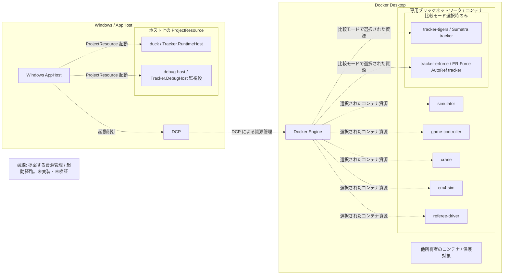
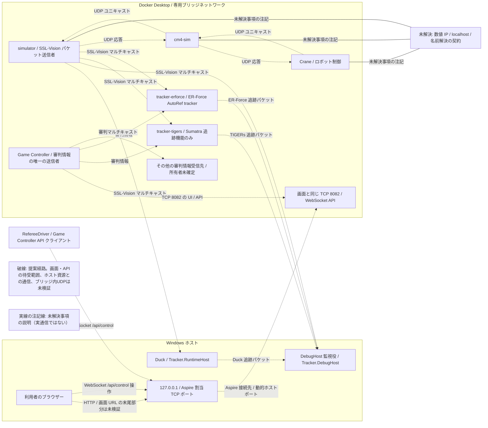
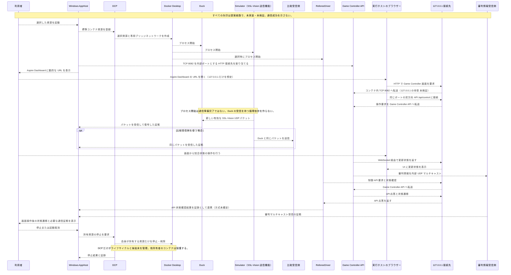

# Aspire シミュレーション試験環境

> **現行設計案 — 未実装・未受入。** Windows の AppHost と利用者ごとの Docker Desktop を使う提案を示す。ユーザーが管理する Ubuntu 上の別の Docker Engine は製品実行経路に含めない。Docker Desktop が内部で使う WSL 2 の仕組みは別の構成要素であり、本設計はその変更や削除を求めない。実装、DCP の Windows 上の挙動、専用ブリッジネットワーク内の UDP 通信とマルチキャスト、準備完了判定、受入試験は未検証である。
>
> [2026-10-21 の再編前の設計記録](aspire-simulation-test-environment-history.md)には、元の全内容をそのまま残している。過去の状態や方式は記録時点だけに適用する。

## 目的と設計判断

Windows 上の AppHost から Aspire 13.5.4 の標準 `AddContainer` を使い、利用者自身の Docker Desktop に試験資源を登録する。DCP が Aspire の実行単位を接続する機能を通じ、資源の作成、監視、記録、停止、削除を一元管理する。コンテナの作成から後始末まで DCP だけが管理し、別の Docker コマンド管理プログラムと二重に管理しない。

DCP は Developer Control Plane の略称で、Aspire が内部で使う起動管理プログラムである。AppHost が起動する資源とその関係を定義し、DCP が資源の起動、監視、停止、後始末を管理し、Docker Engine がコンテナを実行する。DCP は資源の起動管理を担い、ネットワーク通信の方式とは役割が異なる。通常の利用者が DCP を直接操作する必要はない。詳しくは [DCP の公式リポジトリ](https://github.com/microsoft/dcp) と [AppHost の構成資料](https://learn.microsoft.com/en-us/dotnet/aspire/app-host/configuration) を参照する。

これは提案であり現行実装とは区別する。現在の `Testing/Duck.Testing.AppHost` は `duck` を `Tracker.RuntimeHost` の `ProjectResource` とし、`simulator`、`game-controller`、`crane`、必要な `cm4-sim` を Docker コマンドライン起動管理プログラムを介した `ExecutableResource` として扱う。旧 `AddContainer` では、DCP が割り当てた利用者定義ネットワークと `--network host` を同時に Docker へ渡したため、Docker は `cannot attach both user-defined and non-user-defined network-modes` としてコンテナ作成を拒否した。この競合を解消する設計案では、標準 `AddContainer` に明示的な `--network host` を渡さず、Aspire/DCP が管理する実行ネットワークを使う必要がある。これは提案する修正方針であり、標準 `AddContainer` と専用ブリッジネットワークの実装・試験・受入が済んだことを示さない。

## 対象資源

AppHost の一回の実行で必要な資源を選択して起動する。基礎資源は simulator、Game Controller、crane、必要に応じた cm4-sim、および Duck の `Tracker.RuntimeHost`。試合制御用 RefereeDriver、比較用追跡器、比較表示用 DebugHost は試験に応じて加える。固定イメージ版を使い、受入時にイメージのハッシュ値と対応するコンテナ ID を記録する。

比較モードは任意選択とし、選択時は同じ AppHost 実行に加え、提案中の Aspire/DCP/Docker Desktop 管理対象として扱う。これは移行後の構成目標であり、実装や受入の証拠ではない。資源の役割と比較契約は[トラッカー比較デバッグ設計](tracker-comparison-debug-design.md)を参照する。

| 資源 | 役割とデータ |
| --- | --- |
| `simulator` | SSL-Vision マルチキャスト `224.5.23.2:10020` の送信者。別の SSL-Vision プロセスは起動しない。 |
| `duck` | ホスト上の `Tracker.RuntimeHost` をプロジェクト資源として起動する。SSL-Vision を受信し、Duck の追跡結果を含む公式形式 `TrackerWrapperPacket` を `224.5.23.2:11010` へ送信する。 |
| `tracker-tigers` | 比較時だけ使う Sumatra の追跡機能コンテナ。SSL-Vision `224.5.23.2:10020` と Game Controller の審判情報 `224.5.23.1:11003` を受信し、追跡結果を含む公式形式 `TrackerWrapperPacket` を `224.5.23.2:11010` へ送信する。比較起動では TIGERs AI を起動しない。 |
| `tracker-erforce` | 比較時だけ使う ER-Force AutoRef の追跡機能コンテナ。同じ SSL-Vision と審判情報を受信し、追跡結果を含む公式形式 `TrackerWrapperPacket` を `224.5.23.2:11010` へ送信する。 |
| `debug-host` | ホスト上の `Tracker.DebugHost` をプロジェクト資源として起動する。自身の追跡機能を無効にし、SSL-Vision と `224.5.23.2:11010` の Duck / TIGERs / ER-Force の公式形式 `TrackerWrapperPacket` を受信して比較する。 |

Duck と DebugHost はホスト上の `ProjectResource` であり、専用ブリッジネットワーク内のコンテナではない。ホスト上の `ProjectResource` とブリッジ上のコンテナ間でマルチキャストを送受信できるかは未検証で、図の経路を実通信の成立とみなさない。Crane はロボット制御資源であり、追跡資源ではない。TIGERs AI 対 Crane の対戦経路は別課題 #43 / #50 の範囲で、本比較モードは起動しない。

## 配置案

図中の破線矢印は提案経路を示し、未実装・未検証である。矢印は実行済みの通信成功を意味しない。専用ブリッジネットワークにはこの AppHost が所有する資源だけを接続する。

DCP の管理対象はこの実行で登録した資源に限る。異なる所有者の既存コンテナは保護する。ユーザーが管理する Ubuntu 上の別の Docker Engine を製品実行に使う構成や、ホストのネットワーク設定変更は前提にしない。

## 通信要件と未解決の接続先

コンテナ間の UDP とマルチキャストは専用ブリッジネットワーク内で使い、UDP ポートを Windows ホストへ公開しない。コンテナ IP は固定せず、資源名で通信する。表は既存の通信規約／設定で報告されているポート契約であり、新しいネットワークでの到達性は未検証である。ホスト上のプロセス資源とコンテナ間のマルチキャスト経路も未検証である。

| 用途 | 既存契約 |
| --- | --- |
| 視覚検出 | `224.5.23.2:10020/UDP` |
| 審判情報 | `224.5.23.1:11003/UDP` |
| トラッカー | `224.5.23.2:11010/UDP` |
| シミュレーション／チーム制御 | `10300/UDP`、`10301/UDP`、`10302/UDP` |
| Crane、cm4-sim、simulator 間 | `12345/UDP`、`12346/UDP`。実構成では `12350/UDP` も報告あり |
| simulator からのロボット応答 | `50100 + robot-id/UDP` |
| ロボットからの応答 | `224.5.20.(100 + robot-id):50100 + robot-id/UDP` |
| コンテナ内 Game Controller API | `ws://game-controller:8082/api/control`。コンテナ間の名前解決に使う内部接続先であり、Windows ホストからは使わない。 |
| Windows 上の RefereeDriver 制御 API | `ws://127.0.0.1:<Aspire 割当ポート>/api/control`。AppHost が割り当てる Game Controller のホスト側 HTTP 接続先と同じポートを使う案。127.0.0.1 のみの待受と接続は未検証。 |
| Windows ブラウザーの操作画面 | `http://127.0.0.1:<Aspire 割当ポート>/` を候補とする。Game Controller の公式 README は画面と API が同じポートであることを示すが、固定イメージの画面 URL の末尾部分と実到達性は未検証。 |

通信図は主要な経路を示す。表にある 10300/UDP、10301/UDP、10302/UDP の制御契約と各 UDP ポート番号の割当ては、接続先や対応関係を確定できないため図に割り当てていない。通信図の破線は既存契約を踏まえた提案であり、新ネットワークでの到達性を示さない。数値 IP／`localhost` の契約が解決するまで、該当する接続は阻害状態として扱う。

RefereeDriver はホスト上の `ProjectResource` なので、コンテナ内の名前 `game-controller` を接続先には使わない。現行 `Testing/Duck.Testing.RefereeDriver/RefereeDriverNetworkAdapters.cs` の `DefaultEndpoint` は `ws://127.0.0.1:8082/api/control` 固定である。移行後は AppHost が割り当てたホスト側ポートを RefereeDriver に渡し、`127.0.0.1:<割当ポート>` 経由で API に接続する案とする。ポートの受け渡し方法と自端末だけで待ち受ける設定は未確定・未検証。利用者の操作画面とホスト上の制御 API は、コンテナ間の内部接続や審判情報 UDP マルチキャストとは別の入口として扱う。Game Controller の UI と `/api/control` は同じコンテナポート 8082 を使う。AppHost はそのポートを対象に HTTP 接続先を定義し、動的に割り当てられたホスト側 URL を Aspire Dashboard に表示する案とする。利用者は AppHost 起動後、Aspire Dashboard に表示された Game Controller の URL を開く。表示する URL は `http://127.0.0.1:<割当ポート>/` を想定するが、固定イメージでの画面 URL の末尾部分、ポート割当て、127.0.0.1 だけで待ち受ける設定は未検証である。実装は 127.0.0.1 以外の待受や実行ホスト外からの到達を許さないことを確認してから採用する。実現方法を確認できない場合はホスト側の通信を有効にせず、受入を阻害として残す。

Game Controller API のホスト上の利用者は同じ割当ポートの `ws://127.0.0.1:<割当ポート>/api/control` に接続する。コンテナ内のクライアントだけが `ws://game-controller:8082/api/control` を使う。審判情報の `224.5.23.1:11003/UDP` は Game Controller から試験資源へ流す内部マルチキャストであり、ブラウザー操作用の接続先ではない。利用者が実行ホスト上で操作する範囲を今回の対象とし、同一ネットワーク内の別端末からの操作は対象外。

外部実装との接続には名前解決上の阻害要因がある。Crane は `127.0.0.1` と数値 IP を使う。orion-cm4-sim は `inet_addr` を使い、応答先を `127.0.0.1` に固定する。simulator の応答先も数値 `QHostAddress` を要求する。起動時に名前を一度だけ IP に変換する方法では、コンテナ再作成後の IP 変更に追従できない。外部契約の修正または安定した接続先が必要であり、本案では解決済みとみなさない。記述は既存資料からの報告で、今回再検証していない。

画面と制御 API の入口は実行ホスト内の利用者に限り、Aspire が割り当てる動的ポートを 127.0.0.1 のみで待ち受ける案とする。起動後は Aspire Dashboard の資源一覧で Game Controller の HTTP URL を確認し、その URL を開く。実行ホスト外への公開、ホストの通信規則変更、UDP ホスト公開、マルチキャスト中継は行わない。標準のコンテナ登録機能と DCP で 127.0.0.1 だけの待受を保証できるかは未確認であり、保証できるまで実装・公開しない。Game Controller v3.20.3 の README は画面と `/api/control` が同じポートを使うこと、Aspire の公式資料はコンテナのホスト側ポート割当てと Dashboard 表示方法を説明する。資料だけでは本構成の 127.0.0.1 だけの待受や画面操作の状態反映を保証しない（[Game Controller v3.20.3 README](https://github.com/RoboCup-SSL/ssl-game-controller/blob/v3.20.3/README.md)、[Aspire のネットワーク概要](https://aspire.dev/fundamentals/networking-overview/)、[Aspire のリソース URL](https://aspire.dev/fundamentals/custom-resource-urls/)）。

## 準備完了、依存、停止

プロセス開始を通信準備完了とみなさない。Duck 自身が有効な新しい視覚検出データを含むパケットを受信・復号したことを確認し、比較モードでは DebugHost の監視役が同じ入力を受け、Duck / TIGERs / ER-Force の追跡パケットを各送信元から受信した証拠も記録する。ホスト上の `ProjectResource` とコンテナネットワーク間の到達性が未確認なら、比較モードは準備完了としない。RefereeDriver は Game Controller の制御 API と `HALT` から `running` への状態遷移を確認する。HTTP `GET` の応答や起動通知だけでは準備完了としない。simulator の起動を Duck の受信に依存させず、循環依存を作らない。Aspire の `WaitFor` は起動依存を表し、障害後の自動再起動は保証しない。プロジェクトが固定するのは `Aspire.AppHost.Sdk` 13.5.4 である。過去に確認された DCP 0.25.13 は当時の実行時観測に限る。現在の Windows 上の DCP 実行時と版の挙動は未検証である。

起動、通信準備完了、停止の図も提案であり未検証である。プロセス起動と通信準備完了は別の状態として扱う。Game Controller の状態確認結果を AppHost が受け取る証跡連携方式は未確定であり、図の連携線は提案である。利用者のブラウザー入口は実行ホストの 127.0.0.1 だけを使う接続先とし、画面/API のポートは Game Controller 内部ポート 8082 に対応させる。Aspire Dashboard に示す実際の URL と 127.0.0.1 だけで待ち受ける設定は実行時に確認する。

DCP だけが対象コンテナを所有・停止・削除・後始末する。起動取消、部分起動失敗、通常停止、個別再起動、一括停止の各経路で、この AppHost 実行の資源だけを操作し、異なる所有者の既存コンテナを保護する。正常停止は 15 秒以内とする。証跡には完全なコンテナ ID、イメージのハッシュ値、DCP 資源 ID、実行 ID、ネットワークとの対応、前後の所有者状態、関連ログを含める。失敗や未観測を合格に置き換えない。

## 優先受入条件

以下は受入目標であり、実施済みの結果ではない。各項目は 合格、失敗、未実施、阻害、未検証 のいずれかを証拠とともに記録する。まだ確認できない条件は未実施または阻害として残す。

1. Windows 起動と所有権: Windows AppHost がユーザーの Docker Desktop に接続し、選択資源を同じブリッジネットワークで DCP 資源として管理する。開始、取消、途中失敗、二重起動、個別再起動、一括停止で他所有者のコンテナを変更せず、正常停止が 15 秒以内であることを完全 ID と所有者の前後比較で示す。
2. 実 UDP／マルチキャスト通信: Duck が 5 秒以内に新しい視覚検出データを含むパケットを 10 件以上復号し、比較受信側も同じパケットを受ける。審判・追跡マルチキャスト、必要な UDP 制御とロボット応答往復も実パケットで示す。
3. 試合制御と動作: Game Controller の双方向制御 API で停止から稼働への遷移を確認する。Crane／cm4-sim／simulator の応答往復、および視覚検出データで 100 mm 以上の移動を確認する。
4. 利用者の試合操作: AppHost 起動後に Aspire Dashboard が Game Controller の URL と割当ポートを表示する。URL から実行ホスト内のブラウザーで画面を開き、画面と制御 API の双方向接続が成功することを確認する。画面から停止状態を稼働状態へ変更し、画面表示の更新に加え、API 状態確認と審判情報の内部 UDP マルチキャスト受信側で同じ状態遷移を照合する。`127.0.0.1` 経由の到達、127.0.0.1 以外から到達しないこと、操作による状態反映はいずれも未検証。ネットワーク内の別端末からの接続は受入対象にしない。
5. 再作成と名前解決: 資源名の再解決、個別コンテナ再作成後の通信、応答待受、所有資源の後始末を確認する。数値 IP 依存は阻害事項として記録し、合格判定を保留する。

ソケットの待受だけ、`HTTP 400`、ホスト上だけのパケット観測、WSL 内での継続的検証は Windows 実機の合格証拠ではない。必要な通信経路全体または DCP の挙動が未実行なら受入未完了である。

## 安全境界と関連課題

ユーザー管理 Ubuntu 上の別の Docker Engine で製品資源を実行しない。審判情報とその他 UDP ポートをホストへ公開しない。画面/API 用の通信ポートは実行ホストの 127.0.0.1 だけに割り当てる。実装でその待受範囲を保証できるまでは接続先の公開を行わない。他の利用者または別実行のコンテナに触れない。Docker Desktop、WSL、Docker の接続先設定、`PATH`、認証、ネットワーク設定、ホスト設定を永続的に変更しない。

課題 #81 の旧 Docker コマンドライン実装とそのレビューは、当該実装の証拠に限る。新しい標準 `AddContainer`／DCP の所有権、ネットワーク、停止契約を保証しない。関連する課題 #79–#82 の完了条件は独立しており、この文書変更で閉じない。過去の設計検証とレビューの記録は[再編前の設計記録](aspire-simulation-test-environment-history.md)を参照する。以前の証拠は現行設計を検証しないため、本書の再レビューが必要である。

2026-10-21 に記録された Docker Desktop 版、Docker Engine 版、空のイメージ／コンテナ一覧、旧環境のパケット観測は、その時点の履歴に限る。その後、四つのイメージが環境に取り込まれたため、これらを現在の環境一覧として扱わない。根拠と旧主張は[再編前の設計記録](aspire-simulation-test-environment-history.md)を参照する。外部実装や通信契約の記述も報告済みの前提であり、再検証が必要である。
