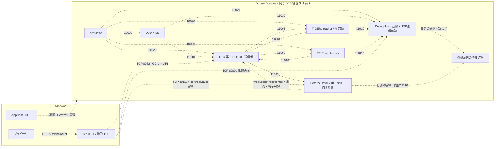

# トラッカー比較デバッグ 設計

> 現行の移行設計。以下のコンテナ配置とWindows操作は未実装・未受入である。主設計と一緒に実装・受入を行う。

## 目的

Aspire のシミュレーション試験環境で、同じ SSL-Vision 入力を Duck、TIGERs、ER-Force のトラッカーへ同時に与え、出力差を `Tracker.DebugHost` で確認できるようにする。

比較は単なる起動確認ではなく、どの入力時点に対する差か、どの表示元同士を比較したか、物体ごとの差がどこで発生したかを追跡できるデバッグ経路とする。

初期対象は次の三つのトラッカーとする。

- Duck `Tracker.RuntimeHost`。
- TIGERs Sumatra の world predictor / tracker。
- ER-Force AutoRef に含まれる tracker source。

raw vision は共通の比較入力として扱うが、シミュレータの真値とは扱わない。

## 既存機能の再利用

`Tracker.DebugHost` には、official `TrackerWrapperPacket` の外部受信、UUID を優先した表示元の識別、Split / Overlay 表示、CaptureOn 中の tracker packet snapshot 保存、診断再生時の対応付けが既にある。

したがって Aspire 側で別の比較 UI を新設せず、`Tracker.DebugHost` を比較デバッグの表示・記録面として再利用する。

ライブ表示では同一 UI render tick で各表示元の最新スナップショットを固定する。異なる UDP stream のパケット時刻が厳密に一致することは要求しない。

保存後の比較では diagnostics sample tick を共通の選択時点とし、各トラッカーを同じ選択時点へ独立に対応付ける。選択時点より後の tracker snapshot を比較対象へ使わない。

## Aspire 資源

本節は主設計の移行後の構成を示し、現行の起動管理プログラムの実装とは区別する。Windows は AppHost、DCP、ブラウザーを動かす。以下の比較資源と通常の simulator、Game Controller、Duck、Crane、必要な cm4-sim、RefereeDriver、および UDP 準備確認機能は、すべて同じ DCP 管理の Docker Desktop ブリッジに置く。利用者管理の Ubuntu 上の別 Docker Engine、ホスト上の UDP 受信、中継、ホストネットワークは使わない。

| 資源名 | 実行形態 | 役割 |
| --- | --- | --- |
| `duck` | DCP が管理する `Tracker.RuntimeHost` コンテナ | SSL-Vision `224.5.23.2:10020` を受信し、`sim` 設定で `224.5.23.2:11010` へ公式形式の追跡情報を送る。 |
| `tracker-tigers` | DCP が管理する Sumatra 追跡機能コンテナ | 同じ10020と Game Controller の11003を受信し、11010へ追跡情報を送る。TIGERs AI と内蔵 Game Controller は起動しない。 |
| `tracker-erforce` | DCP が管理する ER-Force AutoRef 追跡機能コンテナ | 同じ10020と11003を受信し、11010へ追跡情報を送る。 |
| `debug-host` | DCP が管理する `Tracker.DebugHost` コンテナ | 自身の追跡と UDP 送信を無効にする。10020と三者の11010を受信し、比較表示・記録・再生を行う。Windows ブラウザーは限定された TCP 接続先で画面を開く。 |

コンテナの完全 ID、イメージのハッシュ値、実行 ID、資源 ID、ネットワーク ID を結び付ける。サービス自身の受信・復号と送信元の新しさは当該資源内で確認し、マルチキャストだけを所有者の証明には使わない。DCP が唯一のコンテナ管理者であり、外部の起動管理プログラムは併用しない。

Game Controller は `224.5.23.1:11003` の唯一の送信者とする。TIGERs は `source=NETWORK`、`port=11003`、`gameController=false`、`publishRefereeMessages=false` の比較用設定を使う。ER-Force の `--gc-port 11003` も受信側の指定であり、審判情報を送信させない。Game Controller の視覚検出／追跡情報の入力、RefereeDriver の11003観測、既存の準備確認機能も同じブリッジ内に置く。



破線は未実装・未受入の経路を表す。Crane と cm4-sim の制御は主設計の通信契約に従う。コンテナの名前解決、数値 IP、127.0.0.1、再作成後の接続先更新と、Aspire 13.5.4 の 127.0.0.1 待受は主設計の確認契約を満たすまで阻害として残す。

## RefereeDriver の共通契約

比較時も[主設計の実行・内部診断](aspire-simulation-test-environment.md#refereedriver-の実行と内部診断)を使う。`Testing/Duck.Testing.RefereeDriver.Host` にHTTP依存を分離し、既存の受信・制御ライブラリと利用側の実行条件を維持する。`Program` は標準の依存登録と起動へ委譲し、単一の受信処理を観測と明示制御で共有する。比較追跡器やGame Controllerの代わりに11003を送信しない。

構成は起動時に読み取る。`RefereeDriver:Enabled=true` と `Testing:ContainerMode=true` で内部HTTP39110を待ち受け、`RefereeDriver:GameControllerUri=ws://game-controller:8082/api/control` を観測と明示制御へ渡す。`RefereeDriver:InterfaceAddress` は任意のコンテナ内IPv4で、`Testing:Diagnostics:RunId`、`Testing:Diagnostics:ResourceId`、`Testing:Diagnostics:ContainerId`、`Testing:Diagnostics:Generation` を明示する。完全IDの構造検査をDCP所有証明とはみなさない。

自動制御は `RefereeDriver:AutoDriveToActive=true` を追加で明示した場合だけ選ぶ。既定の観測専用は書込みを行わず、Windowsブラウザーの手動操作を保持する。自動改名設定を追加せず、既存の制御JSONと明示的なチーム名設定を維持する。無効時はUDP受信・Game Controller接続・制御・診断経路の登録を行わず、診断は404となる。HTTPサーバー自体を起動しない契約ではない。

`GET /health/referee` は `isReady`、現在の `reason`、自身の `diagnostic`、有効なAPI観測の `api` を返す。正常な復号と進捗、完全ID、同じ受信世代・送信元・件数に対応する証跡、UDPの5秒以内とAPI取得開始から3秒以内の新しさ、状態一致が揃う場合だけ200とする。欠落・未知の経過時間・古入力・不一致は503で、再取得により新しさを延命しない。協定世界時の受信日時は時差を含む形式で表示し、単調時刻を異なるプロセス間で比較しない。APIの指令番号を仮定せず、異なる通信規約の原子的な同期とはしない。

応答の全項目と設定の型・既定値は主設計に従う。失敗後の理由は `NoObservation` となり得て、最後の失敗履歴を保持する契約ではない。内部39110の待受、コンテナ用でない127.0.0.1待受、将来のWindows動的127.0.0.1公開を分ける。

標準のUDP生成処理と要求ごとの `ClientWebSocket` 生成を本番経路へ登録する。CIの組成試験は通信口と時計を置換して実復号・依存登録・常駐処理・HTTP・停止・制御順を確認し、実ソケット設定は別の動的ポート試験で確認する。薄い入口の単独起動、すべての標準通信口を使う実行、実Game Controllerと名前の再解決、Docker Desktop／Windows／DCP所有の受入は未検証である。資源配線や配布物、名前空間共有候補の採用・適用を完了扱いにしない。

## TIGERs tracker

TIGERs は `tigersmannheim/sumatra` image を使用する。Sumatra の `simulation_protocol` 構成は raw SSL-Vision `224.5.23.2:10020` を受信し、vision tracking data を `224.5.23.2:11010` へ送信する。

比較専用起動では AI を有効化しない。Crane の既存対戦構成にある `--aiBlue` は付けず、world predictor / tracker の出力だけを比較対象にする。

代表起動引数は次の形とする。

```text
--headless
--visionAddress 224.5.23.2:10020
--refereeAddress 224.5.23.1:11003
--moduli simulation_protocol_comparison
```

Sumatra image は移動タグをそのまま再現試験の識別子にしない。利用できる固定 version tag がある場合はそれを使い、固定 tag が無い場合は Docker image digest を AppHost 設定と試験証跡へ保存する。

## ER-Force tracker

ER-Force は Crane の開発用 compose で利用実績がある `roboticserlangen/autoref:2025.1.0` を初期 image とする。

代表起動引数は次とする。

```text
--vision-port 10020
--tracker-port 11010
--gc-port 11003
```

新しい ER-Force AutoRef image へ更新する場合は version tag または `commit-<hash>` を固定し、比較結果と image version を同じ証跡に残す。

## DebugHost の起動設定

`debug-host` はブリッジ内の `Tracker.DebugHost` コンテナとして起動する。比較専用の監視役とし、自身の追跡と UDP 送信は動かさない。受信開始後に同じ有限窓の Duck / TIGERs / ER-Force の追跡情報を調べ、三つの 比較対象の役割 が互いに別の 送信元識別子 へ一意に対応した場合だけ `Ready` とする。コンテナ開始だけでは準備完了としない。

simulator の起動を Duck／DebugHost の受信待ちに依存させない。比較追跡器は simulator と Game Controller の準備を待つ。DebugHost の起動前に三者の受信完了を要求せず、起動後の 比較の準備確認 で判定する。各受信証跡と外部サービスの準備確認はブリッジ内で採取し、主設計に定めた限定 HTTP 接続先で DCP／AppHostへ伝える。旧ホスト側の `TrackerPacketReadinessMonitor` 等をそのまま残さない。

AppHost から最低限、次を上書きする。

- `VisionReceiver:MulticastAddress=224.5.23.2`。
- `VisionReceiver:Port=10020`。
- `Tracker:Enabled=false`。
- `Tracker:PublishUdp=false`。
- `Tracker:Receive:Enabled=true`。
- `Tracker:Receive:MulticastAddress=224.5.23.2`。
- `Tracker:Receive:Port=11010`。
- `Tracker:Uuid=debug-host-observer`。
- `Tracker:SourceName=debug-host-observer`。

`debug-host-observer` を DebugHost 自身の identity とすることで、Duck の `uuid=ibis` を DebugHost 自身と誤って同一視しない。TIGERs / ER-Force は packet の UUID を優先し、UUID が無い場合だけ source name と remote endpoint を補助識別に使う。

`Tracker.DebugHost` の既存契約を維持し、外部 tracker の source identity は UUID を優先する。同じ UUID が複数の remote endpoint から届いても一つの source として集約し、候補のうち `ReceivedAt` が最新の snapshot を代表にする。endpoint ごとの物体を寄せ集めて一つの snapshot を合成しない。UUID が空または不明な場合だけ source name と remote endpoint を代用して source を分ける。

comparison mode では、既存の `SourceRole` (`own` / `external` / `unknown`) と、比較対象を表す logical role (`Duck` / `TIGERs` / `ER-Force`) を別概念として扱う。既存の `SourceRole` は変更せず、logical role の解決には packet の source name を使う。

| logical role | Aspire resource | 必須 source name |
| --- | --- | --- |
| `Duck` | `duck` | `ibis` |
| `TIGERs` | `tracker-tigers` | `TIGERs` |
| `ER-Force` | `tracker-erforce` | `ER-FORCE` |

source name は `StringComparison.Ordinal` で完全一致させる。UUID は source identity の判定には使うが、logical role の判定には使わない。固定した image または Duck の `sim` profile を更新して source name が変わる場合は、この対応表と focused test を同じ変更で更新し、未定義の名称を推測して role へ割り当てない。

logical role resolver は、代表 snapshot へ集約する前の受信 source metadata を入力にする。各 packet を上表の logical role 候補へ割り当てた後、既存の UUID 優先規則で comparison source identity を求める。UUID がある場合は UUID が identity を決め、UUID が無い場合だけ source name と remote endpoint を代用する。

comparison mode の `Ready` は endpoint 数ではなく、Duck / TIGERs / ER-Force の三つの logical role が互いに別の comparison source identity へ一意に解決できたかで判定する。各 role はちょうど一つの identity に対応し、一つの identity を複数 role へ割り当てず、一つの role に複数 identity が同時に対応しないことを必須とする。同じ UUID に複数 role の source name が現れた場合は endpoint ごとに分裂させず、role 解決不足として `Ready` にしない。同じ role と UUID が複数 endpoint から届く場合だけは一つの identity として扱い、`ReceivedAt` が最新の snapshot を代表にする。

live comparison の role selector は `Duck` / `TIGERs` / `ER-Force` を固定の選択肢とし、各 role から一意な comparison source identity を参照する。CaptureOn の保存では既存の endpoint-sensitive source key を維持し、通常の diagnostics replay にある `External` / `Unknown` / source label の aggregate source option も変更しない。comparison mode の replay だけが、保存済みの source name / UUID / remote endpoint に同じ logical role resolver と UUID 優先 identity 規則を再適用して三 role を解決する。したがって live と replay の role 判定は同じ契約を使いながら、既存 DebugHost の汎用 source-label replay 契約は維持する。

## 比較の時刻基準

### ライブ比較

ライブ比較は同一 UI render tick で Duck / TIGERs / ER-Force の latest snapshot を固定する。

各 source について tracker frame timestamp、UDP 受信時刻、render tick の採取時刻を表示し、source 間の timestamp delta と snapshot age を併記する。

時刻差が大きい場合は物体差を隠さず表示するが、「同時刻に近い比較ではない」ことを状態として明示する。閾値は設定値とし、初期実装では値を製品コードへ固定しない。

### CaptureOn / replay

CaptureOn では既存の tracker packet snapshot sidecar に Duck / TIGERs / ER-Force の raw `TrackerWrapperPacket` と source metadata をすべて保存する。

replay では diagnostics sample tick を共通基準にする。各 source は保存済み alignment を優先し、対応が無い場合は同じ source の選択時点以前にある latest-before snapshot を使う。

三つの source を比較する場合でも timeline cursor は一つとし、source ごとに別の時点へ移動させない。

## 数値差分

既存の Split / Overlay に加え、比較用の数値差分を表示する。

比較は一つの基準 source と一つ以上の比較 source で行う。既定の基準 source は Duck とし、次を標準の組合せとする。

- Duck ↔ TIGERs。
- Duck ↔ ER-Force。
- TIGERs ↔ ER-Force は必要に応じて選択可能にする。

### ロボット

ロボットは `(team color, robot id)` を同一物体のキーとして対応付ける。

両 source に存在するロボットについて、official tracker packet に値が存在する項目だけを比較する。

- 位置 X/Y と二次元位置差。
- 速度 X/Y と二次元速度差。
- orientation と最短角度差。
- angular velocity の差。

片方だけに存在するロボットは数値 0 として比較せず、`Missing in <source>` として別の差分種別にする。

### ボール

tracker ごとの ball track id は同一性を保証しないため、異なる tracker 間の対応付けキーには使わない。

両 source が単一ボールだけを出している場合はその二つを比較する。

複数ボールが存在する場合は XY 平面の位置距離に基づく一対一対応を行う。各 source の `TrackedFrame.balls` に現れる順序を source-local index として保持し、track id は対応付けに使わない。有限な XY 座標を持つ二つのボールについて、ユーザー設定の距離上限以下の組だけを候補 edge とする。距離が上限と等しい組は候補に含め、上限を越える組は候補に含めない。

assignment の結果は、まず候補 edge 内で対応する pair 数を最大化し、次に全 pair の XY 距離合計を最小化する。同じ pair 数かつ同じ距離合計になる解が複数ある場合は、`(reference source-local index, comparison source-local index)` の pair を reference index、comparison index の順に並べた列を辞書順比較し、最小の列を採用する。特定の assignment algorithm は要求しないが、この優先順位と tie-break から得られる結果は実装によらず同一でなければならない。候補へ使えない位置のボールと、採用した pair に含まれないボールは unmatched とする。

対応したボールについて、存在する項目だけを比較する。

- X/Y/Z 位置と位置差。
- X/Y/Z 速度と速度差。

## 差分 UI

`Tracker.DebugHost` の live Compare と `/diagnostics` に共通の `Tracker Difference` 表示モデルを追加する。

最低限、次を確認できるようにする。

- 基準 source と比較 source。
- 各 source の UUID / source label / frame number。
- 各 source の tracker timestamp / received time / age。
- source 間の timestamp delta。
- ball の matched / unmatched 状態と位置・速度差。
- robot ごとの matched / missing 状態と位置・速度・角度差。
- source ごとの ball / robot count。

フィールド上の Overlay と数値表は同じ固定済み snapshot pair から生成し、描画と数値で別の時点を参照しない。

## デバッグ操作

比較モードでは次の手順で確認する。デバッグ接続、記録先、取り出しと再生の共通契約は[主設計](aspire-simulation-test-environment.md#debughost-のデバッグと記録)に従う。

1. Windows AppHost から、同じ Docker Desktop ブリッジの simulator、Game Controller、Crane、必要な cm4-sim、Duck、TIGERs、ER-Force、DebugHost、RefereeDriver、準備確認機能を選択して起動する。
2. Dashboard の `debug-host` の 127.0.0.1 URL を Windows ブラウザーで開く。三つの 比較対象の役割 の別 識別子 と受信時刻を確認する。Game Controller は別の 127.0.0.1 URL から操作する。
3. Split／Overlay と `Tracker Difference` で、固定した同じ二つの追跡状態の物体差と時刻差を見る。
4. 実行を一時停止する場合は、DCP の当該所有コンテナ完全 ID とプロセスIDを確認し、Windows のデバッグ環境から `docker.exe --context desktop-linux exec -i <完全ID> /vsdbg/vsdbg --interpreter=vscode` の標準入出力で接続する。同じ版のソースコードとデバッグ情報ファイルを対応付け、デバッグ TCP ポートは公開しない。停止中の古いパケットを受入計測へ含めない。
5. CaptureOn／CaptureOff で記録を確定し、`%LOCALAPPDATA%\\Duck\\Aspire\\<run-id>\\captures` に raw vision、診断、三者の追跡情報と時刻・送信元の関連ファイルが残ったことを確認する。コンテナの `/data/captures` とこの保存先を割り当てる。
6. `/diagnostics` では同じ diagnostics sample tick に三者を合わせる。取り出す場合は Windows の記録保存先全体を複製する。後日の再生専用起動は保存先を `/data/replay` へ読み取り専用で割り当てる。通常停止や再作成で元記録を削除しない。

Windowsでの接続方法、デバッグ用配布物、保存先の読み書きの権限、再生時の読み取り専用動作は未実装・未検証である。操作手順を記述したことは成功の証拠ではない。
通常用 `DebugHost` の基底、固定参照、発行出力の入力元は[Linux配布設計](aspire-simulation-test-environment.md#linux-向け通常コンテナの配布定義-i81-04b2)のI81-04B2に従う。`/vsdbg/vsdbg` などの追加デバッグ資材とWindowsからの接続はI81-04B3および実機受入で別に確認し、通常用コンテナイメージの定義を成功根拠にしない。

## 起動失敗と部分起動

TIGERs または ER-Force tracker の一方が起動できなくても Duck と Simulator の通常試験まで巻き込んで停止させない。

ただし比較モードの状態は、要求した tracker source が受信できていない場合、または Duck / TIGERs / ER-Force の三つの logical role を別 comparison source identity へ解決できない場合に `Ready` としない。同一 UUID の複数 endpoint は一つの source として扱い、endpoint 数だけで `Ready` を落とさない。Aspire の resource 状態と DebugHost の source 一覧の両方で欠落または role 解決不足を確認できるようにする。source が一時的に消失したときは DebugHost comparison health も not-ready とし、resource status と表示 state を一致させる。

## OS 別ネットワーク動作確認

主設計の `ASPIRE-NET-001`〜`ASPIRE-NET-009`、`ASPIRE-HOST-001`、`ASPIRE-DEBUG-001`、`ASPIRE-CAPTURE-001` を適用する。今回の移行受入は Windows AppHost と利用者の Docker Desktop を対象とする。Linux／macOSへの対応も、同じ配置契約で個別に実測する。

- 同じブリッジの Duck、DebugHost、TIGERs、ER-Force が、simulator の `224.5.23.2:10020` を同じ有限窓で受信する。Duck 自身は安定起動後5秒以内に新しい検出データ10件以上を復号する。
- 三者の `224.5.23.2:11010` を DebugHost が同時に受信し、三つの比較対象の役割を別々の識別子として保持する。Game Controller等の必要受信側にも届く。
- Game Controller が唯一生成する `224.5.23.1:11003` を両比較追跡器と必要な観測機能が受信し、Windows画面操作、API状態、内部審判情報で同じ試合遷移を確認する。
- 同じマルチキャストの宛先／ポートの受信者を開始・停止しても、他の受信件数が止まらない。コンテナ内の `InterfaceAddress` 未指定と明示IPv4の双方を確認する。
- 個別再作成後に新しい完全IDと接続先を取得し、応答先の更新、マルチキャストの宛先への再参加、三者の新しさに基づく準備復帰を確認する。
- RefereeDriverの既定観測は書込み0を維持し、Windows画面の手動操作と明示自動制御を分ける。自身の `GET /health/referee` で完全ID、受信世代、件数、協定世界時の受信日時、単調経過時間、API照合を確認し、無効404／準備不足503／一致200を区別する。
- WindowsブラウザーからGame ControllerとDebugHostへ到達し、127.0.0.1以外の待受がないことを準備確認口も含めて確認する。記録の取り出し・再生とデバッグ接続も別条件として記録する。

ブリッジ内の独立観測器の件数だけ、Windowsホストだけの観測、別Docker Engineや別OSでの成功は対象サービス自身とWindows Docker Desktopの受入に代用しない。通信が成立しない場合は `Ready` とせず、UDP公開、中継、ホストネットワークへ自動変更しない。

## テスト方針

実装は TDD で行う。

AppHost の application model test で次を先に固定する。

- `tracker-tigers`、`tracker-erforce`、`debug-host` が比較モードに存在する。
- Duck、両外部追跡器、DebugHost、RefereeDriver、準備確認機能が DCP の同じコンテナネットワークに所属する。所有ID照合とサービス自身の準備確認を分ける。
- 両 tracker が基底構成の ready な `simulator` / `game-controller` に health-based `WaitFor` し、11003 の producer を追加しない。
- `tracker-tigers` が `gameController=false`、`publishRefereeMessages=false` の外部 Game Controller 用設定を使う。
- 全UDP参加者が同じブリッジを使い、ホストネットワーク、UDPホスト公開、旧Docker起動管理プログラムを使わない。
- TIGERs が raw vision 10020 を入力し tracker 11010 を出力する設定である。
- ER-Force が `--vision-port 10020 --tracker-port 11010` で起動する。
- DebugHost の tracker receiver が 11010 で有効になる。
- DebugHost 自身の tracker が無効である。
- `debug-host` はコンテナ資源で、受信開始後に三者の準備を判定する。simulatorと受信側の起動に循環依存を作らない。
- Game ControllerとDebugHostのUI、HTTP準備確認は、主設計の内部ポートから127.0.0.1の動的TCPへ対応付け、再作成後に更新する。
- RefereeDriverの明示設定、既定観測の書込み0、内部接続先の自己宛先拒否、同じ受信処理を使う明示制御、停止と所有資源回収、診断本文と200／503／無効404を標準組成試験で固定する。
- RefereeDriverのUDP観測と旧準備確認の受信をWindowsに残さない。記録のWindows保存先、デバッグ接続の対象IDを実行IDと結び付ける。
- DebugHost comparison health が三 source identity の個別解決と同じ確認窓の新しい packet を要求する。tracker resource ready と DebugHost source readiness を別々に model / focused test で固定する。

DebugHost の focused test では次を固定する。

- source name `ibis` / `TIGERs` / `ER-FORCE` がそれぞれ logical role `Duck` / `TIGERs` / `ER-Force` にだけ解決され、既存 `SourceRole` は三者とも `external` のままでも comparison role を識別できる。
- UUID が異なる Duck / TIGERs / ER-Force を別 comparison source identity として保持する。
- 同一 logical role と UUID が複数 endpoint から届く場合は既存契約どおり一つの identity に集約し、`ReceivedAt` が最新の snapshot だけを代表にする。
- 同一 UUID に複数 logical role の source name が対応する場合は endpoint ごとに別 source とせず、role 解決不足として comparison mode を `Ready` にしない。
- 同一 logical role に異なる UUID が同時に対応する場合も role 解決不足として `Ready` にしない。
- UUID が空または不明な場合は source name と remote endpoint の代用 identity で分離し、異なる endpoint の packet を一つの snapshot へ混ぜない。
- 同じ保存済み source metadata を live と replay の resolver へ与えると同じ logical role と comparison source identity に解決され、通常の diagnostics replay の source label aggregate は変更されない。
- robot は team + id で対応付ける。
- ball track id を tracker 間対応付けに使わない。
- 2 対 1 と 1 対 2 の ball fixture で、pair 数最大化後に距離合計最小化で対応相手を決め、残りを unmatched にする。
- 2 対 2 で局所的な最近傍選択では pair 数が減る fixture を使い、pair 数最大化を距離最小化より優先する。
- 2 対 2 で pair 数と距離合計が同じになる fixture を使い、source-local index の辞書順 tie-break で結果が固定される。
- ball 距離が gate と等しい fixture は matched、gate を越える fixture は unmatched とする。
- missing / unmatched object をゼロ差分として扱わない。
- live の Overlay と数値差分が同じ snapshot pair を使う。
- replay の三 source が同じ selected diagnostics sample tick を基準にし、future snapshot を使わない。

## 実装単位

- `ASPIRE-006A`: 比較資源の役割と準備確認を維持する。#81でDuck／DebugHostを含む標準コンテナ資源へ移し、DCP所有・同じブリッジ・限定TCP接続先を構成試験で固定する。旧起動管理の実装の検証は移行後の証拠にしない。
- `ASPIRE-006B`: source identity、三 tracker の同時 packet readiness、DebugHost comparison health の回帰 test を追加する。
- `ASPIRE-006C`: `Tracker Difference` の物体対応付けと数値差分モデルを TDD で追加する。
- `ASPIRE-006D`: live Split / Overlay と数値差分を同じ snapshot pair へ接続する。
- `ASPIRE-006E`: CaptureOn / replay で三 tracker を同じ diagnostics sample tick に揃える比較を確認する。

## 対象外

- TIGERs / ER-Force の tracker algorithm の改変。
- 外部 tracker の出力を Duck tracker の入力へ戻す処理。
- 外部 tracker の track id を Duck の track id へ変換する処理。
- raw vision や Simulator 出力を真値として自動採点する機能。
- 初期段階での統計的な優劣判定や tracker ranking。
- 比較結果の CSV / JSON export。

## 完了条件

- 一回の Windows Aspire 起動で、Duck／TIGERs／ER-Force／DebugHostと全UDP参加者を同じDCP管理のDocker Desktopブリッジへ起動できる。DCPが唯一のコンテナ管理者である。
- 両比較追跡器は準備完了した simulator／Game Controllerを待つ。DebugHostは起動後に三つの比較対象の役割に対応する別々の識別子と新しいパケットを確認する。受信を待つ起動循環を作らない。
- 三 tracker が同じ raw vision stream を入力として使用する。
- DebugHost が三 source の official tracker packet を別 source として識別できる。
- live で Split / Overlay と数値差分を確認できる。
- CaptureOn 後に同じ選択時点へ三 source を対応付けて再現できる。
- robot の位置・速度・角度・存在差と、ball の対応・位置・速度・存在差を追跡できる。
- 時刻差が物体差と分離して表示され、古い snapshot を同時刻の結果と誤認しない。
- 比較機能が利用できない場合でも通常の Duck + Crane シミュレーション試験は維持される。
- Windowsの実機でブリッジ内のマルチキャストと同じマルチキャストの宛先／ポートの複数受信を示す。他OSは個別確認し、未確認OSを対応済みと扱わない。
- WindowsからのGame Controller／比較画面操作、限定TCP待受、所有IDを確認したデバッグ接続、記録の取り出しと停止後の再生を主設計の条件で示す。
