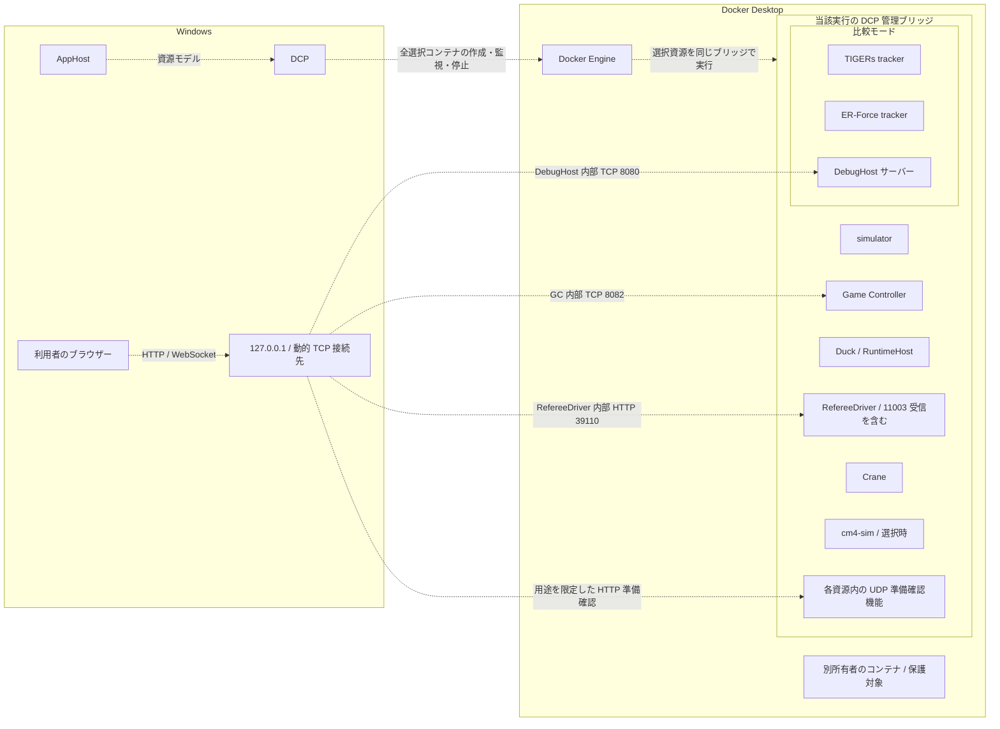
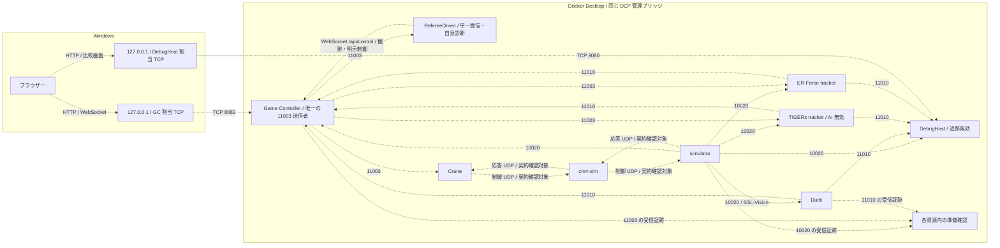
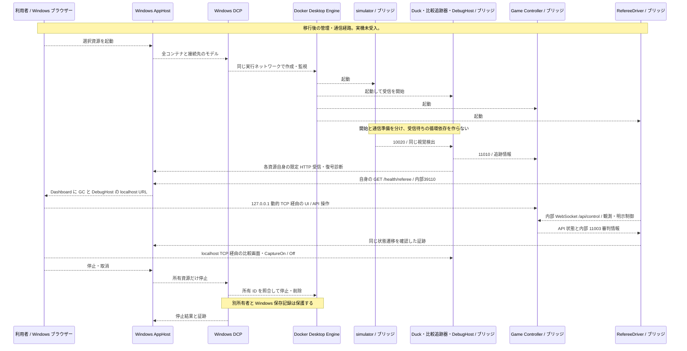

> **現行設計案・移行未完了・未受入。** Windows の AppHost と利用者ごとの Docker Desktop を使う。UDP とマルチキャストの参加者は、すべて同じ DCP 管理のブリッジネットワーク内へ配置する。Windows 上には AppHost、DCP、利用者のブラウザーを置く。利用者管理の Ubuntu 上の別の Docker Engine は製品実行経路に含めない。Docker Desktop 内部の Linux 仮想環境 や WSL 2 は製品の基盤であり、その変更や削除は求めない。

| `referee-driver` | 選択時に起動するコンテナ。新しい実行プロジェクトの単一受信処理で11003を観測し、自身の診断と内部API状態を照合する。自動制御は明示選択時だけ行う。Windows に UDP 受信部を残さない。 |

## RefereeDriver の実行と内部診断

### 実行プロジェクトと明示設定

`Testing/Duck.Testing.RefereeDriver.Host` を明示選択する実行プロジェクトとする。薄い `Program` は標準構成の生成と起動へ委譲し、標準の依存登録で単一の `RefereeReceiveService`、API観測、状態照合、内部HTTPを組み合わせる。HTTPの実行時依存 `Microsoft.AspNetCore.App` はこのプロジェクトへ分離し、既存の受信・制御ライブラリと利用側の実行条件を変えない。

次の構成は起動時に読み取る。設定の自動再読込みを保証しない。環境変数で渡す場合は、構成キーの区切り `:` を `__` に置き換える。

| 構成キー | 型と既定動作 | 有効時の契約 |
| --- | --- | --- |
| `RefereeDriver:Enabled` | 真偽値。明示した `true` だけ有効。未指定、`false`、解釈できない値は無効。 | 無効時はUDP受信、Game Controller接続、制御を開始せず、診断経路を登録しない。 |
| `Testing:ContainerMode` | 真偽値。明示した `true` だけコンテナ用待受を選ぶ。 | `Enabled=true` の場合、本設定が `true` なら `http://0.0.0.0:39110`、それ以外は `http://127.0.0.1:39110`。HTTPSへの転送は追加しない。 |
| `RefereeDriver:GameControllerUri` | 有効時に必須の絶対形式の接続先アドレス。暗黙の既定接続先はない。 | `ws` または `wss` の `/api/control` を指定する。通常の内部値は `ws://game-controller:8082/api/control`。観測と明示制御に同じ検査済み接続先を渡す。 |
| `RefereeDriver:InterfaceAddress` | 任意のIPv4アドレス。未指定なら既定の受信インターフェース。 | `224.5.23.1:11003` の受信で共有ポートを許可し、IPv4の全アドレスで待ち受け、指定したインターフェースで参加する。 |
| `RefereeDriver:AutoDriveToActive` | 真偽値。未指定、`false`、解釈できない値は観測専用。 | `Enabled` と本設定がともに明示した `true` の場合だけ、既存の制御処理を一度実行する。 |
| `Testing:Diagnostics:RunId` / `Testing:Diagnostics:ResourceId` | 空白だけでない文字列。 | 当該実行と資源を識別する。送信元のアドレスやホスト名から補完しない。 |
| `Testing:Diagnostics:ContainerId` / `Testing:Diagnostics:Generation` | 完全なコンテナIDを半角16進表記64桁で指定し、起動世代は正の `Int64` で指定する。 | 未指定・不正値は帰属不明とする。正常復号件数は記録するが、準備完了にはしない。 |

無効時の診断経路は404となり、既存の待受設定を保持する。無効設定は、HTTPサーバー自体を起動しないことを意味しない。コンテナ内の39110待受と、後続のDCPによるWindows 127.0.0.1の動的ポート公開は別に確認する。

接続先に利用者情報や断片識別子を含めない。コンテナ用構成では127.0.0.1や::1等の自身を指す接続先、既知の自身の名前、資源IDと同じホスト名、診断用39110を指す宛先を起動前に拒否する。コンテナ用でない明示構成の127.0.0.1接続と、既存の制御機能の公開既定値は維持する。

### 自身の受信診断と状態照合

`GET /health/referee` は自身の受信証跡とAPI状態の現在の照合を返す。一致して準備完了の場合だけ200とし、帰属不明、入力なし、復号失敗、未知の経過時間、期限切れ、状態不一致では503とする。

| 応答項目 | 内容 |
| --- | --- |
| `isReady` / `reason` | 現在の照合結果と理由。失敗後に保持値が解除されると `NoObservation` となり得る。最後の失敗履歴を保持する契約ではない。 |
| `diagnostic.identity` | `runId`、`resourceId`、`containerId`、`generation`。帰属不明時は `null`。構造検査された入力であり、実DCP所有の証明ではない。 |
| `diagnostic` の受信証跡 | `inputId`、`receiverEpoch`、`sourceKey`、`sourceName`、`sourceUuid`、`remoteEndpoint`、`successfullyDecodedCount`、`decodeFailureCount`、`lastReceivedAt`、`decodeAgeUpperBound`、`decodeStatus`、`isReady`、`reason`。単一の対応する受信状態を返す。 |
| `api` | 正規化した `state.command` と `state.phase`、`endpoint`、`endpointGeneration`、`requestSequence`、`readStartedTimestamp`、`readCompletedTimestamp`、`ageUpperBound`。有効な観測がなければ `null`。 |

協定世界時は最終受信日時の表示に使い、新しさは同じプロセスの単調時計で判定する。日時は時差を含む形式（例：`2026-10-22T21:00:00+00:00`）で返す。同じ受信世代・送信元で正常復号件数の増加を確認し、UDP受信から5秒以内、API取得開始から3秒以内の証跡を照合する。API取得処理にも3秒の期限を設ける。読取り開始前の古い入力や、別の受信件数で更新された入力を混ぜず、HTTPの再取得で経過時間を延命しない。

APIの `HALT`、`STOP`、`RUNNING` とUDPの指令を明示対応させる。APIにUDPの `command_counter` があるとは仮定しない。同じプロセス内の観測期間の有限な新しさを照合するもので、異なる通信規約の原子的な同期や実流量での可用性を保証しない。資源の起動世代、受信世代、接続先の設定世代を区別する。

観測処理は0.1秒間隔で順次照合し、UDPを別に受信しない。観測専用時は制御への書込みを行わない。明示した自動制御では、同じ受信処理を使う既存の制御処理が `HALT` から `NEXT_COMMAND`、必要に応じて `FORCE_START` または `NORMAL_START` へ進める。この選択と診断の200判定は独立した契約である。既存のJSON形式と明示的なチーム名設定を保持し、自動改名用の設定は追加しない。

制御の送信は初期出力全体の受信後に行い、正常・失敗・取消のいずれでも接続を破棄する。自動制御の正常完了後も観測を継続し、停止時は受信、API取得、保留制御と明示所有資源を回収する。制御の待機は既存の呼出取消に従い、新しい自前期限を追加しない。

### 実装と受入の証拠範囲

標準登録は既存のUDP生成処理へ渡し、API接続は要求ごとに新しい `ClientWebSocket` へ接続先の絶対アドレスを渡す。固定した数値IPを別に保持しない。CIの隔離した組成試験では通信口と時計を置換し、実際の復号、標準の依存登録、常駐処理、127.0.0.1の動的ポートのHTTP、停止、明示制御を確認する。既存のUDP生成処理は別の動的ポート試験で実ソケットへの設定を確認する。

薄い実行入口の単独起動、標準の通信口をすべて使う実行、実Game Controllerへの接続と名前の再解決、Docker Desktopのマルチキャスト、Windowsでの公開、DCP所有照合は別の未検証事項である。実行プロジェクトの実装を、コンテナ配布やAppHost／DCPへの資源配線の完了に置き換えない。名前空間を共有する候補の採用や適用も、この契約の具体化には含めない。

| `ASPIRE-NET-007` | 観測専用のRefereeDriverを使い、Windows ブラウザーの Game Controller UI操作で `HALT` から `running` へ遷移し、API応答と内部11003受信で同じ遷移を確認する。Crane／cm4-sim／simulatorの必要UDP往復と、視覚検出データ上の100 mm以上の移動を示す。 |

RefereeDriverの確認では、有効・無効、帰属欠落・短いID、古い入力、API不一致、停止、明示した自動制御と既定の観測専用を分ける。`GET /health/referee` の本文と200／503を同じ対象の受信世代・件数・単調経過時間に結び付ける。無効時404、内部39110待受、将来のWindows限定公開を個別に確認し、CIの組成試験をWindows実機受入へ転用しない。
