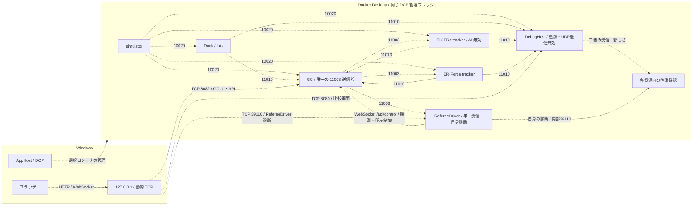

## RefereeDriver の共通契約

比較時も[主設計の実行・内部診断](aspire-simulation-test-environment.md#refereedriver-の実行と内部診断)を使う。`Testing/Duck.Testing.RefereeDriver.Host` にHTTP依存を分離し、既存の受信・制御ライブラリと利用側の実行条件を維持する。`Program` は標準の依存登録と起動へ委譲し、単一の受信処理を観測と明示制御で共有する。比較追跡器やGame Controllerの代わりに11003を送信しない。

構成は起動時に読み取る。`RefereeDriver:Enabled=true` と `Testing:ContainerMode=true` で内部HTTP39110を待ち受け、`RefereeDriver:GameControllerUri=ws://game-controller:8082/api/control` を観測と明示制御へ渡す。`RefereeDriver:InterfaceAddress` は任意のコンテナ内IPv4で、`Testing:Diagnostics:RunId`、`Testing:Diagnostics:ResourceId`、`Testing:Diagnostics:ContainerId`、`Testing:Diagnostics:Generation` を明示する。完全IDの構造検査をDCP所有証明とはみなさない。

自動制御は `RefereeDriver:AutoDriveToActive=true` を追加で明示した場合だけ選ぶ。既定の観測専用は書込みを行わず、Windowsブラウザーの手動操作を保持する。自動改名設定を追加せず、既存の制御JSONと明示的なチーム名設定を維持する。無効時はUDP受信・Game Controller接続・制御・診断経路の登録を行わず、診断は404となる。HTTPサーバー自体を起動しない契約ではない。

`GET /health/referee` は `isReady`、現在の `reason`、自身の `diagnostic`、有効なAPI観測の `api` を返す。正常な復号と進捗、完全ID、同じ受信世代・送信元・件数に対応する証跡、UDPの5秒以内とAPI取得開始から3秒以内の新しさ、状態一致が揃う場合だけ200とする。欠落・未知の経過時間・古入力・不一致は503で、再取得により新しさを延命しない。協定世界時の受信日時は時差を含む形式で表示し、単調時刻を異なるプロセス間で比較しない。APIの指令番号を仮定せず、異なる通信規約の原子的な同期とはしない。

応答の全項目と設定の型・既定値は主設計に従う。失敗後の理由は `NoObservation` となり得て、最後の失敗履歴を保持する契約ではない。内部39110の待受、コンテナ用でない127.0.0.1待受、将来のWindows動的127.0.0.1公開を分ける。

標準のUDP生成処理と要求ごとの `ClientWebSocket` 生成を本番経路へ登録する。CIの組成試験は通信口と時計を置換して実復号・依存登録・常駐処理・HTTP・停止・制御順を確認し、実ソケット設定は別の動的ポート試験で確認する。薄い入口の単独起動、すべての標準通信口を使う実行、実Game Controllerと名前の再解決、Docker Desktop／Windows／DCP所有の受入は未検証である。資源配線や配布物、名前空間共有候補の採用・適用を完了扱いにしない。

- RefereeDriverの既定観測は書込み0を維持し、Windows画面の手動操作と明示自動制御を分ける。自身の `GET /health/referee` で完全ID、受信世代、件数、協定世界時の受信日時、単調経過時間、API照合を確認し、無効404／準備不足503／一致200を区別する。

- RefereeDriverの明示設定、既定観測の書込み0、内部接続先の自己宛先拒否、同じ受信処理を使う明示制御、停止と所有資源回収、診断本文と200／503／無効404を標準組成試験で固定する。
